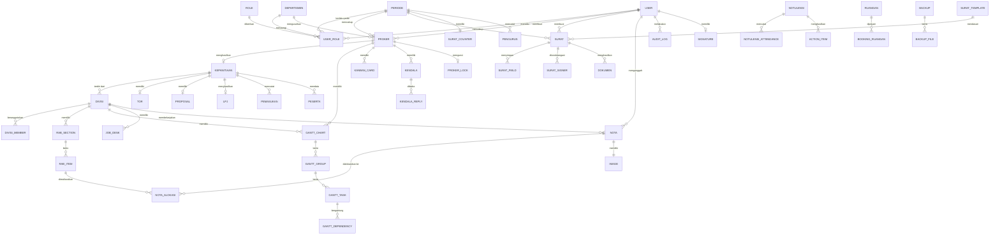

# System Design — HMIF Center

**Arsitektur Teknis & Rancangan Sistem**

| | |
|---|---|
| **Versi** | 1.0 |
| **Tanggal** | 1 September 2026 |
| **Dokumen Terkait** | [PRD.md](PRD.md) · [USER_FLOW.md](USER_FLOW.md) · [DESIGN_SYSTEM.md](DESIGN_SYSTEM.md) |

---

## Daftar Isi

1. [Arsitektur Tingkat Tinggi](#1-arsitektur-tingkat-tinggi)
2. [Tech Stack & Justifikasi](#2-tech-stack--justifikasi)
3. [Entity Relationship Diagram](#3-entity-relationship-diagram)
4. [Skema Database](#4-skema-database)
5. [Model Otorisasi & RLS](#5-model-otorisasi--rls)
6. [Algoritma Anti-Bentrok Proker](#6-algoritma-anti-bentrok-proker)
7. [Generator Nomor Surat](#7-generator-nomor-surat)
8. [Pipeline Generate Dokumen](#8-pipeline-generate-dokumen)
9. [Pipeline Pemrosesan Gambar](#9-pipeline-pemrosesan-gambar)
10. [Arsitektur Gantt Chart](#10-arsitektur-gantt-chart)
11. [Sistem RAB & Kalkulasi](#11-sistem-rab--kalkulasi)
12. [Storage Adapter](#12-storage-adapter)
13. [Realtime & Live Update](#13-realtime--live-update)
14. [Audit Log](#14-audit-log)
15. [Sistem Backup & Restore](#15-sistem-backup--restore)
16. [Struktur API](#16-struktur-api)
17. [Struktur Folder Project](#17-struktur-folder-project)
18. [Strategi Keamanan](#18-strategi-keamanan)
19. [Strategi Performa](#19-strategi-performa)
20. [Deployment & Environment](#20-deployment--environment)

---

## 1. Arsitektur Tingkat Tinggi

```
┌─────────────────────────────────────────────────────────────────────────┐
│                              KLIEN (Browser)                             │
│  ┌──────────────────────────────────────────────────────────────────┐   │
│  │  Next.js 15 App Router — React Server Components + Client         │   │
│  │  ┌────────────┬────────────┬────────────┬────────────────────┐   │   │
│  │  │  Gantt SVG │ RAB Grid   │ Kanban DnD │ Camera + jscanify  │   │   │
│  │  │  (kustom)  │ (kustom)   │ (dnd-kit)  │ (OpenCV.js)        │   │   │
│  │  └────────────┴────────────┴────────────┴────────────────────┘   │   │
│  │  Tailwind CSS + shadcn/ui · TanStack Query · Zustand              │   │
│  └──────────────────────────────────────────────────────────────────┘   │
└───────────────────────────┬─────────────────────┬───────────────────────┘
                            │ HTTPS               │ WebSocket
                            ▼                     ▼
┌───────────────────────────────────────┐  ┌──────────────────────────────┐
│      VERCEL (Serverless Functions)     │  │   SUPABASE REALTIME          │
│  ┌─────────────────────────────────┐  │  │   Broadcast perubahan proker │
│  │  Route Handlers (/api/*)         │  │  │   & gantt ke Master Gantt    │
│  │  ├─ Auth Middleware              │  │  └──────────────────────────────┘
│  │  ├─ Permission Guard             │  │
│  │  ├─ Audit Interceptor            │  │
│  │  └─ Zod Validation               │  │
│  ├─────────────────────────────────┤  │
│  │  Server Actions                  │  │
│  ├─────────────────────────────────┤  │
│  │  Domain Services                 │  │
│  │  ├─ ProkerService  (anti-bentrok)│  │
│  │  ├─ SuratService   (penomoran)   │  │
│  │  ├─ DocumentEngine (docx/pdf)    │  │
│  │  ├─ RabService     (kalkulasi)   │  │
│  │  ├─ ImageService   (validasi)    │  │
│  │  ├─ LpjService     (analisis)    │  │
│  │  └─ BackupService                │  │
│  ├─────────────────────────────────┤  │
│  │  StorageAdapter (abstraksi)      │  │
│  └─────────────────────────────────┘  │
│  Vercel Cron → backup bulanan          │
└──────────────┬─────────────────────────┘
               │ Prisma / postgres-js
               ▼
┌─────────────────────────────────────────────────────────────────────────┐
│                            SUPABASE                                      │
│  ┌────────────────────────┐  ┌──────────────────┐  ┌────────────────┐  │
│  │  PostgreSQL 15          │  │  Supabase Auth   │  │ Supabase       │  │
│  │  ├─ Row Level Security  │  │  Email+Password  │  │ Storage        │  │
│  │  ├─ btree_gist ext      │  │  JWT Session     │  │ ├─ private/    │  │
│  │  ├─ EXCLUDE constraint  │  └──────────────────┘  │ │  ├─ nota-master│ │
│  │  ├─ Advisory Lock       │                        │ │  ├─ ttd       │ │
│  │  ├─ Trigger audit       │                        │ │  └─ dokumen   │ │
│  │  └─ Materialized View   │                        │ └─ public/     │  │
│  └────────────────────────┘                        │    ├─ preview  │  │
│                                                     │    └─ thumb    │  │
│                                                     └────────────────┘  │
└─────────────────────────────────────────────────────────────────────────┘
                                    │
                                    ▼ (fase berikutnya)
                        ┌───────────────────────────┐
                        │  GOOGLE DRIVE             │
                        │  Service Account HMIF      │
                        │  └─ Backup/YYYY-MM/       │
                        └───────────────────────────┘
```

### 1.1 Prinsip Arsitektur

| # | Prinsip | Implementasi |
|---|---|---|
| A1 | **Aturan bisnis kritis ditegakkan di database** | Anti-bentrok via `EXCLUDE` constraint; nomor surat via advisory lock; otorisasi via RLS |
| A2 | **Server sebagai satu-satunya sumber kebenaran** | Klien tidak pernah menentukan permission; setiap mutasi divalidasi ulang di server |
| A3 | **Abstraksi pada titik yang akan berubah** | `StorageAdapter` (Supabase → Drive → S3), `DocumentEngine` (template versioned) |
| A4 | **Pemrosesan berat di klien bila memungkinkan** | Pipeline gambar dijalankan di browser untuk menghindari batas 10 detik Vercel Hobby |
| A5 | **Jejak audit tidak dapat dihapus** | Trigger database, tabel append-only, tanpa DELETE/UPDATE policy |
| A6 | **Degradasi anggun** | Realtime putus → Gantt tetap tampil statis; Drive belum ada → Supabase Storage |

---

## 2. Tech Stack & Justifikasi

| Lapis | Teknologi | Versi | Alasan Pemilihan |
|---|---|---|---|
| **Framework** | Next.js (App Router) | 15.x | Server Components mengurangi JS di klien → sesuai target performa; Server Actions menyederhanakan mutasi; deployment Vercel mulus |
| **Bahasa** | TypeScript | 5.x | Type safety krusial untuk domain kompleks (RAB, penomoran surat) |
| **Styling** | Tailwind CSS | 4.x | Utility-first cepat; token warna HMIF sebagai CSS variable; bundle kecil |
| **Komponen** | shadcn/ui | latest | Bukan dependency — kode disalin ke project, bebas dikustom sesuai palet HMIF |
| **Database** | PostgreSQL (Supabase) | 15 | `daterange` + GiST untuk anti-bentrok; RLS untuk otorisasi; JSONB untuk data semi-terstruktur |
| **ORM** | Prisma | 5.x | Type-safe query, migrasi terkelola. Query kritis (anti-bentrok, penomoran) memakai raw SQL |
| **Auth** | Supabase Auth | — | Email+password siap pakai, JWT terintegrasi RLS |
| **Storage** | Supabase Storage | — | Terintegrasi RLS, CDN, signed URL. Di balik `StorageAdapter` |
| **Realtime** | Supabase Realtime | — | Postgres CDC → WebSocket untuk Master Gantt live |
| **State Server** | TanStack Query | 5.x | Cache, revalidasi, optimistic update |
| **State Klien** | Zustand | 4.x | Ringan; hanya untuk state UI (filter Gantt, skala waktu) |
| **Form** | React Hook Form + Zod | — | Validasi skema dipakai bersama klien & server |
| **Gantt** | **Kustom (SVG)** | — | Tidak ada library yang sesuai desain referensi; kontrol penuh atas performa & tampilan |
| **Drag & Drop** | dnd-kit | 6.x | Aksesibel, ringan, mendukung keyboard |
| **Rich Text** | TipTap | 2.x | Berbasis ProseMirror; output HTML bersih untuk konversi DOCX |
| **DOCX Generate** | docxtemplater | 3.x | Mempertahankan format template asli (kop, tabel, styling) secara utuh |
| **DOCX Image** | docxtemplater-image-module-free | — | Menyisipkan TTD & stempel |
| **PDF** | LibreOffice headless / Gotenberg | — | Konversi DOCX→PDF dengan fidelitas tinggi & teks tetap seleksi-able |
| **Excel** | ExcelJS | 4.x | Kontrol penuh atas merge cell, formula, styling — wajib untuk replikasi template RAB |
| **Gambar (klien)** | Canvas API + `browser-image-compression` | — | Tiga turunan dari satu decode |
| **Gambar (server)** | sharp | 0.33.x | Validasi & fallback processing |
| **Scan Dokumen** | jscanify (OpenCV.js) | — | Deteksi tepi + koreksi perspektif, gratis, sisi klien |
| **EXIF** | exifr | 7.x | Baca orientation sebelum rotasi |
| **Cron** | Vercel Cron | — | Terintegrasi, gratis pada tier hobby |
| **Validasi** | Zod | 3.x | Skema tunggal untuk form, API, dan import/export |
| **Tabel** | TanStack Table | 8.x | Headless — styling penuh sesuai design system |

### 2.1 Keputusan yang Ditolak & Alasannya

| Alternatif | Ditolak Karena |
|---|---|
| frappe-gantt / dhtmlx-gantt | Tampilan tidak sesuai referensi desain; kustomisasi mendalam lebih mahal daripada membangun sendiri |
| Menyimpan RAB sebagai file Excel | Tidak dapat di-query, tidak dapat divalidasi, tidak dapat dikalkulasi lintas divisi |
| Pemrosesan gambar penuh di server | Batas 10 detik Vercel Hobby; biaya kompute |
| Otorisasi hanya di lapis aplikasi | Rentan bila ada endpoint terlewat; RLS memberi jaring pengaman di database |
| Validasi anti-bentrok hanya di aplikasi | Race condition saat dua Kadept submit bersamaan |
| MongoDB / Firebase | Butuh transaksi ACID & constraint relasional untuk keuangan dan penomoran |

---

## 3. Entity Relationship Diagram



---

## 4. Skema Database

> Ditulis dalam SQL PostgreSQL. Prisma schema diturunkan dari ini.

### 4.1 Extensions & Enums

```sql
CREATE EXTENSION IF NOT EXISTS "uuid-ossp";
CREATE EXTENSION IF NOT EXISTS "btree_gist";   -- WAJIB: untuk EXCLUDE constraint anti-bentrok
CREATE EXTENSION IF NOT EXISTS "pg_trgm";      -- pencarian teks

CREATE TYPE role_code AS ENUM (
  'ADMIN', 'KETUA', 'WAKIL', 'SEKUM', 'BENDUM',
  'KADEPT', 'ANGGOTA', 'BPH'
);

CREATE TYPE proker_kategori AS ENUM ('TERJADWAL', 'BERKALA', 'RESPONSIF');

CREATE TYPE proker_status AS ENUM (
  'DRAFT', 'MENUNGGU_APPROVAL', 'MENUNGGU_APPROVAL_REVISI',
  'DISETUJUI', 'BERJALAN', 'SELESAI', 'DITOLAK', 'PERLU_REVISI', 'DIBATALKAN'
);

CREATE TYPE surat_status AS ENUM (
  'DRAFT', 'MENUNGGU_APPROVAL', 'DISETUJUI', 'TERBIT', 'DITOLAK', 'DIBATALKAN'
);

CREATE TYPE rab_status AS ENUM (
  'DRAFT', 'DIAJUKAN', 'DISETUJUI', 'REALISASI', 'SELESAI'
);

CREATE TYPE nota_status AS ENUM (
  'DIUNGGAH', 'MENUNGGU_VERIFIKASI', 'TERVERIFIKASI',
  'DITOLAK', 'PERLU_PERBAIKAN'
);

CREATE TYPE kendala_status AS ENUM ('TERBUKA', 'SEDANG_DITANGANI', 'SELESAI');
CREATE TYPE prioritas AS ENUM ('RENDAH', 'SEDANG', 'TINGGI', 'KRITIS');
CREATE TYPE kanban_kolom AS ENUM ('TODO', 'IN_PROGRESS', 'REVIEW', 'DONE');
CREATE TYPE periode_status AS ENUM ('AKTIF', 'ARSIP', 'PERSIAPAN');
CREATE TYPE kehadiran AS ENUM ('HADIR', 'IZIN', 'SAKIT', 'ALFA');
CREATE TYPE image_kind AS ENUM ('FOTO', 'DOKUMEN');
```

### 4.2 Inti — Periode, User, Role

```sql
CREATE TABLE periode (
  id              UUID PRIMARY KEY DEFAULT uuid_generate_v4(),
  nama            TEXT NOT NULL,                    -- "HMIF 3.0 2025/2026"
  tanggal_mulai   DATE NOT NULL,
  tanggal_selesai DATE NOT NULL,
  status          periode_status NOT NULL DEFAULT 'PERSIAPAN',
  nomor_surat_awal INTEGER NOT NULL DEFAULT 1,      -- Admin dapat menyetel nomor awal
  created_at      TIMESTAMPTZ NOT NULL DEFAULT now(),
  updated_at      TIMESTAMPTZ NOT NULL DEFAULT now(),
  CONSTRAINT periode_tanggal_valid CHECK (tanggal_selesai > tanggal_mulai)
);

-- Menjamin hanya SATU periode aktif
CREATE UNIQUE INDEX periode_hanya_satu_aktif
  ON periode ((status)) WHERE status = 'AKTIF';

CREATE TABLE app_user (
  id            UUID PRIMARY KEY,                   -- sama dengan auth.users.id Supabase
  nama_lengkap  TEXT NOT NULL,
  nim           TEXT NOT NULL,
  email         TEXT NOT NULL UNIQUE,
  angkatan      INTEGER,
  no_hp         TEXT,
  avatar_path   TEXT,
  is_active     BOOLEAN NOT NULL DEFAULT true,
  created_at    TIMESTAMPTZ NOT NULL DEFAULT now(),
  updated_at    TIMESTAMPTZ NOT NULL DEFAULT now()
);
CREATE UNIQUE INDEX app_user_nim_unique ON app_user (nim);

CREATE TABLE departemen (
  id          UUID PRIMARY KEY DEFAULT uuid_generate_v4(),
  kode        TEXT NOT NULL UNIQUE,                 -- 'KAD','MIKAT','INT','EKS','KOMINFO','RND'
  nama        TEXT NOT NULL,
  warna       TEXT NOT NULL,                        -- hex untuk Gantt, mis. '#1E90FF'
  urutan      INTEGER NOT NULL DEFAULT 0,
  is_active   BOOLEAN NOT NULL DEFAULT true
);

-- Multi-role: satu user dapat memiliki banyak baris di sini
CREATE TABLE user_role (
  id            UUID PRIMARY KEY DEFAULT uuid_generate_v4(),
  user_id       UUID NOT NULL REFERENCES app_user(id) ON DELETE CASCADE,
  periode_id    UUID NOT NULL REFERENCES periode(id) ON DELETE CASCADE,
  role          role_code NOT NULL,
  departemen_id UUID REFERENCES departemen(id),     -- wajib untuk KADEPT & ANGGOTA
  jabatan_teks  TEXT,                               -- teks jabatan untuk surat, mis. "Kepala Departemen Kaderisasi"
  created_at    TIMESTAMPTZ NOT NULL DEFAULT now(),
  UNIQUE (user_id, periode_id, role, departemen_id),
  CONSTRAINT role_dept_wajib CHECK (
    (role IN ('KADEPT','ANGGOTA') AND departemen_id IS NOT NULL)
    OR (role NOT IN ('KADEPT','ANGGOTA'))
  )
);
CREATE INDEX user_role_lookup ON user_role (user_id, periode_id);

CREATE TABLE invitation (
  id          UUID PRIMARY KEY DEFAULT uuid_generate_v4(),
  email       TEXT NOT NULL,
  token_hash  TEXT NOT NULL UNIQUE,
  user_id     UUID NOT NULL REFERENCES app_user(id) ON DELETE CASCADE,
  expires_at  TIMESTAMPTZ NOT NULL,
  used_at     TIMESTAMPTZ,
  created_by  UUID NOT NULL REFERENCES app_user(id),
  created_at  TIMESTAMPTZ NOT NULL DEFAULT now()
);

CREATE TABLE signature (
  user_id     UUID PRIMARY KEY REFERENCES app_user(id) ON DELETE CASCADE,
  storage_key TEXT NOT NULL,                        -- bucket privat
  updated_at  TIMESTAMPTZ NOT NULL DEFAULT now()
);
```

### 4.3 Program Kerja & Anti-Bentrok

```sql
CREATE TABLE proker (
  id                UUID PRIMARY KEY DEFAULT uuid_generate_v4(),
  periode_id        UUID NOT NULL REFERENCES periode(id),
  departemen_id     UUID NOT NULL REFERENCES departemen(id),
  nama              TEXT NOT NULL,
  kategori          proker_kategori NOT NULL,
  status            proker_status NOT NULL DEFAULT 'DRAFT',
  deskripsi         TEXT,
  tujuan            TEXT,
  sasaran           TEXT,
  estimasi_peserta  INTEGER,
  penanggung_jawab  UUID REFERENCES app_user(id),

  -- Penjadwalan
  tanggal_mulai_persiapan DATE,
  tanggal_hari_h_mulai    DATE,
  tanggal_hari_h_selesai  DATE,

  -- Pola berulang (kategori BERKALA)
  pola_ulang        JSONB,   -- {"frekuensi":"MINGGUAN","hari":["SABTU"],"mulai":"...","selesai":"..."}

  -- Anggaran
  estimasi_anggaran NUMERIC(15,2),
  sumber_dana       TEXT[],

  -- Approval
  diajukan_at       TIMESTAMPTZ,
  disetujui_oleh    UUID REFERENCES app_user(id),
  disetujui_at      TIMESTAMPTZ,
  alasan_penolakan  TEXT,

  dibuat_oleh       UUID NOT NULL REFERENCES app_user(id),
  created_at        TIMESTAMPTZ NOT NULL DEFAULT now(),
  updated_at        TIMESTAMPTZ NOT NULL DEFAULT now(),

  CONSTRAINT terjadwal_wajib_tanggal CHECK (
    kategori <> 'TERJADWAL' OR (
      tanggal_mulai_persiapan IS NOT NULL AND
      tanggal_hari_h_mulai    IS NOT NULL AND
      tanggal_hari_h_selesai  IS NOT NULL
    )
  ),
  CONSTRAINT urutan_tanggal CHECK (
    tanggal_mulai_persiapan IS NULL OR
    (tanggal_mulai_persiapan <= tanggal_hari_h_mulai
     AND tanggal_hari_h_mulai <= tanggal_hari_h_selesai)
  ),
  CONSTRAINT durasi_persiapan_15_45 CHECK (
    kategori <> 'TERJADWAL' OR (
      (tanggal_hari_h_mulai - tanggal_mulai_persiapan) BETWEEN 15 AND 45
    )
  )
);

CREATE INDEX proker_periode_status ON proker (periode_id, status);
CREATE INDEX proker_departemen     ON proker (departemen_id);
```

**Tabel kunci kalender — jantung sistem anti-bentrok:**

```sql
-- Hanya berisi proker TERJADWAL yang berstatus DISETUJUI atau BERJALAN.
-- EXCLUDE constraint di sini yang benar-benar mencegah bentrok — bukan logika aplikasi.
CREATE TABLE proker_lock (
  id          UUID PRIMARY KEY DEFAULT uuid_generate_v4(),
  proker_id   UUID NOT NULL UNIQUE REFERENCES proker(id) ON DELETE CASCADE,
  periode_id  UUID NOT NULL REFERENCES periode(id) ON DELETE CASCADE,
  rentang     DATERANGE NOT NULL,
  created_at  TIMESTAMPTZ NOT NULL DEFAULT now(),

  -- INI ATURAN INTINYA:
  -- Dua proker terjadwal dalam periode yang sama tidak boleh punya rentang beririsan.
  CONSTRAINT no_overlap_terjadwal
    EXCLUDE USING gist (
      periode_id WITH =,
      rentang    WITH &&
    )
);

CREATE INDEX proker_lock_rentang ON proker_lock USING gist (rentang);
```

### 4.4 Gantt Chart

```sql
CREATE TABLE gantt_chart (
  id            UUID PRIMARY KEY DEFAULT uuid_generate_v4(),
  scope         TEXT NOT NULL,                      -- 'PROKER' | 'DIVISI' | 'KETUPLAK' | 'DEPARTEMEN'
  proker_id     UUID REFERENCES proker(id) ON DELETE CASCADE,
  divisi_id     UUID REFERENCES divisi(id) ON DELETE CASCADE,
  departemen_id UUID REFERENCES departemen(id) ON DELETE CASCADE,
  kepanitiaan_id UUID REFERENCES kepanitiaan(id) ON DELETE CASCADE,
  judul         TEXT NOT NULL,
  created_at    TIMESTAMPTZ NOT NULL DEFAULT now(),
  updated_at    TIMESTAMPTZ NOT NULL DEFAULT now(),
  CONSTRAINT gantt_scope_tepat_satu CHECK (
    (proker_id IS NOT NULL)::int + (divisi_id IS NOT NULL)::int +
    (departemen_id IS NOT NULL)::int + (kepanitiaan_id IS NOT NULL)::int = 1
  )
);

CREATE TABLE gantt_group (
  id        UUID PRIMARY KEY DEFAULT uuid_generate_v4(),
  chart_id  UUID NOT NULL REFERENCES gantt_chart(id) ON DELETE CASCADE,
  nama      TEXT NOT NULL,                          -- "Planning", "Persiapan", nama departemen
  warna     TEXT NOT NULL,
  pj_nama   TEXT,                                   -- label di atas bar grup
  urutan    INTEGER NOT NULL DEFAULT 0,
  collapsed BOOLEAN NOT NULL DEFAULT false
);

CREATE TABLE gantt_task (
  id            UUID PRIMARY KEY DEFAULT uuid_generate_v4(),
  group_id      UUID NOT NULL REFERENCES gantt_group(id) ON DELETE CASCADE,
  nama          TEXT NOT NULL,
  tanggal_mulai DATE NOT NULL,
  tanggal_selesai DATE NOT NULL,
  progres       SMALLINT NOT NULL DEFAULT 0 CHECK (progres BETWEEN 0 AND 100),
  assignee_id   UUID REFERENCES app_user(id),
  is_milestone  BOOLEAN NOT NULL DEFAULT false,
  urutan        INTEGER NOT NULL DEFAULT 0,
  created_at    TIMESTAMPTZ NOT NULL DEFAULT now(),
  updated_at    TIMESTAMPTZ NOT NULL DEFAULT now(),
  CONSTRAINT task_tanggal_valid CHECK (tanggal_selesai >= tanggal_mulai)
);
CREATE INDEX gantt_task_group ON gantt_task (group_id);

CREATE TABLE gantt_dependency (
  id          UUID PRIMARY KEY DEFAULT uuid_generate_v4(),
  from_task   UUID NOT NULL REFERENCES gantt_task(id) ON DELETE CASCADE,
  to_task     UUID NOT NULL REFERENCES gantt_task(id) ON DELETE CASCADE,
  tipe        TEXT NOT NULL DEFAULT 'FS',           -- Finish-to-Start
  UNIQUE (from_task, to_task)
);
```

### 4.5 Kepanitiaan & Divisi

```sql
CREATE TABLE kepanitiaan (
  id                UUID PRIMARY KEY DEFAULT uuid_generate_v4(),
  proker_id         UUID NOT NULL UNIQUE REFERENCES proker(id) ON DELETE CASCADE,
  nama_acara        TEXT NOT NULL,
  tema              TEXT,
  kode_kegiatan     TEXT,                           -- untuk nomor surat: 'KT2HMIF','MUSMAIF'
  ketua_pelaksana   UUID REFERENCES app_user(id),   -- BEBAS lintas departemen
  wakil_pelaksana   UUID REFERENCES app_user(id),
  sekretaris        UUID REFERENCES app_user(id),
  bendahara         UUID REFERENCES app_user(id),
  target_anggaran   NUMERIC(15,2),
  created_at        TIMESTAMPTZ NOT NULL DEFAULT now()
);

CREATE TABLE divisi (
  id              UUID PRIMARY KEY DEFAULT uuid_generate_v4(),
  kepanitiaan_id  UUID NOT NULL REFERENCES kepanitiaan(id) ON DELETE CASCADE,
  nama            TEXT NOT NULL,                    -- 'ACARA','KONSUMSI','HUMAS','PDD','P3K',...
  koordinator_id  UUID REFERENCES app_user(id),
  warna           TEXT,
  urutan          INTEGER NOT NULL DEFAULT 0,
  UNIQUE (kepanitiaan_id, nama)
);

CREATE TABLE divisi_member (
  id          UUID PRIMARY KEY DEFAULT uuid_generate_v4(),
  divisi_id   UUID NOT NULL REFERENCES divisi(id) ON DELETE CASCADE,
  user_id     UUID NOT NULL REFERENCES app_user(id) ON DELETE CASCADE,
  peran       TEXT,                                 -- 'KOORDINATOR' | 'ANGGOTA'
  UNIQUE (divisi_id, user_id)
);
CREATE INDEX divisi_member_user ON divisi_member (user_id);

CREATE TABLE job_desk (
  id          UUID PRIMARY KEY DEFAULT uuid_generate_v4(),
  divisi_id   UUID NOT NULL REFERENCES divisi(id) ON DELETE CASCADE,
  konten      JSONB,                                -- output TipTap
  updated_by  UUID REFERENCES app_user(id),
  updated_at  TIMESTAMPTZ NOT NULL DEFAULT now()
);
```

### 4.6 RAB — Tiga Level Hierarki

```sql
-- LEVEL 2: sub-section di dalam divisi
-- Contoh: "KONSUMSI PANITIA", "KONSUMSI PESERTA", "KEBUTUHAN DIVISI"
CREATE TABLE rab_section (
  id          UUID PRIMARY KEY DEFAULT uuid_generate_v4(),
  divisi_id   UUID NOT NULL REFERENCES divisi(id) ON DELETE CASCADE,
  nama        TEXT NOT NULL,
  urutan      INTEGER NOT NULL DEFAULT 0,
  UNIQUE (divisi_id, nama)
);

-- LEVEL 3: item
CREATE TABLE rab_item (
  id              UUID PRIMARY KEY DEFAULT uuid_generate_v4(),
  section_id      UUID NOT NULL REFERENCES rab_section(id) ON DELETE CASCADE,
  no_urut         INTEGER NOT NULL,
  jenis_barang    TEXT NOT NULL,

  -- Dua kolom untuk 'jumlah': teks asli (tampilan/export) + numerik (kalkulasi)
  jumlah_teks     TEXT NOT NULL,                    -- "10" | "16 Unit" | "2 Hari 1 Malam"
  jumlah_numerik  NUMERIC(12,2),                    -- hasil parse; NULL bila gagal

  harga_satuan    NUMERIC(15,2) NOT NULL DEFAULT 0,
  total           NUMERIC(15,2) NOT NULL DEFAULT 0,
  total_manual    BOOLEAN NOT NULL DEFAULT false,   -- true bila di-override user
  keterangan      TEXT,                             -- field tambahan (tidak ada di Excel asli)

  created_at      TIMESTAMPTZ NOT NULL DEFAULT now(),
  updated_at      TIMESTAMPTZ NOT NULL DEFAULT now(),
  UNIQUE (section_id, no_urut)
);
CREATE INDEX rab_item_section ON rab_item (section_id);

CREATE TABLE rab_meta (
  kepanitiaan_id  UUID PRIMARY KEY REFERENCES kepanitiaan(id) ON DELETE CASCADE,
  status          rab_status NOT NULL DEFAULT 'DRAFT',
  dana_tak_terduga NUMERIC(15,2) NOT NULL DEFAULT 0,
  disetujui_oleh  UUID REFERENCES app_user(id),
  disetujui_at    TIMESTAMPTZ,
  alasan_buka_kunci TEXT,
  updated_at      TIMESTAMPTZ NOT NULL DEFAULT now()
);

-- Sheet PEMASUKAN
CREATE TABLE pemasukan (
  id              UUID PRIMARY KEY DEFAULT uuid_generate_v4(),
  kepanitiaan_id  UUID NOT NULL REFERENCES kepanitiaan(id) ON DELETE CASCADE,
  no_urut         INTEGER NOT NULL,
  keterangan      TEXT NOT NULL,                    -- "Total Pembayaran SYNCHRONIZE", "Himpunan"
  saldo           NUMERIC(15,2) NOT NULL DEFAULT 0
);

CREATE TABLE peserta (
  id              UUID PRIMARY KEY DEFAULT uuid_generate_v4(),
  kepanitiaan_id  UUID NOT NULL REFERENCES kepanitiaan(id) ON DELETE CASCADE,
  no_urut         INTEGER NOT NULL,
  nama_lengkap    TEXT NOT NULL,
  nim             TEXT,
  sudah_bayar     BOOLEAN NOT NULL DEFAULT false,
  tanggal_bayar   DATE,
  jumlah          NUMERIC(15,2) NOT NULL DEFAULT 0
);
CREATE INDEX peserta_kepanitiaan ON peserta (kepanitiaan_id);
```

### 4.7 Nota & Gambar

```sql
CREATE TABLE image (
  id                  UUID PRIMARY KEY DEFAULT uuid_generate_v4(),
  uploader_id         UUID NOT NULL REFERENCES app_user(id),
  original_filename   TEXT NOT NULL,
  storage_uuid        TEXT NOT NULL UNIQUE,         -- nama file internal (bukan nama user)

  master_path         TEXT NOT NULL,
  preview_path        TEXT NOT NULL,
  thumbnail_path      TEXT NOT NULL,
  original_path       TEXT,                         -- opsional arsip

  original_mime_type  TEXT NOT NULL,
  master_mime_type    TEXT NOT NULL,

  original_width      INTEGER NOT NULL,
  original_height     INTEGER NOT NULL,
  master_width        INTEGER NOT NULL,
  master_height       INTEGER NOT NULL,
  master_file_size    BIGINT NOT NULL,

  kind                image_kind NOT NULL DEFAULT 'FOTO',  -- menentukan kualitas 90 vs 93
  is_scanned          BOOLEAN NOT NULL DEFAULT false,      -- diproses jscanify

  created_at          TIMESTAMPTZ NOT NULL DEFAULT now(),
  updated_at          TIMESTAMPTZ NOT NULL DEFAULT now(),

  CONSTRAINT master_valid CHECK (
    master_width > 0 AND master_height > 0 AND master_file_size > 0
  )
);

CREATE TABLE nota (
  id                UUID PRIMARY KEY DEFAULT uuid_generate_v4(),
  divisi_id         UUID NOT NULL REFERENCES divisi(id) ON DELETE CASCADE,
  image_id          UUID NOT NULL REFERENCES image(id),
  uploader_id       UUID NOT NULL REFERENCES app_user(id),

  tanggal_belanja   DATE NOT NULL,
  total_nota        NUMERIC(15,2) NOT NULL,
  keterangan        TEXT,

  status            nota_status NOT NULL DEFAULT 'MENUNGGU_VERIFIKASI',
  verified_by       UUID REFERENCES app_user(id),
  verified_at       TIMESTAMPTZ,
  alasan_penolakan  TEXT,

  created_at        TIMESTAMPTZ NOT NULL DEFAULT now(),
  updated_at        TIMESTAMPTZ NOT NULL DEFAULT now()
);
CREATE INDEX nota_divisi_status ON nota (divisi_id, status);

-- Satu nota dapat mencakup beberapa item RAB
CREATE TABLE nota_alokasi (
  id            UUID PRIMARY KEY DEFAULT uuid_generate_v4(),
  nota_id       UUID NOT NULL REFERENCES nota(id) ON DELETE CASCADE,
  rab_item_id   UUID NOT NULL REFERENCES rab_item(id),
  jumlah_aktual NUMERIC(12,2),
  harga_aktual  NUMERIC(15,2),
  nominal       NUMERIC(15,2) NOT NULL,             -- porsi nota untuk item ini
  UNIQUE (nota_id, rab_item_id)
);
CREATE INDEX nota_alokasi_item ON nota_alokasi (rab_item_id);
```

**Constraint integritas alokasi** (trigger, karena melibatkan agregat):

```sql
CREATE OR REPLACE FUNCTION cek_total_alokasi() RETURNS TRIGGER AS $$
DECLARE
  v_nota_id     UUID;
  v_total_nota  NUMERIC(15,2);
  v_total_alok  NUMERIC(15,2);
BEGIN
  v_nota_id := COALESCE(NEW.nota_id, OLD.nota_id);
  SELECT total_nota INTO v_total_nota FROM nota WHERE id = v_nota_id;
  SELECT COALESCE(SUM(nominal),0) INTO v_total_alok
    FROM nota_alokasi WHERE nota_id = v_nota_id;

  IF v_total_alok > v_total_nota THEN
    RAISE EXCEPTION
      'Total alokasi (%) melebihi total nota (%)', v_total_alok, v_total_nota;
  END IF;
  RETURN NULL;
END; $$ LANGUAGE plpgsql;

CREATE CONSTRAINT TRIGGER trg_cek_alokasi
  AFTER INSERT OR UPDATE OR DELETE ON nota_alokasi
  DEFERRABLE INITIALLY DEFERRED
  FOR EACH ROW EXECUTE FUNCTION cek_total_alokasi();
```

### 4.8 Persuratan

```sql
CREATE TABLE surat_template (
  id            UUID PRIMARY KEY DEFAULT uuid_generate_v4(),
  kode_surat    TEXT NOT NULL,                      -- '01'..'09'
  varian        TEXT NOT NULL,                      -- 'PEMINJAMAN_BARANG','PEMINJAMAN_RUANGAN',...
  nama          TEXT NOT NULL,
  storage_key   TEXT NOT NULL,                      -- lokasi file .docx template
  field_schema  JSONB NOT NULL,                     -- definisi field dinamis (Zod-compatible)
  versi         INTEGER NOT NULL DEFAULT 1,
  is_active     BOOLEAN NOT NULL DEFAULT true,
  UNIQUE (kode_surat, varian, versi)
);

-- Counter nomor surat — satu baris per periode
CREATE TABLE surat_counter (
  periode_id      UUID PRIMARY KEY REFERENCES periode(id) ON DELETE CASCADE,
  nomor_terakhir  INTEGER NOT NULL DEFAULT 0,
  updated_at      TIMESTAMPTZ NOT NULL DEFAULT now()
);

CREATE TABLE surat (
  id                UUID PRIMARY KEY DEFAULT uuid_generate_v4(),
  periode_id        UUID NOT NULL REFERENCES periode(id),
  template_id       UUID NOT NULL REFERENCES surat_template(id),

  -- Komponen nomor surat
  kode_surat        TEXT NOT NULL,                  -- '05'
  nomor_urut        INTEGER,                        -- NULL sampai DISETUJUI
  kode_administrasi TEXT NOT NULL DEFAULT 'UN43.3.7',
  kode_kegiatan     TEXT NOT NULL DEFAULT 'HMIF',   -- variabel: 'KT2HMIF','MUSMAIF'
  bulan_romawi      TEXT,
  tahun             INTEGER,
  nomor_lengkap     TEXT,                           -- hasil rakitan, mis. '05/379/UN43.3.7/KT2HMIF/VIII/2025'

  tanggal_surat     DATE NOT NULL,
  kota              TEXT NOT NULL DEFAULT 'Cilegon',
  lampiran          TEXT DEFAULT '-',
  perihal           TEXT NOT NULL,
  tujuan_nama       TEXT NOT NULL,
  tujuan_alamat     TEXT NOT NULL,
  isi_html          TEXT,

  data_dinamis      JSONB NOT NULL DEFAULT '{}',    -- field khusus per jenis surat

  status            surat_status NOT NULL DEFAULT 'DRAFT',
  format_output     TEXT NOT NULL DEFAULT 'BOTH',   -- 'DOCX' | 'PDF' | 'BOTH'

  kepanitiaan_id    UUID REFERENCES kepanitiaan(id),
  departemen_id     UUID REFERENCES departemen(id),

  dibuat_oleh       UUID NOT NULL REFERENCES app_user(id),
  disetujui_oleh    UUID REFERENCES app_user(id),
  disetujui_at      TIMESTAMPTZ,
  alasan_penolakan  TEXT,

  created_at        TIMESTAMPTZ NOT NULL DEFAULT now(),
  updated_at        TIMESTAMPTZ NOT NULL DEFAULT now()
);

-- Nomor urut unik per periode — jaring pengaman terakhir
CREATE UNIQUE INDEX surat_nomor_unik_per_periode
  ON surat (periode_id, nomor_urut) WHERE nomor_urut IS NOT NULL;

CREATE INDEX surat_status_idx ON surat (periode_id, status);
CREATE INDEX surat_search ON surat USING gin (
  to_tsvector('indonesian', coalesce(perihal,'') || ' ' || coalesce(tujuan_nama,''))
);

CREATE TABLE surat_signer (
  id          UUID PRIMARY KEY DEFAULT uuid_generate_v4(),
  surat_id    UUID NOT NULL REFERENCES surat(id) ON DELETE CASCADE,
  urutan      INTEGER NOT NULL,
  posisi      TEXT NOT NULL,                        -- 'KIRI' | 'KANAN'
  jabatan     TEXT NOT NULL,                        -- "Ketua Pelaksana","Mengetahui, Ketua HMIF"
  nama        TEXT NOT NULL,
  nim         TEXT,
  user_id     UUID REFERENCES app_user(id),         -- bila ada, TTD diambil dari signature
  pakai_ttd   BOOLEAN NOT NULL DEFAULT false,
  pakai_stempel BOOLEAN NOT NULL DEFAULT false
);

CREATE TABLE dokumen (
  id            UUID PRIMARY KEY DEFAULT uuid_generate_v4(),
  surat_id      UUID REFERENCES surat(id) ON DELETE CASCADE,
  kepanitiaan_id UUID REFERENCES kepanitiaan(id) ON DELETE CASCADE,
  jenis         TEXT NOT NULL,                      -- 'SURAT','TOR','PROPOSAL','LPJ','NOTULENSI','RAB'
  format        TEXT NOT NULL,                      -- 'DOCX' | 'PDF' | 'XLSX'
  storage_key   TEXT NOT NULL,
  file_size     BIGINT,
  generated_by  UUID NOT NULL REFERENCES app_user(id),
  created_at    TIMESTAMPTZ NOT NULL DEFAULT now()
);
```

### 4.9 Kanban, Kendala, Notulensi, Lainnya

```sql
CREATE TABLE kanban_card (
  id            UUID PRIMARY KEY DEFAULT uuid_generate_v4(),
  proker_id     UUID REFERENCES proker(id) ON DELETE CASCADE,
  divisi_id     UUID REFERENCES divisi(id) ON DELETE CASCADE,
  departemen_id UUID REFERENCES departemen(id) ON DELETE CASCADE,
  judul         TEXT NOT NULL,
  deskripsi     TEXT,
  kolom         kanban_kolom NOT NULL DEFAULT 'TODO',
  prioritas     prioritas NOT NULL DEFAULT 'SEDANG',
  assignee_id   UUID REFERENCES app_user(id),
  deadline      DATE,
  urutan        INTEGER NOT NULL DEFAULT 0,
  created_by    UUID NOT NULL REFERENCES app_user(id),
  created_at    TIMESTAMPTZ NOT NULL DEFAULT now(),
  updated_at    TIMESTAMPTZ NOT NULL DEFAULT now()
);
CREATE INDEX kanban_lookup ON kanban_card (departemen_id, kolom);

CREATE TABLE checklist_item (
  id          UUID PRIMARY KEY DEFAULT uuid_generate_v4(),
  card_id     UUID NOT NULL REFERENCES kanban_card(id) ON DELETE CASCADE,
  teks        TEXT NOT NULL,
  selesai     BOOLEAN NOT NULL DEFAULT false,
  assignee_id UUID REFERENCES app_user(id),
  deadline    DATE,
  urutan      INTEGER NOT NULL DEFAULT 0
);

CREATE TABLE kendala (
  id            UUID PRIMARY KEY DEFAULT uuid_generate_v4(),
  departemen_id UUID REFERENCES departemen(id) ON DELETE CASCADE,
  divisi_id     UUID REFERENCES divisi(id) ON DELETE CASCADE,
  proker_id     UUID REFERENCES proker(id),
  judul         TEXT NOT NULL,
  deskripsi     TEXT NOT NULL,
  prioritas     prioritas NOT NULL DEFAULT 'SEDANG',
  status        kendala_status NOT NULL DEFAULT 'TERBUKA',
  assignee_id   UUID REFERENCES app_user(id),
  dibuat_oleh   UUID NOT NULL REFERENCES app_user(id),
  resolved_at   TIMESTAMPTZ,
  catatan_penyelesaian TEXT,
  created_at    TIMESTAMPTZ NOT NULL DEFAULT now()
);
CREATE INDEX kendala_prioritas ON kendala (prioritas, status)
  WHERE status <> 'SELESAI';

CREATE TABLE kendala_reply (
  id          UUID PRIMARY KEY DEFAULT uuid_generate_v4(),
  kendala_id  UUID NOT NULL REFERENCES kendala(id) ON DELETE CASCADE,
  parent_id   UUID REFERENCES kendala_reply(id) ON DELETE CASCADE,
  konten      TEXT NOT NULL,
  penulis_id  UUID NOT NULL REFERENCES app_user(id),
  created_at  TIMESTAMPTZ NOT NULL DEFAULT now()
);

CREATE TABLE notulensi (
  id            UUID PRIMARY KEY DEFAULT uuid_generate_v4(),
  periode_id    UUID NOT NULL REFERENCES periode(id),
  departemen_id UUID REFERENCES departemen(id),
  judul         TEXT NOT NULL,
  tanggal       DATE NOT NULL,
  waktu_mulai   TIME,
  waktu_selesai TIME,
  tempat        TEXT,
  pemimpin_id   UUID REFERENCES app_user(id),
  notulis_id    UUID REFERENCES app_user(id),
  konten        JSONB,                              -- TipTap
  keputusan     JSONB,                              -- array poin keputusan
  created_at    TIMESTAMPTZ NOT NULL DEFAULT now()
);
CREATE INDEX notulensi_search ON notulensi USING gin (
  to_tsvector('indonesian', coalesce(judul,''))
);

CREATE TABLE notulensi_attendance (
  id            UUID PRIMARY KEY DEFAULT uuid_generate_v4(),
  notulensi_id  UUID NOT NULL REFERENCES notulensi(id) ON DELETE CASCADE,
  user_id       UUID NOT NULL REFERENCES app_user(id),
  status        kehadiran NOT NULL DEFAULT 'ALFA',
  UNIQUE (notulensi_id, user_id)
);

CREATE TABLE action_item (
  id            UUID PRIMARY KEY DEFAULT uuid_generate_v4(),
  notulensi_id  UUID NOT NULL REFERENCES notulensi(id) ON DELETE CASCADE,
  tugas         TEXT NOT NULL,
  pic_id        UUID REFERENCES app_user(id),
  deadline      DATE,
  kanban_card_id UUID REFERENCES kanban_card(id)    -- bila dikonversi
);

CREATE TABLE pengurus (
  id            UUID PRIMARY KEY DEFAULT uuid_generate_v4(),
  periode_id    UUID NOT NULL REFERENCES periode(id) ON DELETE CASCADE,
  user_id       UUID REFERENCES app_user(id),        -- boleh NULL (data pengurus tanpa akun)
  nama_lengkap  TEXT NOT NULL,
  nim           TEXT NOT NULL,
  jabatan       TEXT NOT NULL,
  departemen_id UUID REFERENCES departemen(id),
  angkatan      INTEGER,
  is_aktif      BOOLEAN NOT NULL DEFAULT true,
  UNIQUE (periode_id, nim)
);

CREATE TABLE ruangan (
  id          UUID PRIMARY KEY DEFAULT uuid_generate_v4(),
  nama        TEXT NOT NULL,
  lokasi      TEXT,
  kapasitas   INTEGER,
  pengelola   TEXT,                                 -- "Kepala Bagian Sekretariat FT"
  catatan     TEXT,
  is_active   BOOLEAN NOT NULL DEFAULT true
);

CREATE TABLE booking_ruangan (
  id            UUID PRIMARY KEY DEFAULT uuid_generate_v4(),
  ruangan_id    UUID NOT NULL REFERENCES ruangan(id),
  periode_id    UUID NOT NULL REFERENCES periode(id),
  kegiatan      TEXT NOT NULL,
  tanggal       DATE NOT NULL,
  waktu_mulai   TIME,
  waktu_selesai TIME,
  jumlah_peserta INTEGER,
  keperluan     TEXT,
  surat_id      UUID REFERENCES surat(id),
  dibuat_oleh   UUID NOT NULL REFERENCES app_user(id),
  created_at    TIMESTAMPTZ NOT NULL DEFAULT now()
);
CREATE INDEX booking_tanggal ON booking_ruangan (ruangan_id, tanggal);
```

### 4.10 TOR, Proposal, LPJ

```sql
CREATE TABLE tor (
  id              UUID PRIMARY KEY DEFAULT uuid_generate_v4(),
  kepanitiaan_id  UUID NOT NULL UNIQUE REFERENCES kepanitiaan(id) ON DELETE CASCADE,
  data            JSONB NOT NULL DEFAULT '{}',      -- seluruh 14 bagian TOR
  updated_by      UUID REFERENCES app_user(id),
  updated_at      TIMESTAMPTZ NOT NULL DEFAULT now()
);

CREATE TABLE proposal (
  id              UUID PRIMARY KEY DEFAULT uuid_generate_v4(),
  kepanitiaan_id  UUID NOT NULL UNIQUE REFERENCES kepanitiaan(id) ON DELETE CASCADE,
  data            JSONB NOT NULL DEFAULT '{}',
  updated_by      UUID REFERENCES app_user(id),
  updated_at      TIMESTAMPTZ NOT NULL DEFAULT now()
);

CREATE TABLE lpj (
  id              UUID PRIMARY KEY DEFAULT uuid_generate_v4(),
  kepanitiaan_id  UUID NOT NULL UNIQUE REFERENCES kepanitiaan(id) ON DELETE CASCADE,
  data_manual     JSONB NOT NULL DEFAULT '{}',      -- realisasi, evaluasi, saran
  analisis        JSONB,                            -- hasil kalkulasi otomatis (snapshot)
  status          TEXT NOT NULL DEFAULT 'DRAFT',
  disetujui_oleh  UUID REFERENCES app_user(id),
  disetujui_at    TIMESTAMPTZ,
  updated_at      TIMESTAMPTZ NOT NULL DEFAULT now()
);

CREATE TABLE rundown (
  id              UUID PRIMARY KEY DEFAULT uuid_generate_v4(),
  kepanitiaan_id  UUID NOT NULL REFERENCES kepanitiaan(id) ON DELETE CASCADE,
  tanggal         DATE NOT NULL,
  waktu_mulai     TIME,
  waktu_selesai   TIME,
  acara           TEXT NOT NULL,
  keterangan      TEXT,
  urutan          INTEGER NOT NULL DEFAULT 0
);
```

### 4.11 Audit Log & Backup

```sql
CREATE TABLE audit_log (
  id            BIGSERIAL PRIMARY KEY,
  user_id       UUID REFERENCES app_user(id),
  periode_id    UUID REFERENCES periode(id),
  aksi          TEXT NOT NULL,                      -- 'CREATE','UPDATE','DELETE','APPROVE','REJECT','LOGIN',...
  entitas       TEXT NOT NULL,                      -- nama tabel
  entitas_id    TEXT,
  nilai_lama    JSONB,
  nilai_baru    JSONB,
  ip_address    INET,
  user_agent    TEXT,
  created_at    TIMESTAMPTZ NOT NULL DEFAULT now()
);
CREATE INDEX audit_user_waktu ON audit_log (user_id, created_at DESC);
CREATE INDEX audit_entitas    ON audit_log (entitas, entitas_id);
CREATE INDEX audit_waktu      ON audit_log (created_at DESC);

-- Audit log tidak dapat diubah atau dihapus oleh siapa pun
REVOKE UPDATE, DELETE ON audit_log FROM PUBLIC;

CREATE TABLE backup (
  id              UUID PRIMARY KEY DEFAULT uuid_generate_v4(),
  jenis           TEXT NOT NULL,                    -- 'OTOMATIS' | 'MANUAL' | 'PRA_RESTORE'
  periode_id      UUID REFERENCES periode(id),
  manifest        JSONB NOT NULL,                   -- versi skema, jumlah record, checksum
  storage_key     TEXT NOT NULL,
  ukuran_bytes    BIGINT,
  status          TEXT NOT NULL DEFAULT 'BERJALAN', -- 'BERJALAN'|'SUKSES'|'GAGAL'
  error_message   TEXT,
  dibuat_oleh     UUID REFERENCES app_user(id),
  created_at      TIMESTAMPTZ NOT NULL DEFAULT now(),
  completed_at    TIMESTAMPTZ
);

CREATE TABLE app_config (
  key         TEXT PRIMARY KEY,
  value       JSONB NOT NULL,
  updated_by  UUID REFERENCES app_user(id),
  updated_at  TIMESTAMPTZ NOT NULL DEFAULT now()
);
-- Isi awal:
-- 'kode_administrasi' → "UN43.3.7"
-- 'kode_kegiatan_default' → "HMIF"
-- 'kota_default' → "Cilegon"
-- 'durasi_persiapan_min' → 15
-- 'durasi_persiapan_max' → 45
-- 'deadline_warning_hari' → 7
-- 'deadline_critical_hari' → 3
```

---

## 5. Model Otorisasi & RLS

### 5.1 Strategi Dua Lapis

```
┌──────────────────────────────────────────────────────┐
│  LAPIS 1 — Aplikasi (Next.js)                        │
│  • Middleware cek sesi                                │
│  • Permission Guard sebelum handler                   │
│  • UI menyembunyikan aksi yang tidak diizinkan        │
│  → Tujuan: UX yang baik & pesan error jelas          │
├──────────────────────────────────────────────────────┤
│  LAPIS 2 — Database (PostgreSQL RLS)                 │
│  • Policy per tabel berdasarkan JWT claim             │
│  • Ditegakkan meski ada bug di lapis aplikasi         │
│  → Tujuan: jaring pengaman yang tidak dapat ditembus │
└──────────────────────────────────────────────────────┘
```

### 5.2 Fungsi Helper RLS

```sql
-- Ambil daftar role user pada periode aktif
CREATE OR REPLACE FUNCTION auth_roles() RETURNS role_code[] AS $$
  SELECT COALESCE(array_agg(ur.role), ARRAY[]::role_code[])
  FROM user_role ur
  JOIN periode p ON p.id = ur.periode_id AND p.status = 'AKTIF'
  WHERE ur.user_id = auth.uid();
$$ LANGUAGE sql STABLE SECURITY DEFINER;

-- Cek apakah user memiliki salah satu role tertentu
CREATE OR REPLACE FUNCTION has_role(VARIADIC checked role_code[]) RETURNS BOOLEAN AS $$
  SELECT auth_roles() && checked;
$$ LANGUAGE sql STABLE SECURITY DEFINER;

-- Departemen yang dinaungi user
CREATE OR REPLACE FUNCTION my_departemen() RETURNS UUID[] AS $$
  SELECT COALESCE(array_agg(DISTINCT ur.departemen_id), ARRAY[]::UUID[])
  FROM user_role ur
  JOIN periode p ON p.id = ur.periode_id AND p.status = 'AKTIF'
  WHERE ur.user_id = auth.uid() AND ur.departemen_id IS NOT NULL;
$$ LANGUAGE sql STABLE SECURITY DEFINER;

-- Divisi tempat user menjadi panitia
CREATE OR REPLACE FUNCTION my_divisi() RETURNS UUID[] AS $$
  SELECT COALESCE(array_agg(dm.divisi_id), ARRAY[]::UUID[])
  FROM divisi_member dm WHERE dm.user_id = auth.uid();
$$ LANGUAGE sql STABLE SECURITY DEFINER;

-- Kepanitiaan tempat user terlibat (untuk visibilitas cross-divisi)
CREATE OR REPLACE FUNCTION my_kepanitiaan() RETURNS UUID[] AS $$
  SELECT COALESCE(array_agg(DISTINCT d.kepanitiaan_id), ARRAY[]::UUID[])
  FROM divisi_member dm
  JOIN divisi d ON d.id = dm.divisi_id
  WHERE dm.user_id = auth.uid()
  UNION
  SELECT COALESCE(array_agg(k.id), ARRAY[]::UUID[])
  FROM kepanitiaan k WHERE k.ketua_pelaksana = auth.uid();
$$ LANGUAGE sql STABLE SECURITY DEFINER;

-- Pimpinan: akses lintas departemen
CREATE OR REPLACE FUNCTION is_pimpinan() RETURNS BOOLEAN AS $$
  SELECT has_role('ADMIN','KETUA','WAKIL','SEKUM','BENDUM','BPH');
$$ LANGUAGE sql STABLE SECURITY DEFINER;
```

### 5.3 Contoh Policy

```sql
ALTER TABLE proker ENABLE ROW LEVEL SECURITY;

-- BACA: semua pengurus dapat melihat semua proker (transparansi organisasi)
CREATE POLICY proker_select ON proker FOR SELECT
  USING (true);

-- BUAT: Kadept hanya untuk departemennya; pimpinan bebas
CREATE POLICY proker_insert ON proker FOR INSERT
  WITH CHECK (
    has_role('ADMIN','KETUA','WAKIL')
    OR (has_role('KADEPT') AND departemen_id = ANY(my_departemen()))
  );

-- UBAH: pemilik departemen atau pimpinan; BPH tidak pernah bisa
CREATE POLICY proker_update ON proker FOR UPDATE
  USING (
    has_role('ADMIN','KETUA','WAKIL')
    OR (has_role('KADEPT') AND departemen_id = ANY(my_departemen()))
  );

-- HAPUS: hanya pimpinan
CREATE POLICY proker_delete ON proker FOR DELETE
  USING (has_role('ADMIN','KETUA','WAKIL'));
```

```sql
ALTER TABLE rab_item ENABLE ROW LEVEL SECURITY;

-- BACA: seluruh panitia dalam kepanitiaan yang sama (cross-divisi read-only)
CREATE POLICY rab_item_select ON rab_item FOR SELECT
  USING (
    is_pimpinan()
    OR EXISTS (
      SELECT 1 FROM rab_section s
      JOIN divisi d ON d.id = s.divisi_id
      WHERE s.id = rab_item.section_id
        AND d.kepanitiaan_id = ANY(my_kepanitiaan())
    )
  );

-- TULIS: hanya divisi sendiri, dan hanya bila RAB belum dikunci
CREATE POLICY rab_item_write ON rab_item FOR ALL
  USING (
    (has_role('ADMIN','BENDUM') OR EXISTS (
      SELECT 1 FROM rab_section s
      WHERE s.id = rab_item.section_id AND s.divisi_id = ANY(my_divisi())
    ))
    AND EXISTS (
      SELECT 1 FROM rab_section s
      JOIN divisi d  ON d.id = s.divisi_id
      JOIN rab_meta m ON m.kepanitiaan_id = d.kepanitiaan_id
      WHERE s.id = rab_item.section_id
        AND m.status IN ('DRAFT','DIAJUKAN')
    )
  );
```

```sql
ALTER TABLE nota ENABLE ROW LEVEL SECURITY;

CREATE POLICY nota_select ON nota FOR SELECT
  USING (
    is_pimpinan()
    OR EXISTS (
      SELECT 1 FROM divisi d
      WHERE d.id = nota.divisi_id AND d.kepanitiaan_id = ANY(my_kepanitiaan())
    )
  );

-- Upload: hanya untuk divisi sendiri
CREATE POLICY nota_insert ON nota FOR INSERT
  WITH CHECK (divisi_id = ANY(my_divisi()) OR has_role('ADMIN','BENDUM'));

-- Verifikasi: hanya Bendum
CREATE POLICY nota_verify ON nota FOR UPDATE
  USING (has_role('ADMIN','BENDUM') OR (uploader_id = auth.uid() AND status IN ('DITOLAK','PERLU_PERBAIKAN')));
```

### 5.4 Permission Guard di Aplikasi

```typescript
// lib/auth/permissions.ts
export const PERMISSIONS = {
  'proker.create':   ['ADMIN','KETUA','WAKIL','KADEPT'],
  'proker.approve':  ['KETUA','WAKIL'],              // BPH & Sekum TIDAK termasuk
  'proker.delete':   ['ADMIN','KETUA','WAKIL'],
  'surat.create':    ['ADMIN','KETUA','WAKIL','SEKUM','BENDUM','KADEPT'],
  'surat.approve':   ['KETUA','WAKIL','SEKUM'],
  'rab.lock':        ['ADMIN','KETUA','WAKIL','BENDUM'],
  'nota.verify':     ['ADMIN','BENDUM'],
  'lpj.generate':    ['ADMIN','BENDUM'],
  'user.manage':     ['ADMIN'],
  'periode.manage':  ['ADMIN'],
  'backup.manage':   ['ADMIN'],
} as const;

export function can(userRoles: RoleCode[], permission: keyof typeof PERMISSIONS) {
  // BPH bersifat read-only: tidak pernah memberi hak tulis
  return PERMISSIONS[permission].some(r => userRoles.includes(r));
}
```

---

## 6. Algoritma Anti-Bentrok Proker

### 6.1 Prinsip

Penegakan aturan **tidak berada di aplikasi**, melainkan pada `EXCLUDE` constraint di tabel `proker_lock`. Ini menutup celah *race condition* yang tidak dapat ditutup oleh pengecekan aplikasi.

### 6.2 Alur Pengecekan (Dua Tahap)

```
TAHAP 1 — Pengecekan Preventif (UX)
  Saat user memilih tanggal di wizard.
  Tujuan: memberi tahu lebih awal, bukan menjamin.
  Metode: query overlap biasa.

TAHAP 2 — Penegakan Atomik (Kebenaran)
  Saat approval dieksekusi.
  Tujuan: menjamin tidak ada bentrok, apa pun yang terjadi.
  Metode: INSERT ke proker_lock; database menolak bila beririsan.
```

### 6.3 Tahap 1 — Query Preventif

```sql
-- Mengembalikan proker yang bentrok dengan rentang yang diusulkan
CREATE OR REPLACE FUNCTION cek_konflik_proker(
  p_periode_id  UUID,
  p_mulai       DATE,
  p_selesai     DATE,
  p_exclude_id  UUID DEFAULT NULL
) RETURNS TABLE (
  proker_id       UUID,
  nama_proker     TEXT,
  nama_departemen TEXT,
  rentang_mulai   DATE,
  rentang_selesai DATE
) AS $$
  SELECT
    p.id, p.nama, d.nama,
    lower(pl.rentang), upper(pl.rentang) - 1
  FROM proker_lock pl
  JOIN proker p     ON p.id = pl.proker_id
  JOIN departemen d ON d.id = p.departemen_id
  WHERE pl.periode_id = p_periode_id
    AND pl.rentang && daterange(p_mulai, p_selesai + 1, '[)')
    AND (p_exclude_id IS NULL OR p.id <> p_exclude_id);
$$ LANGUAGE sql STABLE;
```

> Catatan: `daterange(a, b+1, '[)')` dipakai agar rentang bersifat **inklusif** di kedua ujung — tanggal `b` ikut terkunci.

### 6.4 Tahap 2 — Penguncian Atomik

```sql
CREATE OR REPLACE FUNCTION setujui_proker(
  p_proker_id   UUID,
  p_approver_id UUID
) RETURNS JSONB AS $$
DECLARE
  v_proker   proker%ROWTYPE;
  v_rentang  DATERANGE;
  v_konflik  JSONB;
BEGIN
  SELECT * INTO v_proker FROM proker WHERE id = p_proker_id FOR UPDATE;

  IF NOT FOUND THEN
    RAISE EXCEPTION 'Proker tidak ditemukan';
  END IF;

  IF v_proker.status NOT IN ('MENUNGGU_APPROVAL','MENUNGGU_APPROVAL_REVISI') THEN
    RAISE EXCEPTION 'Proker tidak dalam status menunggu approval';
  END IF;

  -- BERKALA & RESPONSIF: setujui tanpa mengunci kalender
  IF v_proker.kategori <> 'TERJADWAL' THEN
    UPDATE proker SET
      status = 'DISETUJUI',
      disetujui_oleh = p_approver_id,
      disetujui_at = now()
    WHERE id = p_proker_id;
    RETURN jsonb_build_object('ok', true, 'locked', false);
  END IF;

  v_rentang := daterange(
    v_proker.tanggal_mulai_persiapan,
    v_proker.tanggal_hari_h_selesai + 1,
    '[)'
  );

  BEGIN
    -- Bila revisi: lepas kunci lama lebih dulu (dalam transaksi yang sama)
    DELETE FROM proker_lock WHERE proker_id = p_proker_id;

    -- INI TITIK PENEGAKANNYA.
    -- Bila beririsan, EXCLUDE constraint melempar exception 23P01.
    INSERT INTO proker_lock (proker_id, periode_id, rentang)
    VALUES (p_proker_id, v_proker.periode_id, v_rentang);

  EXCEPTION WHEN exclusion_violation THEN
    -- Kumpulkan detail konflik untuk ditampilkan ke approver
    SELECT jsonb_agg(jsonb_build_object(
             'proker', k.nama_proker,
             'departemen', k.nama_departemen,
             'mulai', k.rentang_mulai,
             'selesai', k.rentang_selesai))
      INTO v_konflik
      FROM cek_konflik_proker(
             v_proker.periode_id,
             v_proker.tanggal_mulai_persiapan,
             v_proker.tanggal_hari_h_selesai,
             p_proker_id) k;

    UPDATE proker SET status = 'PERLU_REVISI' WHERE id = p_proker_id;

    RETURN jsonb_build_object('ok', false, 'reason', 'KONFLIK', 'konflik', v_konflik);
  END;

  UPDATE proker SET
    status = 'DISETUJUI',
    disetujui_oleh = p_approver_id,
    disetujui_at = now()
  WHERE id = p_proker_id;

  RETURN jsonb_build_object('ok', true, 'locked', true);
END; $$ LANGUAGE plpgsql;
```

### 6.5 Pelepasan Kunci Otomatis

```sql
-- Dijalankan harian melalui Vercel Cron
CREATE OR REPLACE FUNCTION lepas_kunci_selesai() RETURNS INTEGER AS $$
DECLARE v_count INTEGER;
BEGIN
  UPDATE proker SET status = 'SELESAI'
  WHERE status = 'BERJALAN' AND tanggal_hari_h_selesai < CURRENT_DATE;

  DELETE FROM proker_lock pl
  USING proker p
  WHERE pl.proker_id = p.id
    AND p.status IN ('SELESAI','DIBATALKAN');

  GET DIAGNOSTICS v_count = ROW_COUNT;

  UPDATE proker SET status = 'BERJALAN'
  WHERE status = 'DISETUJUI' AND tanggal_mulai_persiapan <= CURRENT_DATE;

  RETURN v_count;
END; $$ LANGUAGE plpgsql;
```

### 6.6 Matriks Aturan Konflik

| Proker Baru ↓ / Existing → | TERJADWAL | BERKALA | RESPONSIF |
|---|:---:|:---:|:---:|
| **TERJADWAL** | ❌ **Ditolak** | ✅ Diizinkan | ✅ Diizinkan |
| **BERKALA** | ✅ Diizinkan | ✅ Diizinkan | ✅ Diizinkan |
| **RESPONSIF** | ✅ Diizinkan | ✅ Diizinkan | ✅ Diizinkan |

Hanya satu sel yang ditolak — dan sel itulah yang dijaga oleh constraint database.

---

## 7. Generator Nomor Surat

### 7.1 Struktur

```
   05    /    379   /   UN43.3.7   /  KT2HMIF  /   VIII   /  2025
   │          │           │             │           │         │
   │          │           │             │           │         └─ tahun dari tanggal_surat
   │          │           │             │           └─────────── bulan Romawi dari tanggal_surat
   │          │           │             └─────────────────────── kode_kegiatan (VARIABEL, input user)
   │          │           └───────────────────────────────────── konstanta dari app_config
   │          └───────────────────────────────────────────────── counter global per periode
   └──────────────────────────────────────────────────────────── kode jenis surat (01–09)
```

### 7.2 Alokasi Atomik

Menggunakan **advisory lock** pada periode. Ini mencegah dua approval bersamaan mendapat nomor yang sama, sekaligus menghindari deadlock antar periode berbeda.

```sql
CREATE OR REPLACE FUNCTION alokasi_nomor_surat(
  p_surat_id UUID,
  p_approver UUID
) RETURNS TEXT AS $$
DECLARE
  v_surat        surat%ROWTYPE;
  v_next         INTEGER;
  v_bulan_romawi TEXT;
  v_kode_adm     TEXT;
  v_nomor        TEXT;
  v_lock_key     BIGINT;
BEGIN
  SELECT * INTO v_surat FROM surat WHERE id = p_surat_id FOR UPDATE;

  IF v_surat.status <> 'MENUNGGU_APPROVAL' THEN
    RAISE EXCEPTION 'Surat tidak dalam status menunggu approval';
  END IF;

  IF v_surat.nomor_urut IS NOT NULL THEN
    RETURN v_surat.nomor_lengkap;   -- idempoten: sudah pernah dialokasikan
  END IF;

  -- Advisory lock berbasis periode: serialisasi hanya dalam periode yang sama
  v_lock_key := hashtextextended(v_surat.periode_id::text, 0);
  PERFORM pg_advisory_xact_lock(v_lock_key);

  -- Ambil & naikkan counter
  INSERT INTO surat_counter (periode_id, nomor_terakhir)
  VALUES (v_surat.periode_id,
          (SELECT nomor_surat_awal - 1 FROM periode WHERE id = v_surat.periode_id))
  ON CONFLICT (periode_id) DO NOTHING;

  UPDATE surat_counter
     SET nomor_terakhir = nomor_terakhir + 1,
         updated_at = now()
   WHERE periode_id = v_surat.periode_id
  RETURNING nomor_terakhir INTO v_next;

  v_bulan_romawi := (ARRAY['I','II','III','IV','V','VI',
                           'VII','VIII','IX','X','XI','XII']
                    )[EXTRACT(MONTH FROM v_surat.tanggal_surat)::int];

  SELECT value #>> '{}' INTO v_kode_adm
    FROM app_config WHERE key = 'kode_administrasi';
  v_kode_adm := COALESCE(v_kode_adm, 'UN43.3.7');

  v_nomor := format('%s/%s/%s/%s/%s/%s',
    v_surat.kode_surat,
    lpad(v_next::text, 3, '0'),
    v_kode_adm,
    v_surat.kode_kegiatan,
    v_bulan_romawi,
    EXTRACT(YEAR FROM v_surat.tanggal_surat)::int
  );

  UPDATE surat SET
    nomor_urut       = v_next,
    bulan_romawi     = v_bulan_romawi,
    tahun            = EXTRACT(YEAR FROM v_surat.tanggal_surat)::int,
    kode_administrasi = v_kode_adm,
    nomor_lengkap    = v_nomor,
    status           = 'DISETUJUI',
    disetujui_oleh   = p_approver,
    disetujui_at     = now()
  WHERE id = p_surat_id;

  RETURN v_nomor;
END; $$ LANGUAGE plpgsql;
```

### 7.3 Reset Antar Periode

```sql
CREATE OR REPLACE FUNCTION aktifkan_periode(p_periode_id UUID) RETURNS VOID AS $$
BEGIN
  UPDATE periode SET status = 'ARSIP' WHERE status = 'AKTIF';
  UPDATE periode SET status = 'AKTIF' WHERE id = p_periode_id;

  -- Counter baru dimulai dari nomor_surat_awal - 1 (default 0 → surat pertama = 001)
  INSERT INTO surat_counter (periode_id, nomor_terakhir)
  VALUES (p_periode_id,
          (SELECT nomor_surat_awal - 1 FROM periode WHERE id = p_periode_id))
  ON CONFLICT (periode_id) DO NOTHING;
END; $$ LANGUAGE plpgsql;
```

### 7.4 Generate Massal

Untuk Surat Keterangan Aktif Organisasi (banyak mahasiswa sekaligus), alokasi dilakukan dalam **satu transaksi** dengan **satu advisory lock**:

```sql
CREATE OR REPLACE FUNCTION alokasi_nomor_batch(
  p_surat_ids UUID[],
  p_approver  UUID
) RETURNS TABLE (surat_id UUID, nomor TEXT) AS $$
DECLARE v_id UUID;
BEGIN
  FOREACH v_id IN ARRAY p_surat_ids LOOP
    RETURN QUERY SELECT v_id, alokasi_nomor_surat(v_id, p_approver);
  END LOOP;
END; $$ LANGUAGE plpgsql;
```

Advisory lock bersifat transaction-scoped, sehingga seluruh batch dijamin berurutan tanpa disela permohonan lain.

---

## 8. Pipeline Generate Dokumen

### 8.1 Arsitektur

```
Data Surat (DB)
      │
      ▼
┌─────────────────────┐
│  DocumentEngine     │
│  ┌───────────────┐  │
│  │ TemplateLoader│──┼──▶ Ambil .docx dari Storage
│  └───────────────┘  │
│  ┌───────────────┐  │
│  │ DataMapper    │──┼──▶ DB row → objek placeholder
│  └───────────────┘  │
│  ┌───────────────┐  │
│  │ docxtemplater │──┼──▶ Isi placeholder + loop tabel
│  └───────────────┘  │
│  ┌───────────────┐  │
│  │ ImageModule   │──┼──▶ Sisipkan TTD (PNG) + Stempel (JPEG)
│  └───────────────┘  │
│  ┌───────────────┐  │
│  │ PdfConverter  │──┼──▶ LibreOffice headless / Gotenberg
│  └───────────────┘  │
└─────────────────────┘
      │
      ▼
 Storage (bucket dokumen) + record tabel `dokumen`
```

### 8.2 Penyiapan Template

Template asli **tidak menggunakan placeholder**. Langkah persiapan (dilakukan sekali, Fase 2):

1. Buka setiap `.docx` di Word
2. Ganti nilai contoh dengan placeholder `{nama_variabel}`
3. Ubah tabel dinamis menjadi loop `{#items}...{/items}`
4. Sisipkan penanda gambar `{%ttd_ketua}` dan `{%stempel}`
5. Simpan sebagai template versi 1, unggah ke Storage
6. Daftarkan skema field di `surat_template.field_schema`

**Contoh transformasi:**

```
SEBELUM (template asli):
  Nomor      : 05/379/UN43.3.7/KT2HMIF/VIII/2025    Senin, 04 Agustus 2025
  Lampiran   : -
  Perihal    : Permohonan Peminjaman Tandu

  Kepada Yth.
  Kepala Badan Penanggulangan Bencana Daerah (BPBD) Kota Cilegon
  di Tempat

SESUDAH (template ber-placeholder):
  Nomor      : {nomor_lengkap}                       {kota}, {tanggal_surat_format}
  Lampiran   : {lampiran}
  Perihal    : {perihal}

  Kepada Yth.
  {tujuan_nama}
  {tujuan_alamat}
```

**Tabel kebutuhan (Peminjaman Barang):**

```
SEBELUM:                          SESUDAH:
┌────┬──────────┬───────────┐    ┌──────────┬─────────────┬──────────────┐
│No. │Kebutuhan │Banyaknya  │    │{#items}  │             │              │
├────┼──────────┼───────────┤    │{no}      │{kebutuhan}  │{banyaknya}   │
│1.  │Tandu     │2 unit     │    │{/items}  │             │              │
└────┴──────────┴───────────┘    └──────────┴─────────────┴──────────────┘
```

### 8.3 Kamus Placeholder Global

| Placeholder | Sumber | Contoh Nilai |
|---|---|---|
| `{nomor_lengkap}` | `surat.nomor_lengkap` | `05/379/UN43.3.7/KT2HMIF/VIII/2025` |
| `{tanggal_surat_format}` | Terformat Indonesia | `Senin, 04 Agustus 2025` |
| `{kota}` | `surat.kota` | `Cilegon` |
| `{lampiran}` | `surat.lampiran` | `1 (satu) Lembar` |
| `{perihal}` | `surat.perihal` | `Permohonan Peminjaman Tandu` |
| `{tujuan_nama}` | `surat.tujuan_nama` | `Ketua DPM FT UNTIRTA` |
| `{tujuan_alamat}` | `surat.tujuan_alamat` | `di Tempat` |
| `{isi_paragraf}` | `surat.isi_html` → teks | (paragraf isi surat) |
| `{nama_kegiatan}` | `data_dinamis.nama_kegiatan` | `AKSARA` |
| `{hari_tanggal}` | `data_dinamis` | `Selasa - Kamis, 19 - 21 Agustus 2025` |
| `{waktu}` | `data_dinamis` | `08:10 - 09:00 WIB` |
| `{tempat}` | `data_dinamis` | `Kampus FT UNTIRTA` |
| `{#signers}...{/signers}` | `surat_signer` | Loop blok tanda tangan |
| `{%ttd_ketua}` | `signature` Ketua | Gambar PNG |
| `{%stempel}` | Aset sistem | `Stempel Digital HMIF.jpeg` |

### 8.4 Konversi PDF

```typescript
// lib/documents/pdf-converter.ts
// Prioritas: fidelitas tinggi + teks tetap dapat diseleksi

export async function docxToPdf(docxBuffer: Buffer): Promise<Buffer> {
  // Opsi A (produksi): Gotenberg — layanan Docker terpisah
  if (process.env.GOTENBERG_URL) {
    return await gotenbergConvert(docxBuffer);
  }

  // Opsi B (VPS): LibreOffice headless
  if (process.env.SOFFICE_PATH) {
    return await libreOfficeConvert(docxBuffer);
  }

  // Opsi C (fallback Vercel): render DOCX → HTML → PDF via Puppeteer
  // Fidelitas lebih rendah — hanya dipakai bila A & B tidak tersedia
  return await htmlToPdfFallback(docxBuffer);
}
```

> **Catatan deployment:** Vercel serverless tidak dapat menjalankan LibreOffice. Rekomendasi: jalankan **Gotenberg** di layanan terpisah (Railway/Fly.io, gratis untuk beban ini), atau tunda konversi PDF hingga pindah ke VPS. Selama itu, DOCX tetap tersedia penuh.

---

## 9. Pipeline Pemrosesan Gambar

### 9.1 Pembagian Kerja Klien–Server

```
KLIEN (Browser)                          SERVER (Vercel)
─────────────────                        ─────────────────
1. Ambil foto / pilih file
2. Baca EXIF orientation (exifr)
3. Auto-rotate ke orientasi benar
4. jscanify: deteksi tepi + koreksi
5. Preview → user setuju
6. Decode SEKALI ke ImageBitmap
7. Dari SATU sumber, buat paralel:
   ├─ MASTER  JPEG Q90/93 ≤3000px
   ├─ PREVIEW WebP Q78    ≤1280px
   └─ THUMB   WebP Q70    ≤400px
8. Upload 3 file + metadata  ──────────▶ 9.  Validasi MIME (magic bytes)
                                          10. Decode ulang master (sharp)
                                          11. Cek dimensi & ukuran > 0
                                          12. Strip metadata sensitif
                                          13. Simpan ke Storage
                                          14. Buat record `image` + `nota`
                                              ── bila gagal di 9–13:
                                                 hapus file parsial,
                                                 TIDAK buat record
```

**Alasan pembagian ini:** menghindari batas eksekusi 10 detik Vercel Hobby, sekaligus memenuhi aturan bahwa **ketiga turunan dibuat dari sumber yang sama, bukan berantai**.

### 9.2 Implementasi Klien

```typescript
// lib/images/client-pipeline.ts
import exifr from 'exifr';

const CONFIG = {
  master:  { maxDim: 3000, quality: { foto: 0.90, dokumen: 0.93 }, type: 'image/jpeg' },
  preview: { maxDim: 1280, quality: 0.78, type: 'image/webp' },
  thumb:   { maxDim: 400,  quality: 0.70, type: 'image/webp' },
} as const;

export async function processImage(file: File, opts: { scanned?: boolean } = {}) {
  // 1. Baca orientasi SEBELUM apa pun
  const orientation = (await exifr.orientation(file)) ?? 1;

  // 2. Decode sekali — sumber tunggal untuk ketiga turunan
  const bitmap = await createImageBitmap(file, { imageOrientation: 'from-image' });

  // 3. Deteksi tipe konten → menentukan kualitas master
  const kind = await detectContentKind(bitmap);   // 'FOTO' | 'DOKUMEN'
  const masterQ = CONFIG.master.quality[kind === 'DOKUMEN' ? 'dokumen' : 'foto'];

  // 4. Ketiga turunan dibuat PARALEL dari bitmap yang sama.
  //    TIDAK berantai — inilah yang mencegah generation loss.
  const [master, preview, thumb] = await Promise.all([
    renderDerivative(bitmap, CONFIG.master.maxDim,  CONFIG.master.type,  masterQ),
    renderDerivative(bitmap, CONFIG.preview.maxDim, CONFIG.preview.type, CONFIG.preview.quality),
    renderDerivative(bitmap, CONFIG.thumb.maxDim,   CONFIG.thumb.type,   CONFIG.thumb.quality),
  ]);

  bitmap.close();

  return {
    master, preview, thumb, kind,
    originalName: file.name,
    originalMime: file.type,
    originalWidth: bitmap.width,
    originalHeight: bitmap.height,
    isScanned: !!opts.scanned,
  };
}

async function renderDerivative(
  src: ImageBitmap, maxDim: number, type: string, quality: number
): Promise<Blob> {
  const { width, height } = fitWithin(src.width, src.height, maxDim);

  const canvas = new OffscreenCanvas(width, height);
  const ctx = canvas.getContext('2d')!;
  ctx.imageSmoothingEnabled = true;
  ctx.imageSmoothingQuality = 'high';
  ctx.drawImage(src, 0, 0, width, height);

  return await canvas.convertToBlob({ type, quality });
}

// ATURAN: aspect ratio dipertahankan, TIDAK PERNAH upscale
function fitWithin(w: number, h: number, maxDim: number) {
  if (w <= maxDim && h <= maxDim) return { width: w, height: h };  // ← tidak upscale
  const ratio = Math.min(maxDim / w, maxDim / h);
  return { width: Math.round(w * ratio), height: Math.round(h * ratio) };
}
```

**Deteksi tipe konten (heuristik):**

```typescript
async function detectContentKind(bitmap: ImageBitmap): Promise<'FOTO'|'DOKUMEN'> {
  // Sampel kecil untuk analisis histogram
  const s = 128;
  const canvas = new OffscreenCanvas(s, s);
  const ctx = canvas.getContext('2d')!;
  ctx.drawImage(bitmap, 0, 0, s, s);
  const { data } = ctx.getImageData(0, 0, s, s);

  let terang = 0, gelap = 0, tengah = 0;
  for (let i = 0; i < data.length; i += 4) {
    const l = 0.299*data[i] + 0.587*data[i+1] + 0.114*data[i+2];
    if (l > 200) terang++; else if (l < 60) gelap++; else tengah++;
  }
  const total = terang + gelap + tengah;

  // Dokumen: dominan terang + sedikit nada tengah (kontras tinggi hitam-putih)
  const rasioTerang = terang / total;
  const rasioTengah = tengah / total;
  return (rasioTerang > 0.55 && rasioTengah < 0.30) ? 'DOKUMEN' : 'FOTO';
}
```

### 9.3 Validasi Server

```typescript
// app/api/images/upload/route.ts
import sharp from 'sharp';
import { fileTypeFromBuffer } from 'file-type';

const ALLOWED = ['image/jpeg','image/png','image/webp'];
const MAX_BYTES = 15 * 1024 * 1024;

export async function POST(req: Request) {
  const form = await req.formData();
  const uploaded: string[] = [];

  try {
    const masterBuf = Buffer.from(await (form.get('master') as File).arrayBuffer());

    // 1. Batas ukuran
    if (masterBuf.length > MAX_BYTES) {
      throw new UploadError('Ukuran file melebihi 15 MB');
    }

    // 2. MIME sniffing — JANGAN percaya ekstensi atau Content-Type dari klien
    const detected = await fileTypeFromBuffer(masterBuf);
    if (!detected || !ALLOWED.includes(detected.mime)) {
      throw new UploadError('Format file tidak didukung');
    }

    // 3. Decode ulang untuk memastikan tidak korup + baca dimensi asli
    const meta = await sharp(masterBuf).metadata();
    if (!meta.width || !meta.height || meta.width < 1 || meta.height < 1) {
      throw new UploadError('Gambar tidak valid');
    }

    // 4. Strip metadata sensitif TANPA re-encode piksel.
    //    rotate() tanpa argumen hanya menerapkan EXIF orientation;
    //    karena klien sudah merotasi, ini menjadi no-op dan aman.
    const cleaned = await sharp(masterBuf)
      .rotate()
      .withMetadata({ exif: {} })     // buang GPS, info perangkat, serial
      .toBuffer();

    // 5. Simpan ketiganya
    const uuid = crypto.randomUUID();               // nama internal — BUKAN nama user
    const masterKey  = `nota/master/${uuid}.jpg`;
    const previewKey = `nota/preview/${uuid}.webp`;
    const thumbKey   = `nota/thumb/${uuid}.webp`;

    await storage.put(masterKey, cleaned, 'image/jpeg');   uploaded.push(masterKey);
    await storage.put(previewKey, previewBuf, 'image/webp'); uploaded.push(previewKey);
    await storage.put(thumbKey, thumbBuf, 'image/webp');     uploaded.push(thumbKey);

    // 6. Verifikasi akhir: master benar-benar dapat dibaca kembali
    const verify = await sharp(await storage.get(masterKey)).metadata();
    if (!verify.width || !verify.height) {
      throw new UploadError('Verifikasi master gagal');
    }

    // 7. Baru buat record DB
    const image = await db.image.create({ /* ... */ });
    return Response.json({ ok: true, imageId: image.id });

  } catch (err) {
    // ATURAN I11: hapus file parsial, JANGAN buat record
    await Promise.allSettled(uploaded.map(k => storage.delete(k)));
    return Response.json({ ok: false, error: String(err) }, { status: 400 });
  }
}
```

### 9.4 Endpoint Unduhan

```typescript
// app/api/images/[id]/download/route.ts
// ATURAN I2 & I3: SELALU master, TIDAK PERNAH rekompresi

export async function GET(req: Request, { params }: { params: { id: string } }) {
  const session = await requireSession(req);
  const image = await db.image.findUnique({ where: { id: params.id } });
  if (!image) return new Response('Tidak ditemukan', { status: 404 });

  await assertCanAccessImage(session, image);

  // WAJIB master_path — bukan preview_path, bukan thumbnail_path
  const buffer = await storage.get(image.master_path);
  if (!buffer) return new Response('File tidak tersedia', { status: 404 });

  // Dikirim APA ADANYA — tanpa transform, tanpa resize, tanpa re-encode
  return new Response(buffer, {
    headers: {
      'Content-Type': image.master_mime_type,
      'Content-Disposition':
        `attachment; filename="${sanitizeFilename(image.original_filename)}"`,
      'Content-Length': String(buffer.length),
      'Cache-Control': 'private, max-age=3600',
    },
  });
}
```

### 9.5 Aturan Penggunaan di UI

| Konteks UI | File yang Dipakai |
|---|---|
| Grid nota, tabel, kartu | **THUMBNAIL** |
| Tampilan detail, lightbox | **PREVIEW** |
| Tombol Unduh | **MASTER** |
| Lampiran LPJ | **MASTER** |
| Sisipan ke DOCX | **MASTER** |

Aturan ini ditegakkan lewat komponen tunggal:

```typescript
// components/images/NotaImage.tsx
type Variant = 'thumb' | 'preview';
// Tidak ada varian 'master' di komponen tampilan — master hanya lewat endpoint unduh.
export function NotaImage({ image, variant }: { image: Image; variant: Variant }) { /* ... */ }
```

---

## 10. Arsitektur Gantt Chart

### 10.1 Mengapa Kustom

| Kebutuhan | frappe-gantt | dhtmlx | Kustom SVG |
|---|:---:|:---:|:---:|
| Sesuai desain referensi | ❌ | ⚠️ berbayar | ✅ |
| Baris grup + label PJ di atas bar | ❌ | ⚠️ | ✅ |
| Marker Hari-H di dalam bar | ❌ | ❌ | ✅ |
| Render 100+ bar < 500 ms | ⚠️ | ✅ | ✅ |
| Kontrol penuh tema HMIF | ⚠️ | ⚠️ | ✅ |
| Ukuran bundle | ~40 KB | ~300 KB | ~12 KB |

### 10.2 Model Data Render

```typescript
// lib/gantt/types.ts
export interface GanttViewModel {
  groups: GanttGroupVM[];
  timeline: TimelineVM;
  today: Date;
}

export interface GanttGroupVM {
  id: string;
  label: string;          // "Kaderisasi" (Master) | "Planning" (proker)
  sublabel?: string;      // nama penanggung jawab, tampil di atas bar
  color: string;          // warna identitas
  collapsed: boolean;
  bars: GanttBarVM[];     // bar ringkas grup (span seluruh anak)
  tasks: GanttTaskVM[];
}

export interface GanttTaskVM {
  id: string;
  label: string;
  start: Date;
  end: Date;
  hariHStart?: Date;      // marker Hari-H di dalam bar (khusus proker)
  hariHEnd?: Date;
  progress: number;       // 0–100
  color: string;
  assigneeName?: string;
  parentId?: string;      // untuk konektor siku
  meta: { prokerId?: string; departemen?: string; status?: string };
}

export interface TimelineVM {
  start: Date;
  end: Date;
  scale: 'week' | 'month' | 'quarter';
  columns: { label: string; sublabel?: string; x: number; width: number }[];
  pxPerDay: number;
}
```

### 10.3 Strategi Render

```typescript
// components/gantt/GanttChart.tsx
//
// Prinsip performa:
// 1. Satu <svg> untuk seluruh chart (bukan per-baris) → 1 layer komposit
// 2. Virtualisasi baris: hanya render baris dalam viewport (+ buffer 5)
// 3. Perhitungan geometri di-memo; hanya dihitung ulang saat data/skala berubah
// 4. Kolom nama task memakai posisi sticky, bukan re-render saat scroll
// 5. Transform CSS untuk scroll horizontal, bukan re-render SVG

export function GanttChart({ model, onBarClick }: Props) {
  const geometry = useMemo(() => computeGeometry(model), [model]);
  const visibleRows = useVirtualRows(geometry.rows, containerRef);

  return (
    <div className="gantt-container">
      {/* Kolom kiri — sticky, tidak ikut scroll horizontal */}
      <div className="gantt-labels">
        {visibleRows.map(row => <RowLabel key={row.id} row={row} />)}
      </div>

      {/* Area chart — scroll horizontal */}
      <div className="gantt-scroll" ref={containerRef}>
        <svg width={geometry.totalWidth} height={geometry.totalHeight}>
          <GridLines geometry={geometry} />
          <TodayLine x={geometry.todayX} />
          {visibleRows.map(row =>
            row.type === 'group'
              ? <GroupBar key={row.id} row={row} geometry={geometry} />
              : <TaskBar  key={row.id} row={row} geometry={geometry}
                          onClick={() => onBarClick(row.id)} />
          )}
          <Connectors geometry={geometry} />
        </svg>
      </div>
    </div>
  );
}
```

**Komponen bar:**

```tsx
function TaskBar({ row, geometry }: BarProps) {
  const { x, y, width, height } = geometry.barRect(row);
  const r = height / 2;   // pill shape

  return (
    <g className="gantt-bar" transform={`translate(${x},${y})`}>
      {/* Badan bar — masa persiapan */}
      <rect width={width} height={height} rx={r} ry={r}
            fill={row.color} opacity={0.9} />

      {/* Isian progres */}
      {row.progress > 0 && (
        <rect width={width * row.progress / 100} height={height}
              rx={r} ry={r} fill={row.color} />
      )}

      {/* Marker Hari-H — segmen kontras di dalam bar */}
      {row.hariHStart && (
        <rect x={geometry.dateToX(row.hariHStart) - x}
              width={geometry.dateSpanWidth(row.hariHStart, row.hariHEnd!)}
              height={height} rx={r} ry={r}
              fill="var(--gantt-hari-h)" />
      )}

      {/* Label PJ di atas bar (khusus baris grup) */}
      {row.assigneeName && (
        <text x={0} y={-6} className="gantt-assignee">{row.assigneeName}</text>
      )}
    </g>
  );
}
```

### 10.4 Master Gantt — Agregasi

```sql
-- View untuk Master Gantt di halaman utama
CREATE OR REPLACE VIEW v_master_gantt AS
SELECT
  d.id            AS departemen_id,
  d.nama          AS departemen_nama,
  d.warna         AS departemen_warna,
  d.urutan        AS departemen_urutan,
  p.id            AS proker_id,
  p.nama          AS proker_nama,
  p.kategori,
  p.status,
  p.tanggal_mulai_persiapan,
  p.tanggal_hari_h_mulai,
  p.tanggal_hari_h_selesai,
  u.nama_lengkap  AS pj_nama,
  COALESCE(prog.persen, 0) AS progres
FROM proker p
JOIN departemen d ON d.id = p.departemen_id
LEFT JOIN app_user u ON u.id = p.penanggung_jawab
LEFT JOIN LATERAL (
  SELECT ROUND(
    100.0 * COUNT(*) FILTER (WHERE kolom = 'DONE') / NULLIF(COUNT(*),0)
  ) AS persen
  FROM kanban_card kc WHERE kc.proker_id = p.id
) prog ON true
WHERE p.status IN ('DISETUJUI','BERJALAN')
  AND p.periode_id = (SELECT id FROM periode WHERE status='AKTIF');
```

---

## 11. Sistem RAB & Kalkulasi

### 11.1 Parsing Kolom `jumlah`

Kolom `jumlah` di template asli berisi teks bebas. Sistem menyimpan **dua nilai**.

```typescript
// lib/rab/parse-jumlah.ts
export interface ParsedJumlah {
  teks: string;
  numerik: number | null;
  butuhInputManual: boolean;
}

export function parseJumlah(input: string): ParsedJumlah {
  const teks = input.trim();

  // Kasus 1: murni angka — "10", "156", "58"
  if (/^\d+([.,]\d+)?$/.test(teks)) {
    return { teks, numerik: parseFloat(teks.replace(',', '.')), butuhInputManual: false };
  }

  // Kasus 2: angka + satuan — "16 Unit", "10 lembar", "2 Pcs"
  const m = teks.match(/^(\d+([.,]\d+)?)\s*[A-Za-z]/);
  if (m) {
    return { teks, numerik: parseFloat(m[1].replace(',', '.')), butuhInputManual: false };
  }

  // Kasus 3: kompleks — "2 pack (12 pcs/pack)", "2 Hari 1 Malam"
  //   Ambil angka pertama sebagai perkiraan, tetapi MINTA KONFIRMASI user
  const first = teks.match(/(\d+([.,]\d+)?)/);
  return {
    teks,
    numerik: first ? parseFloat(first[1].replace(',', '.')) : null,
    butuhInputManual: true,   // → UI menampilkan prompt input manual
  };
}
```

| Input | `jumlah_teks` | `jumlah_numerik` | Butuh Konfirmasi |
|---|---|:---:|:---:|
| `10` | `10` | 10 | ❌ |
| `156` | `156` | 156 | ❌ |
| `16 Unit` | `16 Unit` | 16 | ❌ |
| `10 lembar` | `10 lembar` | 10 | ❌ |
| `2 pack (12 pcs/pack)` | `2 pack (12 pcs/pack)` | 2 | ✅ |
| `2 Hari 1 Malam` | `2 Hari 1 Malam` | 2 | ✅ |
| `1 pack (isi 100)` | `1 pack (isi 100)` | 1 | ✅ |

### 11.2 Kalkulasi Bertingkat

```typescript
// lib/rab/calculate.ts
export function hitungRab(divisiList: DivisiRab[]): RabSummary {
  const perDivisi = divisiList.map(div => {
    const sections = div.sections.map(sec => {
      const items = sec.items.map(item => ({
        ...item,
        // total_manual mengunci nilai; jika tidak, hitung otomatis
        total: item.totalManual
          ? item.total
          : (item.jumlahNumerik ?? 0) * item.hargaSatuan,
      }));
      return { ...sec, items, subtotal: sum(items.map(i => i.total)) };
    });
    return { ...div, sections, total: sum(sections.map(s => s.subtotal)) };
  });

  const totalDivisi = sum(perDivisi.map(d => d.total));

  return {
    perDivisi,                        // → kolom H:J pada sheet Excel
    totalDivisi,
    danaTakTerduga: 0,                // diisi terpisah
    grandTotal: totalDivisi,
  };
}
```

Kalkulasi dijalankan di **klien** (untuk responsivitas < 100 ms) dan **diverifikasi ulang di server** sebelum disimpan.

### 11.3 Generator Excel — Replikasi Template

```typescript
// lib/rab/excel-export.ts
import ExcelJS from 'exceljs';

const STYLE = {
  headerDivisi: {
    fill: { type:'pattern', pattern:'solid', fgColor:{argb:'FFBDD7EE'} },
    font: { bold: true, size: 11 },
    alignment: { horizontal: 'center' as const, vertical: 'middle' as const },
  },
  headerKolom: {
    fill: { type:'pattern', pattern:'solid', fgColor:{argb:'FFDCE6F1'} },
    font: { bold: true },
    alignment: { horizontal: 'center' as const },
  },
  rupiah: { numFmt: '"Rp"#,##0' },
  border: {
    top:{style:'thin'}, left:{style:'thin'},
    bottom:{style:'thin'}, right:{style:'thin'},
  },
};

export async function exportRab(data: RabExportData): Promise<Buffer> {
  const wb = new ExcelJS.Workbook();

  // Sheet 1: RAB — item mulai kolom B, ringkasan divisi di kolom H:J
  const ws = wb.addWorksheet('RAB');
  ws.getColumn('B').width = 6;
  ws.getColumn('C').width = 38;
  ws.getColumn('D').width = 20;
  ws.getColumn('E').width = 15;
  ws.getColumn('F').width = 16;

  let row = 2;
  for (const divisi of data.divisiList) {
    // Header divisi — merge B:F
    ws.mergeCells(`B${row}:F${row}`);
    const hd = ws.getCell(`B${row}`);
    hd.value = `DIVISI ${divisi.nama.toUpperCase()}`;
    Object.assign(hd, STYLE.headerDivisi);
    row++;

    // Header kolom
    ['NO','Jenis Barang','Jumlah','Harga satuan','Total ']
      .forEach((h, i) => {
        const c = ws.getCell(row, 2 + i);
        c.value = h;
        Object.assign(c, STYLE.headerKolom);
        c.border = STYLE.border;
      });
    row++;

    const rowAwal = row;
    for (const section of divisi.sections) {
      // Baris sub-section — merge B:F, tanpa nomor
      if (section.nama) {
        ws.mergeCells(`B${row}:F${row}`);
        const sc = ws.getCell(`B${row}`);
        sc.value = section.nama.toUpperCase();
        sc.alignment = { horizontal: 'center' };
        sc.font = { bold: true };
        row++;
      }

      for (const item of section.items) {
        ws.getCell(row, 2).value = item.noUrut;
        ws.getCell(row, 3).value = item.jenisBarang;
        ws.getCell(row, 4).value = item.jumlahTeks;      // teks asli, bukan angka
        ws.getCell(row, 5).value = item.hargaSatuan;
        ws.getCell(row, 5).numFmt = STYLE.rupiah.numFmt;

        // Formula bila numerik tersedia; nilai statis bila tidak
        ws.getCell(row, 6).value = item.jumlahNumerik !== null && !item.totalManual
          ? { formula: `D${row}*E${row}`, result: item.total }
          : item.total;
        ws.getCell(row, 6).numFmt = STYLE.rupiah.numFmt;

        for (let c = 2; c <= 6; c++) ws.getCell(row, c).border = STYLE.border;
        row++;
      }
    }

    // Baris TOTAL divisi
    ws.mergeCells(`B${row}:E${row}`);
    ws.getCell(`B${row}`).value = 'TOTAL';
    ws.getCell(`B${row}`).alignment = { horizontal: 'center' };
    ws.getCell(`F${row}`).value = { formula: `SUM(F${rowAwal}:F${row-1})`, result: divisi.total };
    ws.getCell(`F${row}`).numFmt = STYLE.rupiah.numFmt;
    row++;
  }

  // Ringkasan divisi — kolom H:J, dimulai dari baris 3 (sesuai template)
  buildRingkasanDivisi(ws, data, { startRow: 3, colNo: 8, colDivisi: 9, colBiaya: 10 });

  buildSheetPemasukan(wb, data);
  buildSheetPengeluaran(wb, data);
  buildSheetRabAktual(wb, data);   // kolom C:G, ringkasan J:L

  return Buffer.from(await wb.xlsx.writeBuffer());
}
```

### 11.4 Sheet PENGELUARAN — Saldo Berjalan

Dihasilkan otomatis dari nota terverifikasi, dengan saldo berjalan berbasis formula:

```typescript
function buildSheetPengeluaran(wb: ExcelJS.Workbook, data: RabExportData) {
  const ws = wb.addWorksheet('PENGELUARAN');
  // Header di baris 3, kolom C:H
  ['NO','Tgl','URAIAN','DIVISI','PENGELUARAN','SALDO']
    .forEach((h,i) => { const c = ws.getCell(3, 3+i); c.value = h; Object.assign(c, STYLE.headerKolom); });

  let row = 4, no = 1;

  // Baris pemasukan lebih dulu
  for (const p of data.pemasukan) {
    ws.getCell(row,3).value = no++;
    ws.getCell(row,5).value = p.keterangan;
    ws.getCell(row,8).value = p.saldo;
    row++;
  }
  ws.mergeCells(`C${row}:G${row}`);
  ws.getCell(`C${row}`).value = 'TOTAL';
  ws.getCell(`H${row}`).value = { formula: `SUM(H4:H${row-1})` };
  const rowSaldoAwal = row;
  row++;

  // Baris pengeluaran dari nota terverifikasi (urut tanggal)
  for (const nota of data.notaTerverifikasi) {
    ws.getCell(row,3).value = no++;
    ws.getCell(row,4).value = nota.tanggalBelanja;
    ws.getCell(row,4).numFmt = 'dd mmmm yyyy';
    ws.getCell(row,5).value = nota.uraian;
    ws.getCell(row,6).value = nota.divisiNama;
    ws.getCell(row,7).value = nota.total;
    ws.getCell(row,7).numFmt = STYLE.rupiah.numFmt;
    // Saldo berjalan = saldo sebelumnya − pengeluaran baris ini
    ws.getCell(row,8).value = { formula: `H${row-1}-G${row}` };
    ws.getCell(row,8).numFmt = STYLE.rupiah.numFmt;
    row++;
  }

  ws.mergeCells(`C${row}:G${row}`);
  ws.getCell(`C${row}`).value = 'SISA UANG';
  ws.getCell(`H${row}`).value = { formula: `H${row-1}` };
}
```

### 11.5 Analisis LPJ

```typescript
// lib/lpj/analyze.ts
export interface AnalisisLpj {
  perItem: ItemAnalysis[];
  perDivisi: DivisiAnalysis[];
  overBudget: ItemAnalysis[];
  belumRealisasi: RabItem[];
  diLuarRab: NotaAlokasi[];
  totalRencana: number;
  totalAktual: number;
  totalPemasukan: number;
  sisaDana: number;
  danaTakTerdugaTerpakai: number;
}

export async function analisisLpj(kepanitiaanId: string): Promise<AnalisisLpj> {
  const rab   = await getRabItems(kepanitiaanId);
  const notas = await getNotaTerverifikasi(kepanitiaanId);
  const pemasukan = await getPemasukan(kepanitiaanId);

  const aktualPerItem = new Map<string, number>();
  for (const n of notas)
    for (const a of n.alokasi)
      aktualPerItem.set(a.rabItemId, (aktualPerItem.get(a.rabItemId) ?? 0) + a.nominal);

  const perItem = rab.map(item => {
    const aktual = aktualPerItem.get(item.id) ?? 0;
    const selisih = aktual - item.total;
    return {
      item,
      rencana: item.total,
      aktual,
      selisih,
      persenSelisih: item.total > 0 ? (selisih / item.total) * 100 : 0,
      kategori: aktual === 0 ? 'BELUM_REALISASI'
              : selisih > 0  ? 'OVER_BUDGET'
              : selisih < 0  ? 'UNDER_BUDGET'
              : 'SESUAI',
    };
  });

  const totalRencana   = sum(rab.map(i => i.total));
  const totalAktual    = sum(notas.map(n => n.total));
  const totalPemasukan = sum(pemasukan.map(p => p.saldo));

  return {
    perItem,
    perDivisi: agregasiPerDivisi(perItem),
    overBudget: perItem.filter(i => i.kategori === 'OVER_BUDGET'),
    belumRealisasi: perItem.filter(i => i.kategori === 'BELUM_REALISASI').map(i => i.item),
    diLuarRab: notas.flatMap(n => n.alokasi.filter(a => !a.rabItemId)),
    totalRencana,
    totalAktual,
    totalPemasukan,
    sisaDana: totalPemasukan - totalAktual,
    danaTakTerdugaTerpakai: hitungDanaTakTerduga(perItem),
  };
}
```

---

## 12. Storage Adapter

Abstraksi yang memungkinkan perpindahan backend penyimpanan tanpa mengubah kode fitur.

```typescript
// lib/storage/adapter.ts
export interface StorageAdapter {
  put(key: string, data: Buffer | Blob, contentType: string,
      opts?: { public?: boolean }): Promise<{ key: string }>;
  get(key: string): Promise<Buffer>;
  getSignedUrl(key: string, expiresInSeconds: number): Promise<string>;
  getPublicUrl(key: string): string;
  delete(key: string): Promise<void>;
  list(prefix: string): Promise<StorageObject[]>;
  exists(key: string): Promise<boolean>;
}
```

### 12.1 Implementasi & Roadmap

| Fase | Adapter | Digunakan Untuk |
|---|---|---|
| **MVP (sekarang)** | `SupabaseStorageAdapter` | Semua file. Bucket privat untuk master/TTD/dokumen; bucket publik untuk preview/thumb |
| **Setelah Drive tersedia** | `GoogleDriveAdapter` | Backup bulanan; arsip dokumen jangka panjang |
| **Pindah ke VPS/server kampus** | `LocalDiskAdapter` | Semua file, dengan nginx sebagai CDN |
| **Skala besar (opsional)** | `S3Adapter` | Cloudflare R2 / AWS S3 |

```typescript
// lib/storage/index.ts
export const storage: StorageAdapter = (() => {
  switch (process.env.STORAGE_DRIVER) {
    case 'gdrive': return new GoogleDriveAdapter(/* service account */);
    case 'local':  return new LocalDiskAdapter(process.env.STORAGE_ROOT!);
    case 's3':     return new S3Adapter(/* ... */);
    default:       return new SupabaseStorageAdapter(supabaseAdmin);
  }
})();
```

### 12.2 Struktur Bucket

```
private/                          ← memerlukan signed URL
├── nota/master/{uuid}.jpg        ← MASTER — hanya untuk unduhan
├── ttd/{user_id}.png             ← tanda tangan
├── dokumen/surat/{surat_id}.docx
├── dokumen/surat/{surat_id}.pdf
├── dokumen/tor/{kepanitiaan_id}.docx
├── dokumen/lpj/{kepanitiaan_id}.docx
├── template/{template_id}_v{n}.docx
└── backup/{backup_id}/...

public/                           ← CDN, akses langsung
├── nota/preview/{uuid}.webp
├── nota/thumb/{uuid}.webp
├── avatar/{user_id}.webp
└── aset/stempel-hmif.png
```

---

## 13. Realtime & Live Update

### 13.1 Kanal

| Kanal | Payload | Konsumen |
|---|---|---|
| `proker:{periode_id}` | INSERT/UPDATE/DELETE pada `proker` & `proker_lock` | Master Gantt, kalender ketersediaan |
| `gantt:{chart_id}` | Perubahan `gantt_task` | Editor Gantt yang sedang dibuka |
| `kanban:{departemen_id}` | Perubahan `kanban_card` | Board Kanban |
| `approval:{user_id}` | Item baru masuk antrian | Badge notifikasi |
| `nota:{kepanitiaan_id}` | Perubahan status nota | Antrian verifikasi bendahara |

### 13.2 Implementasi

```typescript
// hooks/useMasterGanttRealtime.ts
export function useMasterGanttRealtime(periodeId: string) {
  const queryClient = useQueryClient();
  const [connected, setConnected] = useState(false);

  useEffect(() => {
    const channel = supabase
      .channel(`proker:${periodeId}`)
      .on('postgres_changes',
        { event: '*', schema: 'public', table: 'proker',
          filter: `periode_id=eq.${periodeId}` },
        () => queryClient.invalidateQueries({ queryKey: ['master-gantt', periodeId] }))
      .on('postgres_changes',
        { event: '*', schema: 'public', table: 'proker_lock',
          filter: `periode_id=eq.${periodeId}` },
        () => queryClient.invalidateQueries({ queryKey: ['master-gantt', periodeId] }))
      .subscribe(status => setConnected(status === 'SUBSCRIBED'));

    return () => { supabase.removeChannel(channel); };
  }, [periodeId, queryClient]);

  // Degradasi anggun: Gantt tetap tampil statis bila koneksi putus
  return { connected };
}
```

**Penanganan koneksi putus:** banner tipis di atas Gantt — *"Pembaruan langsung terputus. Muat ulang untuk data terbaru."* Chart tetap menampilkan data terakhir.

---

## 14. Audit Log

### 14.1 Trigger Generik

```sql
CREATE OR REPLACE FUNCTION fn_audit() RETURNS TRIGGER AS $$
DECLARE
  v_lama JSONB;
  v_baru JSONB;
  v_aksi TEXT;
BEGIN
  IF    TG_OP = 'INSERT' THEN v_aksi := 'CREATE'; v_baru := to_jsonb(NEW);
  ELSIF TG_OP = 'UPDATE' THEN v_aksi := 'UPDATE'; v_lama := to_jsonb(OLD); v_baru := to_jsonb(NEW);
  ELSIF TG_OP = 'DELETE' THEN v_aksi := 'DELETE'; v_lama := to_jsonb(OLD);
  END IF;

  INSERT INTO audit_log (
    user_id, periode_id, aksi, entitas, entitas_id,
    nilai_lama, nilai_baru, ip_address, user_agent
  ) VALUES (
    auth.uid(),
    current_setting('app.periode_id', true)::UUID,
    v_aksi, TG_TABLE_NAME,
    COALESCE(v_baru->>'id', v_lama->>'id'),
    v_lama, v_baru,
    current_setting('app.ip', true)::INET,
    current_setting('app.user_agent', true)
  );

  RETURN COALESCE(NEW, OLD);
END; $$ LANGUAGE plpgsql SECURITY DEFINER;

-- Dipasang pada tabel yang perlu jejak
DO $$
DECLARE t TEXT;
BEGIN
  FOREACH t IN ARRAY ARRAY[
    'proker','proker_lock','surat','rab_item','rab_meta','nota',
    'user_role','periode','kepanitiaan','divisi','lpj','app_user'
  ] LOOP
    EXECUTE format(
      'CREATE TRIGGER trg_audit_%1$s AFTER INSERT OR UPDATE OR DELETE ON %1$I
       FOR EACH ROW EXECUTE FUNCTION fn_audit()', t);
  END LOOP;
END $$;
```

### 14.2 Konteks Request

```typescript
// lib/db/with-audit-context.ts
export async function withAuditContext<T>(
  req: Request, fn: () => Promise<T>
): Promise<T> {
  const ip = req.headers.get('x-forwarded-for') ?? '0.0.0.0';
  const ua = req.headers.get('user-agent') ?? '';
  const periodeId = await getActivePeriodeId();

  return await db.$transaction(async tx => {
    await tx.$executeRaw`SELECT set_config('app.ip', ${ip}, true)`;
    await tx.$executeRaw`SELECT set_config('app.user_agent', ${ua}, true)`;
    await tx.$executeRaw`SELECT set_config('app.periode_id', ${periodeId}, true)`;
    return await fn();
  });
}
```

---

## 15. Sistem Backup & Restore

### 15.1 Orkestrasi

```typescript
// lib/backup/service.ts
export async function jalankanBackup(opts: {
  jenis: 'OTOMATIS'|'MANUAL'|'PRA_RESTORE';
  userId?: string;
}): Promise<BackupResult> {
  const backupId = crypto.randomUUID();
  const prefix = `backup/${formatYYYYMM()}/${backupId}`;
  const rec = await db.backup.create({
    data: { id: backupId, jenis: opts.jenis, status: 'BERJALAN', storageKey: prefix,
            manifest: {}, dibuatOleh: opts.userId },
  });

  try {
    const manifest: Manifest = {
      versiSkema: SCHEMA_VERSION,
      dibuatPada: new Date().toISOString(),
      jenis: opts.jenis,
      files: [],
      jumlahRecord: {},
    };

    // LAPIS 1 — Database dump
    const dump = await pgDump();
    const dumpGz = await gzip(dump);
    await storage.put(`${prefix}/database/full-dump.sql.gz`, dumpGz, 'application/gzip');
    manifest.files.push({ path: 'database/full-dump.sql.gz',
                          size: dumpGz.length, checksum: sha256(dumpGz) });

    // LAPIS 2 — Export JSON per modul
    for (const modul of MODUL_BACKUP) {
      const rows = await exportModul(modul);
      const json = Buffer.from(JSON.stringify(rows, null, 2));
      await storage.put(`${prefix}/modules/${modul}.json`, json, 'application/json');
      manifest.jumlahRecord[modul] = rows.length;
      manifest.files.push({ path: `modules/${modul}.json`,
                            size: json.length, checksum: sha256(json) });
    }

    // LAPIS 2b — Export Excel (format template asli)
    for (const kep of await db.kepanitiaan.findMany()) {
      const xlsx = await exportRab(await getRabExportData(kep.id));
      await storage.put(`${prefix}/exports/rab-${slug(kep.namaAcara)}.xlsx`, xlsx,
        'application/vnd.openxmlformats-officedocument.spreadsheetml.sheet');
    }

    // LAPIS 3 — Arsip file storage
    const zip = await zipStorage(['nota/','dokumen/','ttd/','avatar/']);
    await storage.put(`${prefix}/files/storage-archive.zip`, zip, 'application/zip');
    manifest.files.push({ path: 'files/storage-archive.zip',
                          size: zip.length, checksum: sha256(zip) });

    await storage.put(`${prefix}/manifest.json`,
      Buffer.from(JSON.stringify(manifest, null, 2)), 'application/json');

    // Sinkronisasi ke Google Drive bila tersedia
    if (process.env.GDRIVE_ENABLED === 'true') await syncToDrive(prefix);

    await db.backup.update({ where: { id: backupId },
      data: { status: 'SUKSES', manifest, completedAt: new Date(),
              ukuranBytes: sum(manifest.files.map(f => f.size)) } });

    await bersihkanBackupLama();
    return { ok: true, backupId };

  } catch (err) {
    await db.backup.update({ where: { id: backupId },
      data: { status: 'GAGAL', errorMessage: String(err) } });
    throw err;
  }
}
```

### 15.2 Vercel Cron

```json
// vercel.json
{
  "crons": [
    { "path": "/api/cron/backup",        "schedule": "0 19 1 * *" },
    { "path": "/api/cron/lepas-kunci",   "schedule": "0 17 * * *" },
    { "path": "/api/cron/cek-deadline",  "schedule": "0 1 * * *" }
  ]
}
```
> Jadwal dalam UTC. `0 19 1 * *` = tanggal 1 pukul 02:00 WIB.

### 15.3 Restore

```typescript
export async function restore(backupId: string, opts: RestoreOptions) {
  // Safety net WAJIB — backup kondisi saat ini lebih dulu
  await jalankanBackup({ jenis: 'PRA_RESTORE', userId: opts.userId });

  const manifest = await loadManifest(backupId);
  await verifikasiChecksum(backupId, manifest);   // gagal → batal

  if (manifest.versiSkema !== SCHEMA_VERSION) {
    throw new Error(
      `Versi skema tidak cocok: backup v${manifest.versiSkema}, sistem v${SCHEMA_VERSION}`);
  }

  if (opts.mode === 'FULL') {
    await db.$transaction(async () => {
      await restoreSqlDump(backupId);
      await restoreStorageArchive(backupId);
    });
  } else {
    for (const modul of opts.modules!) {
      await importModul(modul, await loadModulJson(backupId, modul), opts.strategy);
      // strategy: 'TAMBAH' | 'TIMPA' | 'GABUNG'
    }
  }

  await auditLog('RESTORE', { backupId, opts });
}
```

---

## 16. Struktur API

### 16.1 Konvensi

- **Route Handlers** (`app/api/**/route.ts`) untuk operasi yang perlu kontrol penuh (upload, unduh, generate, cron)
- **Server Actions** untuk mutasi form biasa
- **React Server Components** untuk pembacaan data awal halaman
- Semua respons: `{ ok: boolean, data?: T, error?: { code, message, details? } }`

### 16.2 Daftar Endpoint

| Method | Endpoint | Deskripsi | Permission |
|---|---|---|---|
| **Auth** |
| POST | `/api/auth/login` | Login | Publik |
| POST | `/api/auth/logout` | Logout | Terautentikasi |
| POST | `/api/auth/activate` | Aktivasi via token undangan | Publik + token |
| **User** |
| GET | `/api/users` | Daftar pengguna | `user.manage`, pimpinan |
| POST | `/api/users/invite` | Undang pengguna | `user.manage` |
| POST | `/api/users/bulk-import` | Import massal | `user.manage` |
| PATCH | `/api/users/{id}` | Ubah data/role | `user.manage` |
| POST | `/api/users/me/signature` | Unggah TTD | Diri sendiri |
| **Periode** |
| GET | `/api/periode` | Daftar periode | Semua |
| POST | `/api/periode` | Buat periode | `periode.manage` |
| POST | `/api/periode/{id}/activate` | Aktifkan periode | `periode.manage` |
| **Proker** |
| GET | `/api/proker` | Daftar (filter: dept, kategori, status) | Semua |
| POST | `/api/proker` | Buat proker | `proker.create` |
| GET | `/api/proker/{id}` | Detail | Semua |
| PATCH | `/api/proker/{id}` | Ubah | Pemilik/pimpinan |
| POST | `/api/proker/{id}/submit` | Ajukan approval | Pemilik |
| POST | `/api/proker/{id}/approve` | Setujui (atomik + kunci) | `proker.approve` |
| POST | `/api/proker/{id}/reject` | Tolak | `proker.approve` |
| POST | `/api/proker/cek-konflik` | Cek konflik preventif | Semua |
| GET | `/api/proker/kalender` | Data kalender ketersediaan | Semua |
| **Gantt** |
| GET | `/api/gantt/master` | **Master Gantt** (agregat) | Semua |
| GET | `/api/gantt/{chartId}` | Data satu chart | Semua |
| POST | `/api/gantt/{chartId}/task` | Tambah task | Pemilik chart |
| PATCH | `/api/gantt/task/{id}` | Ubah task | Pemilik |
| POST | `/api/gantt/{chartId}/export` | Export PNG/PDF | Semua |
| **Surat** |
| GET | `/api/surat` | Arsip surat | Sesuai izin |
| POST | `/api/surat` | Buat draft | `surat.create` |
| PATCH | `/api/surat/{id}` | Ubah draft | Pembuat |
| POST | `/api/surat/{id}/submit` | Ajukan | Pembuat |
| POST | `/api/surat/{id}/approve` | Setujui + alokasi nomor + generate | `surat.approve` |
| POST | `/api/surat/batch-approve` | Approval massal | `surat.approve` |
| GET | `/api/surat/{id}/download` | Unduh DOCX/PDF | Sesuai izin |
| GET | `/api/surat/preview` | Preview live (tanpa simpan) | `surat.create` |
| **Kepanitiaan & RAB** |
| GET | `/api/kepanitiaan/{id}` | Detail acara | Semua |
| GET | `/api/kepanitiaan/{id}/rab` | Data RAB lengkap | Panitia + pimpinan |
| PUT | `/api/rab/item/{id}` | Ubah item | Divisi sendiri |
| POST | `/api/rab/{kepanitiaanId}/lock` | Kunci RAB | `rab.lock` |
| POST | `/api/rab/{kepanitiaanId}/unlock` | Buka kunci (wajib alasan) | `rab.lock` |
| GET | `/api/rab/{kepanitiaanId}/export` | Export Excel 4 sheet | Panitia |
| POST | `/api/rab/{kepanitiaanId}/import` | Import dari Excel | Koordinator |
| **Nota & Gambar** |
| POST | `/api/images/upload` | Upload 3 turunan + validasi | Panitia |
| GET | `/api/images/{id}/download` | **Unduh MASTER** | Sesuai izin |
| POST | `/api/nota` | Buat record nota | Panitia divisi |
| GET | `/api/nota` | Daftar (filter status) | Sesuai izin |
| POST | `/api/nota/{id}/verify` | Verifikasi | `nota.verify` |
| POST | `/api/nota/{id}/reject` | Tolak | `nota.verify` |
| **Dokumen** |
| POST | `/api/tor/{kepanitiaanId}/generate` | Generate TOR | Ketuplak |
| POST | `/api/proposal/{kepanitiaanId}/generate` | Generate Proposal | Ketuplak |
| POST | `/api/lpj/{kepanitiaanId}/analyze` | Hitung analisis | `lpj.generate` |
| POST | `/api/lpj/{kepanitiaanId}/generate` | Generate LPJ | `lpj.generate` |
| **Lainnya** |
| GET/POST | `/api/kanban` | Kartu Kanban | Anggota dept |
| GET/POST | `/api/kendala` | Kendala + balasan | Anggota dept |
| GET/POST | `/api/notulensi` | Notulensi | Sekum/Kadept |
| GET/POST | `/api/pengurus` | Data pengurus | Sekum |
| GET/POST | `/api/ruangan/booking` | Peminjaman ruangan | Sekum/Kadept |
| GET | `/api/audit` | Audit log (filter) | Pimpinan, BPH |
| **Admin & Cron** |
| POST | `/api/backup` | Backup manual | `backup.manage` |
| POST | `/api/backup/{id}/restore` | Restore | `backup.manage` |
| GET | `/api/cron/backup` | Backup bulanan | Vercel Cron |
| GET | `/api/cron/lepas-kunci` | Lepas kunci selesai | Vercel Cron |
| GET | `/api/cron/cek-deadline` | Cek deadline | Vercel Cron |

---

## 17. Struktur Folder Project

```
hmif-center/
├── app/
│   ├── (auth)/
│   │   ├── login/page.tsx
│   │   └── undangan/[token]/page.tsx
│   ├── (dashboard)/
│   │   ├── layout.tsx                  # Sidebar + header, guard sesi
│   │   ├── page.tsx                    # BERANDA — Master Gantt + panel role
│   │   ├── proker/
│   │   │   ├── page.tsx
│   │   │   ├── baru/page.tsx           # Wizard 6 langkah
│   │   │   ├── kalender/page.tsx
│   │   │   ├── approval/page.tsx
│   │   │   └── [id]/page.tsx
│   │   ├── acara/
│   │   │   ├── page.tsx
│   │   │   └── [id]/
│   │   │       ├── page.tsx
│   │   │       ├── divisi/[divId]/page.tsx
│   │   │       ├── rab/page.tsx
│   │   │       ├── tor/page.tsx
│   │   │       ├── proposal/page.tsx
│   │   │       └── lpj/page.tsx
│   │   ├── surat/
│   │   │   ├── page.tsx
│   │   │   ├── baru/page.tsx           # Form + preview split
│   │   │   ├── approval/page.tsx
│   │   │   └── [id]/page.tsx
│   │   ├── keuangan/
│   │   │   ├── page.tsx
│   │   │   └── nota/
│   │   │       ├── upload/page.tsx     # Kamera + scan
│   │   │       └── verifikasi/page.tsx
│   │   ├── departemen/[kode]/
│   │   │   ├── page.tsx
│   │   │   ├── kanban/page.tsx
│   │   │   └── kendala/page.tsx
│   │   ├── sekretariat/
│   │   │   ├── notulensi/
│   │   │   ├── pengurus/
│   │   │   └── ruangan/
│   │   ├── admin/
│   │   │   ├── pengguna/
│   │   │   ├── periode/
│   │   │   ├── konfigurasi/
│   │   │   ├── backup/
│   │   │   └── audit/
│   │   └── profil/page.tsx
│   ├── api/
│   │   ├── auth/ users/ periode/ proker/ gantt/ surat/
│   │   ├── rab/ nota/ images/ tor/ proposal/ lpj/
│   │   ├── kanban/ kendala/ notulensi/ pengurus/ ruangan/
│   │   ├── audit/ backup/
│   │   └── cron/
│   ├── layout.tsx
│   └── globals.css                     # Token warna HMIF
│
├── components/
│   ├── ui/                             # shadcn/ui — dikustom ke palet HMIF
│   ├── gantt/
│   │   ├── GanttChart.tsx              # Komponen utama SVG
│   │   ├── MasterGantt.tsx             # Varian agregat homepage
│   │   ├── GanttEditor.tsx
│   │   ├── TaskBar.tsx
│   │   ├── GroupBar.tsx
│   │   ├── TimelineHeader.tsx
│   │   ├── Connectors.tsx
│   │   └── geometry.ts                 # Perhitungan koordinat
│   ├── rab/
│   │   ├── RabGrid.tsx                 # Tabel inline-editable
│   │   ├── RabRow.tsx
│   │   ├── RabSummary.tsx
│   │   └── CurrencyInput.tsx
│   ├── surat/
│   │   ├── SuratForm.tsx               # Form dinamis per jenis
│   │   ├── SuratPreview.tsx            # Preview live
│   │   └── NomorSuratBadge.tsx
│   ├── nota/
│   │   ├── CameraCapture.tsx           # + jscanify
│   │   ├── ScanPreview.tsx             # Preview + retake
│   │   ├── ItemRabSelector.tsx         # Dropdown wajib
│   │   └── NotaImage.tsx               # thumb | preview saja
│   ├── kanban/
│   ├── layout/
│   │   ├── Sidebar.tsx                 # Menu dinamis per role
│   │   ├── Header.tsx
│   │   └── CommandPalette.tsx          # ⌘K
│   └── shared/
│
├── lib/
│   ├── auth/          # session, permissions, guards
│   ├── db/            # prisma client, with-audit-context
│   ├── gantt/         # types, transform, geometry
│   ├── rab/           # parse-jumlah, calculate, excel-export, excel-import
│   ├── surat/         # nomor-generator, template-mapper, field-schemas
│   ├── documents/     # docx-engine, pdf-converter, image-module
│   ├── images/        # client-pipeline, server-validate, detect-kind
│   ├── lpj/           # analyze, generate
│   ├── backup/        # service, export-modul, import-modul, restore
│   ├── storage/       # adapter, supabase, gdrive, local, s3
│   ├── realtime/      # channels, hooks
│   └── utils/         # format-tanggal, format-rupiah, romawi, slug
│
├── prisma/
│   ├── schema.prisma
│   ├── migrations/
│   └── seed.ts                         # 6 dept, role, config, template
│
├── supabase/
│   ├── migrations/                     # SQL: extensions, RLS, functions, triggers
│   └── seed.sql
│
├── public/
│   ├── logo-hmif.png
│   └── stempel-hmif.png
│
├── templates/                          # Template .docx ber-placeholder
│   ├── surat-02-keterangan-aktif.docx
│   ├── surat-03-aspirasi.docx
│   ├── surat-04-undangan-pemateri.docx
│   ├── surat-04-undangan-sambutan.docx
│   ├── surat-05-peminjaman-barang.docx
│   ├── surat-05-peminjaman-ruangan.docx
│   ├── surat-08-kerja-sama.docx
│   ├── tor.docx
│   ├── proposal.docx
│   ├── lpj.docx
│   └── notulensi.docx
│
├── docs/
│   ├── PRD.md
│   ├── USER_FLOW.md
│   ├── SYSTEM_DESIGN.md
│   └── DESIGN_SYSTEM.md
│
├── vercel.json                         # Konfigurasi cron
├── tailwind.config.ts
├── next.config.ts
└── package.json
```

---

## 18. Strategi Keamanan

### 18.1 Ringkasan Kontrol

| Ancaman | Kontrol |
|---|---|
| Akses tanpa otorisasi | RLS di database + Permission Guard di aplikasi (dua lapis independen) |
| Eskalasi privilese | Role diambil dari JWT server-side; klien tidak pernah menentukan role |
| Brute force login | Rate limit 5 percobaan / 15 menit per email + IP |
| Upload berbahaya | MIME sniffing (magic bytes), batas ukuran, nama file UUID, bucket tanpa eksekusi |
| Kebocoran file privat | Signed URL berdurasi pendek (5 menit); bucket privat tanpa akses publik |
| XSS | Sanitasi output TipTap; React escape by default; CSP header |
| CSRF | SameSite cookie + verifikasi origin pada Server Actions |
| SQL Injection | Prisma parameterized; raw SQL memakai parameter binding |
| Manipulasi nomor surat | Alokasi hanya via fungsi database dengan advisory lock |
| Manipulasi kalender | `EXCLUDE` constraint di database |
| Penghapusan jejak | `REVOKE UPDATE, DELETE` pada `audit_log` |
| Kebocoran data di URL | Tidak ada ID sensitif di query string; POST body untuk data privat |

### 18.2 Header Keamanan

```typescript
// next.config.ts
const securityHeaders = [
  { key: 'X-Frame-Options', value: 'DENY' },
  { key: 'X-Content-Type-Options', value: 'nosniff' },
  { key: 'Referrer-Policy', value: 'strict-origin-when-cross-origin' },
  { key: 'Permissions-Policy', value: 'camera=(self), microphone=(), geolocation=()' },
  { key: 'Strict-Transport-Security', value: 'max-age=63072000; includeSubDomains; preload' },
];
```

> `camera=(self)` diperlukan untuk fitur foto nota.

### 18.3 Rate Limiting

| Endpoint | Batas |
|---|---|
| `/api/auth/login` | 5 / 15 menit per email+IP |
| `/api/images/upload` | 30 / jam per user |
| `/api/surat/*/approve` | 100 / jam per user |
| `/api/backup` | 3 / hari |
| Umum | 300 / menit per IP |

---

## 19. Strategi Performa

### 19.1 Anggaran Performa

| Halaman | JS Bundle | LCP | TTI |
|---|---|---|---|
| Login | < 80 KB | < 0,8 s | < 1,0 s |
| Beranda (Master Gantt) | < 180 KB | < 1,2 s | < 1,5 s |
| Editor RAB | < 200 KB | < 1,2 s | < 1,5 s |
| Upload Nota | < 250 KB¹ | < 1,5 s | < 2,0 s |

¹ OpenCV.js (jscanify) dimuat **lazy**, hanya saat kamera dibuka.

### 19.2 Teknik

| Teknik | Penerapan |
|---|---|
| **Server Components** | Semua halaman daftar & detail dirender di server; JS klien hanya untuk interaksi |
| **Dynamic import** | Gantt editor, jscanify, TipTap, ExcelJS dimuat saat dibutuhkan |
| **Virtualisasi** | Baris Gantt, tabel RAB panjang, daftar nota |
| **Memoisasi geometri** | Perhitungan koordinat Gantt hanya saat data/skala berubah |
| **Index database** | Pada seluruh kolom filter & join yang sering dipakai |
| **Materialized view** | Master Gantt bila jumlah proker > 200 (belum perlu pada skala saat ini) |
| **Optimistic update** | Drag Kanban, centang checklist, edit sel RAB |
| **TanStack Query cache** | `staleTime` 30 detik untuk data yang jarang berubah |
| **Gambar responsif** | `srcset` thumb/preview; `loading="lazy"` di grid |
| **Streaming SSR** | Panel dashboard dimuat paralel dengan Suspense |

### 19.3 Optimasi Query Kritis

```sql
-- Master Gantt: satu query untuk seluruh data homepage
EXPLAIN ANALYZE SELECT * FROM v_master_gantt ORDER BY departemen_urutan, tanggal_mulai_persiapan;
-- Target: < 50 ms dengan 60 proker

-- Cek konflik: memanfaatkan index GiST
EXPLAIN ANALYZE SELECT * FROM cek_konflik_proker(:periode, :mulai, :selesai);
-- Target: < 10 ms — GiST index scan, bukan seq scan
```

---

## 20. Deployment & Environment

### 20.1 Environment Variables

```bash
# Database
DATABASE_URL="postgresql://...@db.xxx.supabase.co:5432/postgres"
DIRECT_URL="postgresql://...@db.xxx.supabase.co:5432/postgres"  # untuk migrasi

# Supabase
NEXT_PUBLIC_SUPABASE_URL="https://xxx.supabase.co"
NEXT_PUBLIC_SUPABASE_ANON_KEY="eyJ..."
SUPABASE_SERVICE_ROLE_KEY="eyJ..."      # server-only, JANGAN di-expose

# Storage
STORAGE_DRIVER="supabase"                # supabase | gdrive | local | s3
STORAGE_BUCKET_PRIVATE="private"
STORAGE_BUCKET_PUBLIC="public"

# Google Drive (fase berikutnya)
GDRIVE_ENABLED="false"
GDRIVE_SERVICE_ACCOUNT_JSON=""
GDRIVE_BACKUP_FOLDER_ID=""

# Konversi PDF
GOTENBERG_URL=""                         # kosong → fallback HTML→PDF
SOFFICE_PATH=""                          # untuk VPS

# Aplikasi
NEXT_PUBLIC_APP_URL="https://hmif-center.vercel.app"
CRON_SECRET="..."                        # verifikasi request dari Vercel Cron
SCHEMA_VERSION="1"
```

### 20.2 Tahapan Deployment

| Tahap | Infrastruktur | Catatan |
|---|---|---|
| **Development** | Lokal + Supabase project dev | Seed data dummy |
| **Staging** | Vercel Preview + Supabase project staging | Untuk UAT bersama pengurus |
| **Production (MVP)** | Vercel Hobby/Pro + Supabase Free/Pro | Batas 10 detik function; PDF via Gotenberg eksternal |
| **Production (matang)** | VPS / server kampus + Postgres self-hosted | LibreOffice lokal, disk persisten, tanpa batas eksekusi |

### 20.3 Checklist Migrasi ke VPS

Ketika saatnya pindah dari Vercel+Supabase:

- [ ] Ganti `STORAGE_DRIVER` ke `local` — kode fitur tidak berubah (StorageAdapter)
- [ ] Pasang LibreOffice, set `SOFFICE_PATH` — konversi PDF jadi lokal
- [ ] Restore database dari backup `.sql.gz` terakhir
- [ ] Ekstrak `storage-archive.zip` ke direktori storage
- [ ] Ganti Supabase Auth dengan Auth.js bila perlu (atau tetap pakai Supabase Auth)
- [ ] Ganti Supabase Realtime dengan koneksi WebSocket sendiri, atau nonaktifkan (Gantt tetap berfungsi statis)
- [ ] Ganti Vercel Cron dengan systemd timer / cron sistem
- [ ] Setel nginx sebagai reverse proxy + penyaji file statis

---

## Lampiran — Urutan Migrasi Database

```
001_extensions.sql            uuid-ossp, btree_gist, pg_trgm
002_enums.sql                 seluruh tipe enum
003_core.sql                  periode, app_user, departemen, user_role, invitation, signature
004_proker.sql                proker + proker_lock (EXCLUDE constraint)
005_gantt.sql                 gantt_chart, gantt_group, gantt_task, gantt_dependency
006_kepanitiaan.sql           kepanitiaan, divisi, divisi_member, job_desk
007_rab.sql                   rab_section, rab_item, rab_meta, pemasukan, peserta
008_nota.sql                  image, nota, nota_alokasi + trigger alokasi
009_surat.sql                 surat_template, surat_counter, surat, surat_signer, dokumen
010_kanban_kendala.sql        kanban_card, checklist_item, kendala, kendala_reply
011_sekretariat.sql           notulensi, attendance, action_item, pengurus, ruangan, booking
012_dokumen_acara.sql         tor, proposal, lpj, rundown
013_audit_backup.sql          audit_log, backup, app_config
014_functions.sql             cek_konflik_proker, setujui_proker, alokasi_nomor_surat,
                              aktifkan_periode, lepas_kunci_selesai, fn_audit
015_rls.sql                   helper functions + seluruh policy
016_views.sql                 v_master_gantt + view lainnya
017_triggers.sql              pemasangan trigger audit
018_seed.sql                  6 departemen, app_config, template metadata
```

---

*Dokumen ini adalah acuan teknis tunggal. Setiap penyimpangan dari desain di sini harus didokumentasikan sebagai keputusan arsitektur (ADR) di `docs/adr/`.*
