# User Flow — HMIF Center

**Dokumen Alur Pengguna & Interaksi Sistem**

| | |
|---|---|
| **Versi** | 1.0 |
| **Tanggal** | 1 September 2026 |
| **Dokumen Terkait** | [PRD.md](PRD.md) · [SYSTEM_DESIGN.md](SYSTEM_DESIGN.md) · [DESIGN_SYSTEM.md](DESIGN_SYSTEM.md) |

---

## Daftar Isi

1. [Peta Navigasi Global](#1-peta-navigasi-global)
2. [Alur Autentikasi & Onboarding](#2-alur-autentikasi--onboarding)
3. [Alur Homepage & Master Gantt](#3-alur-homepage--master-gantt)
4. [Alur Program Kerja](#4-alur-program-kerja)
5. [Alur Persuratan](#5-alur-persuratan)
6. [Alur Kepanitiaan & RAB](#6-alur-kepanitiaan--rab)
7. [Alur Nota & LPJ](#7-alur-nota--lpj)
8. [Alur Progres & Kendala](#8-alur-progres--kendala)
9. [Alur Sekretaris](#9-alur-sekretaris)
10. [Alur Backup & Restore](#10-alur-backup--restore)
11. [Matriks State Transition](#11-matriks-state-transition)
12. [Peta Layar & Rute](#12-peta-layar--rute)

---

## 1. Peta Navigasi Global

### 1.1 Struktur Sidebar per Role

```mermaid
graph TD
    ROOT["🏠 Beranda<br/>(Master Gantt + Dashboard)"]

    ROOT --> PROKER["📋 Program Kerja"]
    ROOT --> ACARA["🎯 Acara Besar"]
    ROOT --> SURAT["✉️ Persuratan"]
    ROOT --> KEU["💰 Keuangan"]
    ROOT --> SEK["📁 Kesekretariatan"]
    ROOT --> DEPT["🏢 Departemen"]
    ROOT --> ADM["⚙️ Administrasi"]

    PROKER --> P1["Daftar Proker"]
    PROKER --> P2["Kalender Ketersediaan"]
    PROKER --> P3["Gantt Departemen"]
    PROKER --> P4["Antrian Approval"]

    ACARA --> A1["Daftar Acara"]
    ACARA --> A2["Ruang Kerja Divisi"]
    ACARA --> A3["TOR"]
    ACARA --> A4["Proposal"]

    SURAT --> S1["Buat Surat"]
    SURAT --> S2["Antrian Approval"]
    SURAT --> S3["Arsip Surat"]

    KEU --> K1["RAB"]
    KEU --> K2["Upload Nota"]
    KEU --> K3["Verifikasi Nota"]
    KEU --> K4["LPJ"]

    SEK --> E1["Notulensi"]
    SEK --> E2["Data Pengurus"]
    SEK --> E3["Peminjaman Ruangan"]
    SEK --> E4["Arsip Dokumen"]

    DEPT --> D1["Kanban"]
    DEPT --> D2["Kendala"]
    DEPT --> D3["Haluan Kerja"]

    ADM --> M1["Pengguna & Role"]
    ADM --> M2["Periode Kepengurusan"]
    ADM --> M3["Konfigurasi Sistem"]
    ADM --> M4["Backup & Restore"]
    ADM --> M5["Audit Log"]
```

### 1.2 Visibilitas Menu per Role

| Menu | Admin | Ketua | Wakil | Sekum | Bendum | Kadept | Anggota | BPH |
|---|:---:|:---:|:---:|:---:|:---:|:---:|:---:|:---:|
| Beranda | ✅ | ✅ | ✅ | ✅ | ✅ | ✅ | ✅ | ✅ |
| Program Kerja | ✅ | ✅ | ✅ | ✅ | ✅ | ✅ | ✅ | 👁️ |
| ↳ Antrian Approval | — | ✅ | ✅ | — | — | — | — | — |
| Acara Besar | ✅ | ✅ | ✅ | ✅ | ✅ | ✅ | ✅ | 👁️ |
| Persuratan | ✅ | ✅ | ✅ | ✅ | ✅ | ✅ | — | 👁️ |
| ↳ Antrian Approval | — | ✅ | ✅ | ✅ | — | — | — | — |
| Keuangan | ✅ | 👁️ | 👁️ | 👁️ | ✅ | 👁️ | ✅¹ | 👁️ |
| Kesekretariatan | ✅ | 👁️ | 👁️ | ✅ | 👁️ | 👁️ | 👁️ | 👁️ |
| Departemen | ✅ | 👁️ | 👁️ | 👁️ | 👁️ | ✅² | ✅² | 👁️ |
| Administrasi | ✅ | 👁️³ | — | — | — | — | — | 👁️³ |

✅ = akses penuh · 👁️ = read-only · — = tersembunyi
¹ hanya Upload Nota untuk divisinya · ² hanya departemen sendiri · ³ hanya Audit Log

---

## 2. Alur Autentikasi & Onboarding

### 2.1 Admin Mengundang Pengurus Baru

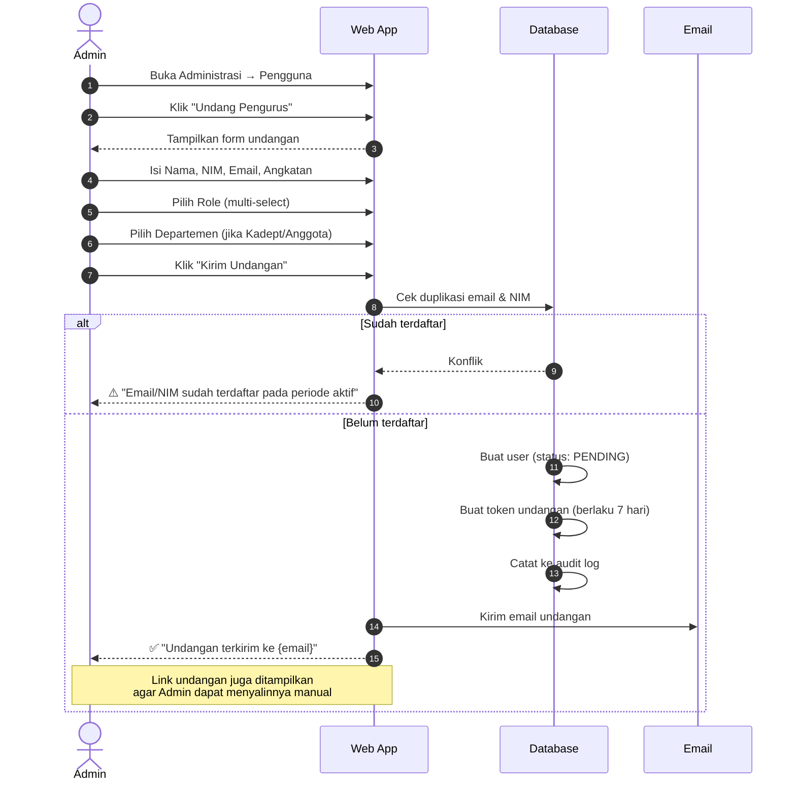

### 2.2 Pengurus Mengaktifkan Akun

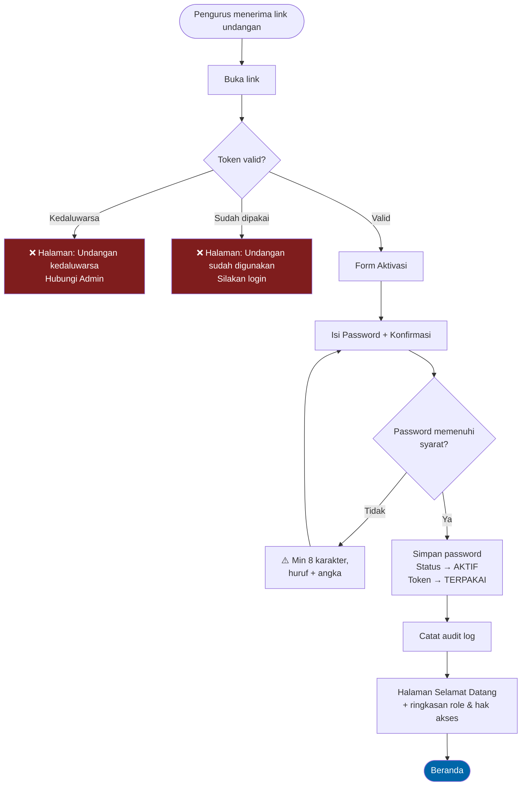

### 2.3 Login Harian

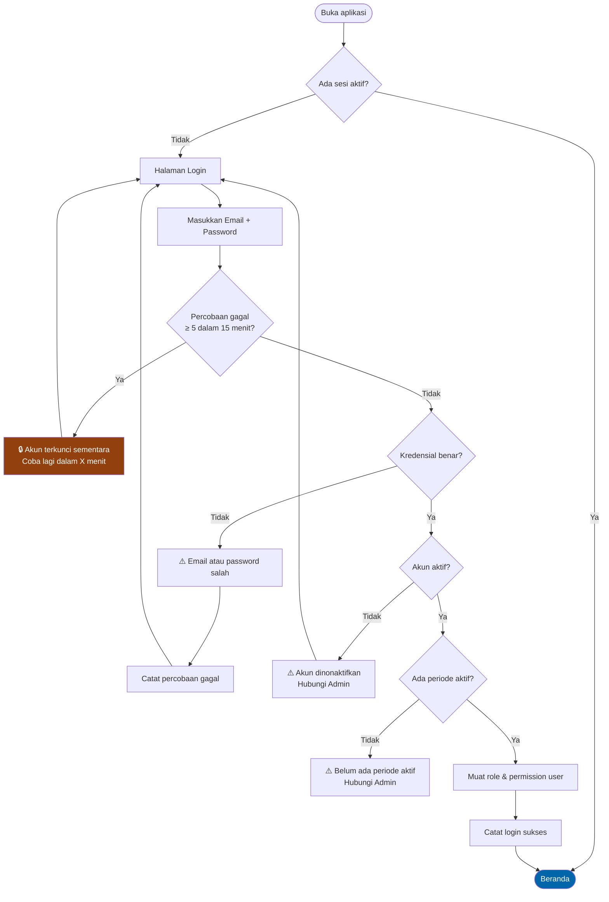

---

## 3. Alur Homepage & Master Gantt

### 3.1 Struktur Halaman Beranda

```
┌──────────────────────────────────────────────────────────────────────┐
│  HEADER   [Logo HMIF]  Beranda  Proker  Acara  Surat  ...   [🔍] [👤]│
├──────────┬───────────────────────────────────────────────────────────┤
│          │                                                            │
│ SIDEBAR  │   ╔══════════════════════════════════════════════════════╗ │
│          │   ║  TIMELINE PROGRAM KERJA HMIF                         ║ │
│  🏠      │   ║  Periode 2025/2026        [Minggu▾][Filter▾][Ekspor] ║ │
│  📋      │   ╠══════════════════════════════════════════════════════╣ │
│  🎯      │   ║           │  Okt   │  Nov   │  Des   │  Jan   │ Feb  ║ │
│  ✉️      │   ║           │W1 W2W3W4│W1W2W3W4│W1W2W3W4│W1W2W3W4│      ║ │
│  💰      │   ║ ▼ Kaderisasi ────────────────────────────────────────║ │
│  📁      │   ║   SYNCHRONIZE  ▬▬▬▬▬▬▬▬▬█▬                            ║ │
│  🏢      │   ║   Upgrading                    ▬▬▬▬▬█                 ║ │
│  ⚙️      │   ║ ▼ Kominfo   ─────────────────────────────────────────║ │
│          │   ║   IT Festival                        ▬▬▬▬▬▬▬█▬       ║ │
│          │   ║ ▶ Minat & Bakat (3)  ────────────────────────────────║ │
│          │   ║ ▼ Eksternal ─────────────────────────────────────────║ │
│          │   ║   Company Visit         ▬▬▬▬█                        ║ │
│          │   ║                          ┊ hari ini                  ║ │
│          │   ╚══════════════════════════════════════════════════════╝ │
│          │                                                            │
│          │   ┌────────────────┐ ┌────────────────┐ ┌───────────────┐ │
│          │   │ PANEL ROLE #1  │ │ PANEL ROLE #2  │ │ PANEL ROLE #3 │ │
│          │   └────────────────┘ └────────────────┘ └───────────────┘ │
└──────────┴───────────────────────────────────────────────────────────┘

Legenda:  ▬ = masa persiapan   █ = hari-H   ┊ = garis hari ini
```

### 3.2 Alur Pemuatan & Live Update

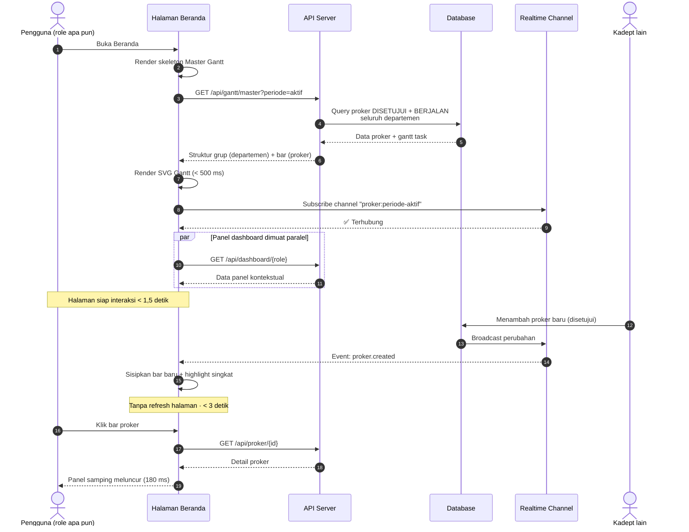

### 3.3 Interaksi Master Gantt

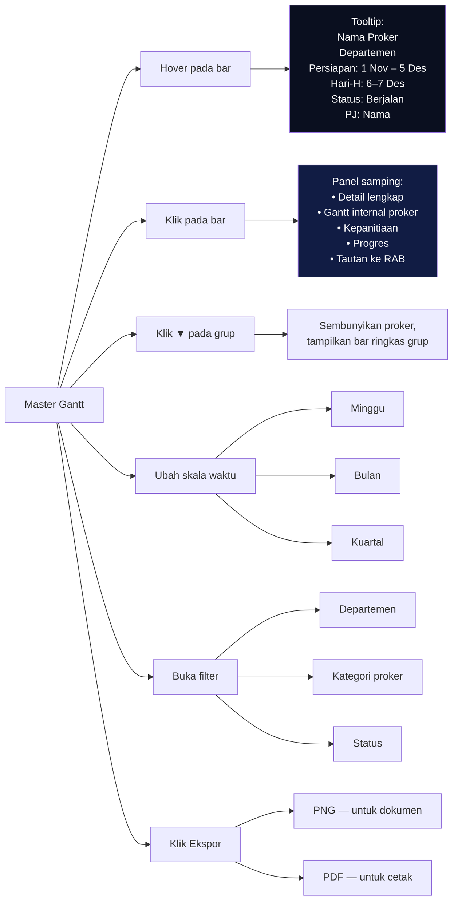

---

## 4. Alur Program Kerja

### 4.1 Alur Utama Penambahan Proker Terjadwal

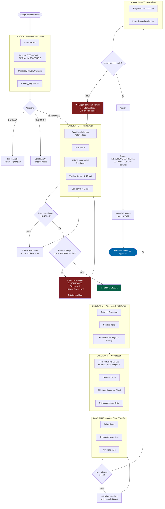

### 4.2 Kalender Ketersediaan — Tampilan

```
╔═══════════════════════════════════════════════════════════════════╗
║  KALENDER KETERSEDIAAN — November 2026        [◀]  [Hari Ini] [▶] ║
╠═══════════════════════════════════════════════════════════════════╣
║   Sen    Sel    Rab    Kam    Jum    Sab    Min                   ║
║ ┌──────┬──────┬──────┬──────┬──────┬──────┬──────┐               ║
║ │      │      │  1   │  2   │  3   │  4   │  5   │               ║
║ │      │      │▓▓▓▓▓▓│▓▓▓▓▓▓│▓▓▓▓▓▓│▓▓▓▓▓▓│▓▓▓▓▓▓│               ║
║ ├──────┼──────┼──────┼──────┼──────┼──────┼──────┤               ║
║ │  6   │  7   │  8   │  9   │ 10   │ 11   │ 12   │               ║
║ │▓▓▓▓▓▓│▓▓▓▓▓▓│▓▓▓▓▓▓│▓▓▓▓▓▓│▓▓▓▓▓▓│▓▓▓▓▓▓│▓▓▓▓▓▓│               ║
║ ├──────┼──────┼──────┼──────┼──────┼──────┼──────┤               ║
║ │ 13   │ 14   │ 15   │ 16   │ 17   │ 18   │ 19   │               ║
║ │▓▓▓▓▓▓│▓▓▓▓▓▓│      │      │      │      │      │               ║
║ └──────┴──────┴──────┴──────┴──────┴──────┴──────┘               ║
║                                                                    ║
║  ▓▓ Terkunci — SYNCHRONIZE (Kaderisasi) · 1 Nov – 7 Des           ║
║  ░░ Proker Berkala (tidak memblokir)                              ║
║  ⬜ Tersedia                                                       ║
╚═══════════════════════════════════════════════════════════════════╝

Hover pada tanggal terkunci → tooltip:
  "SYNCHRONIZE
   Departemen Kaderisasi
   Persiapan 1 Nov – 5 Des · Hari-H 6–7 Des
   Ketua Pelaksana: Muhammad Zidan"
```

### 4.3 Alur Approval Proker

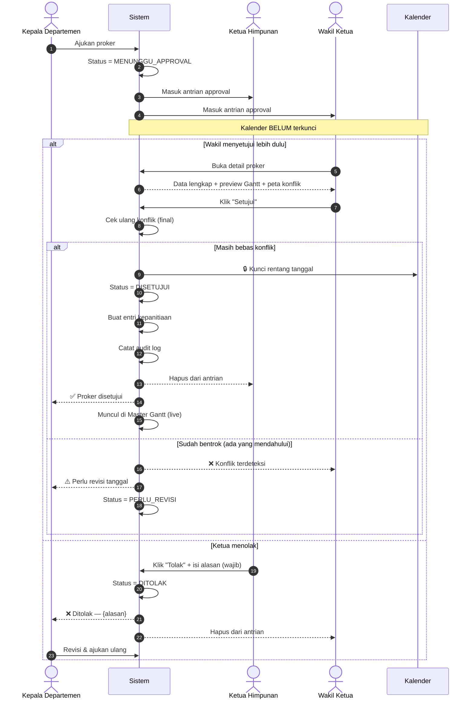

### 4.4 Alur Edit Proker yang Sudah Terkunci

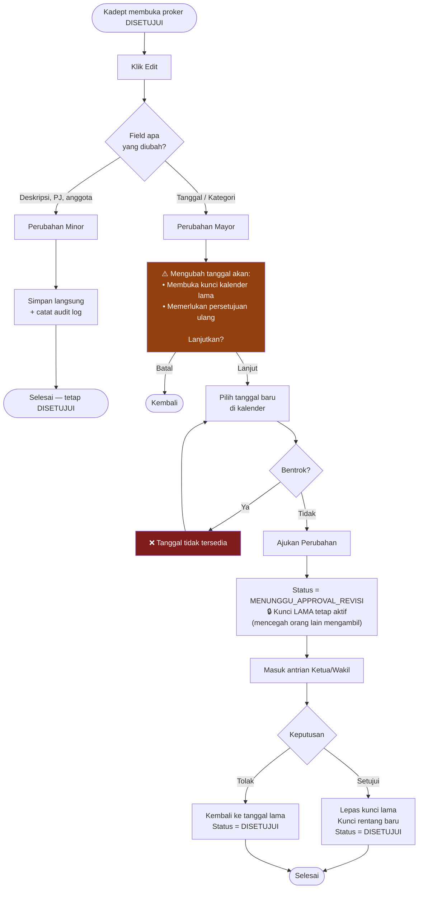

---

## 5. Alur Persuratan

### 5.1 Alur Lengkap Pembuatan Surat

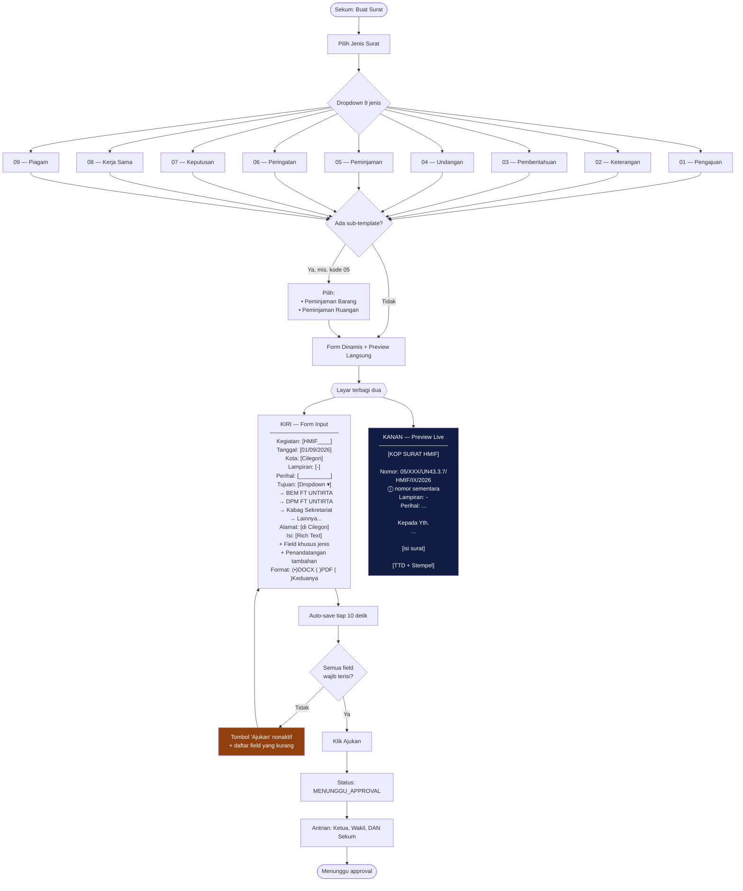

### 5.2 Alur Approval & Generate (Detail Penomoran)

```mermaid
sequenceDiagram
    autonumber
    actor AP as Approver<br/>(Ketua/Wakil/Sekum)
    participant W as Web App
    participant API as API Server
    participant DB as Database
    participant GEN as Document Engine
    participant ST as Storage

    AP->>W: Buka antrian approval surat
    W->>API: GET /api/surat/pending
    API-->>W: Daftar surat menunggu
    AP->>W: Klik salah satu surat
    W-->>AP: Preview dokumen + tombol aksi

    alt Menyetujui
        AP->>W: Klik "Setujui & Terbitkan"
        W->>API: POST /api/surat/{id}/approve

        rect rgb(20, 40, 70)
            Note over API,DB: TRANSAKSI ATOMIK
            API->>DB: BEGIN
            API->>DB: SELECT ... FOR UPDATE pada counter periode
            DB-->>API: nomor_terakhir = 274
            API->>DB: UPDATE counter → 275
            API->>DB: Simpan nomor_surat lengkap<br/>"02/275/UN43.3.7/HMIF/IX/2026"
            API->>DB: Status → DISETUJUI
            API->>DB: Catat audit log
            API->>DB: COMMIT
        end

        API->>GEN: Render dokumen
        GEN->>GEN: Muat template DOCX
        GEN->>GEN: Isi placeholder
        GEN->>GEN: Sisipkan TTD Ketua (PNG)
        GEN->>GEN: Overlay Stempel HMIF
        GEN->>GEN: Sisipkan TTD tambahan (jika ada)

        alt Format = DOCX
            GEN-->>API: file.docx
        else Format = PDF
            GEN->>GEN: Konversi ke PDF (teks tetap seleksi-able)
            GEN-->>API: file.pdf
        else Format = Keduanya
            GEN-->>API: file.docx + file.pdf
        end

        API->>ST: Simpan ke bucket arsip
        ST-->>API: path file
        API->>DB: Simpan path + status TERBIT
        API-->>W: ✅ Surat terbit — nomor 02/275/...
        W-->>AP: Tampilkan nomor final + tombol Unduh
        Note over W: Surat hilang dari antrian<br/>approver lain

    else Menolak
        AP->>W: Klik "Tolak" + isi alasan
        W->>API: POST /api/surat/{id}/reject
        API->>DB: Status → DITOLAK + alasan
        Note over DB: ⚠️ Nomor TIDAK dialokasikan
        API->>DB: Catat audit log
        API-->>W: Surat dikembalikan ke pembuat
    end
```

### 5.3 Alur Generate Massal — Surat Aktif Organisasi

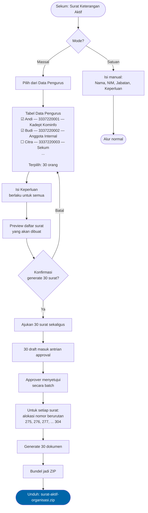

---

## 6. Alur Kepanitiaan & RAB

### 6.1 Pembentukan Kepanitiaan (Otomatis)

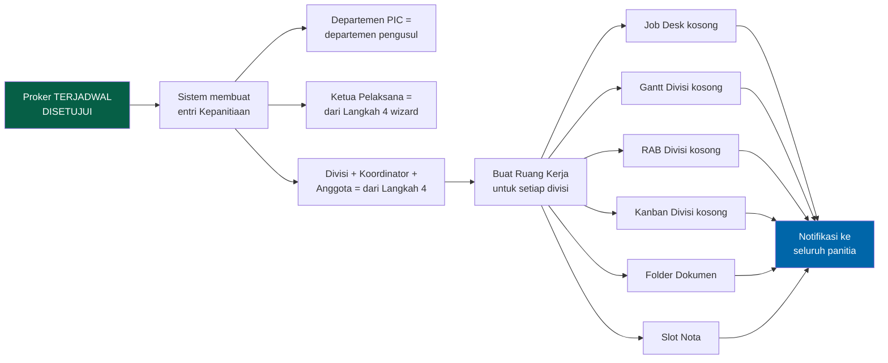

### 6.2 Struktur Ruang Kerja Acara Besar

```
╔══════════════════════════════════════════════════════════════════════╗
║  SYNCHRONIZE 2026                          [Kaderisasi] [Berjalan]   ║
║  Ketua Pelaksana: Muhammad Zidan Heiqmatyar                          ║
║  Persiapan 1 Nov – 5 Des  ·  Hari-H 6–7 Des 2026                     ║
╠══════════════════════════════════════════════════════════════════════╣
║ [Ringkasan] [Gantt] [Divisi] [RAB] [TOR] [Proposal] [Nota] [LPJ]     ║
╠══════════════════════════════════════════════════════════════════════╣
║                                                                       ║
║  TAB: DIVISI                                                          ║
║  ┌───────────────┬───────────────┬───────────────┬────────────────┐  ║
║  │ 🎪 ACARA      │ 🍱 KONSUMSI   │ 📢 HUMAS      │ 🎨 PDD         │  ║
║  │ Koor: Rina    │ Koor: Dedi    │ Koor: Sinta   │ Koor: Fajar    │  ║
║  │ 8 anggota     │ 6 anggota     │ 5 anggota     │ 7 anggota      │  ║
║  │ RAB: 172.000  │ RAB: 6.654.000│ RAB: 8.600.000│ RAB: 8.212.000 │  ║
║  │ Progres ▓▓▓░ 75%│ ▓▓▓▓ 90%    │ ▓▓░░ 50%      │ ▓▓▓░ 70%       │  ║
║  │ [Buka]        │ [Buka]        │ [Buka]        │ [Buka]         │  ║
║  └───────────────┴───────────────┴───────────────┴────────────────┘  ║
║  ┌───────────────┬───────────────┬───────────────┬────────────────┐  ║
║  │ ⚕️ P3K        │ 🔧 PERALATAN  │ 📝 SEKRETARIS │ 💰 BENDAHARA   │  ║
║  │ ...           │ ...           │ ...           │ ...            │  ║
║  └───────────────┴───────────────┴───────────────┴────────────────┘  ║
║                                                                       ║
║  ⓘ Anda adalah Koordinator Divisi Konsumsi.                          ║
║    Divisi lain dapat dilihat namun tidak dapat diubah.               ║
╚══════════════════════════════════════════════════════════════════════╝
```

### 6.3 Alur Visibilitas Cross-Divisi

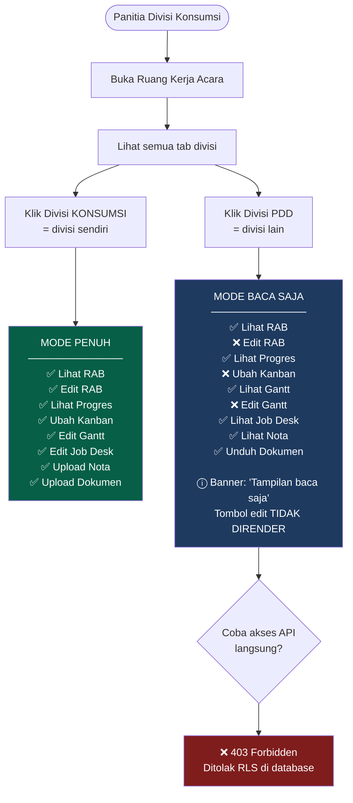

### 6.4 Alur Penyusunan RAB

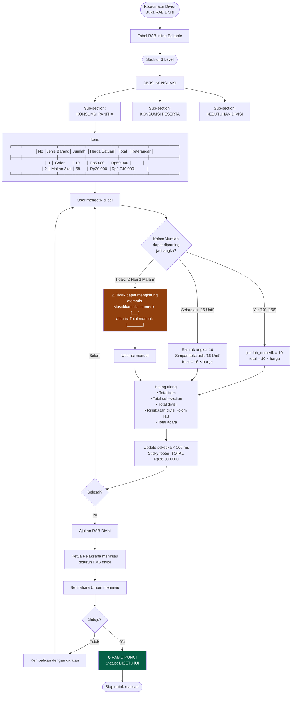

### 6.5 Alur Export RAB ke Excel

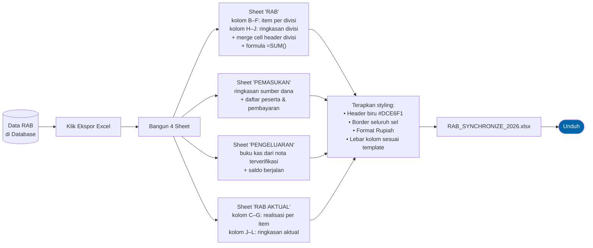

---

## 7. Alur Nota & LPJ

### 7.1 Alur Upload Nota (Detail Penuh)

```mermaid
flowchart TD
    START([Panitia buka menu Upload Nota]) --> DIV{Terdaftar di<br/>berapa divisi?}

    DIV -->|Satu| AUTO[Divisi terpilih otomatis]
    DIV -->|Lebih dari satu| PICKDIV[Pilih Divisi]

    AUTO --> DROPDOWN
    PICKDIV --> DROPDOWN

    DROPDOWN["🔽 PILIH ITEM RAB<br/>─────────────────────<br/>Dropdown berisi item dari<br/>RAB divisi terpilih:<br/>• Galon<br/>• Makan 3 kali<br/>• Snack<br/>• Aqua Botol<br/>• Materai<br/>• Print MoU<br/>─────────────────────<br/>⚠️ WAJIB dipilih sebelum kamera aktif"]

    DROPDOWN --> MULTI{Nota mencakup<br/>lebih dari 1 item?}

    MULTI -->|Ya| ADDMORE["Tambah item lain:<br/>☑ Snack — Rp50.000<br/>☑ Galon — Rp25.000<br/>─────────────<br/>Total alokasi: Rp75.000"]
    MULTI -->|Tidak| SINGLE1[Satu item saja]

    ADDMORE --> CAM
    SINGLE1 --> CAM

    CAM[📷 Buka Kamera / Pilih Galeri]

    CAM --> CAPTURE[Ambil foto]
    CAPTURE --> SCAN["🔍 AUTO-SCAN (jscanify)<br/>• Deteksi tepi dokumen<br/>• Koreksi perspektif<br/>• Tingkatkan kontras"]

    SCAN --> DETECT{Tepi terdeteksi?}
    DETECT -->|Ya| CROPPED[Nota terlihat lurus<br/>seperti hasil pindai]
    DETECT -->|Tidak| ASIS[Gunakan foto apa adanya<br/>setelah auto-rotate EXIF]

    CROPPED --> PREVIEW
    ASIS --> PREVIEW

    PREVIEW["👁️ PREVIEW WAJIB<br/>────────────────<br/>[gambar hasil scan]<br/><br/>Apakah nota terbaca jelas?<br/><br/>[🔄 Ambil Ulang]  [✓ Gunakan]"]

    PREVIEW -->|Ambil Ulang| CAM
    PREVIEW -->|Gunakan| PROCESS

    PROCESS["⚙️ PIPELINE GAMBAR (sisi klien)<br/>Satu decode → tiga turunan paralel"]

    PROCESS --> M1[MASTER<br/>JPEG Q90/Q93<br/>≤3000px]
    PROCESS --> M2[PREVIEW<br/>WebP Q78<br/>≤1280px]
    PROCESS --> M3[THUMB<br/>WebP Q70<br/>≤400px]

    M1 & M2 & M3 --> META[Isi Metadata:<br/>• Tanggal Belanja<br/>• Jumlah Aktual<br/>• Harga Aktual<br/>• Alokasi per item<br/>• Keterangan]

    META --> CHECK{Total alokasi =<br/>total nota?}
    CHECK -->|Tidak| ERRALLOC["⚠️ Alokasi Rp70.000<br/>≠ Total nota Rp75.000<br/>Selisih Rp5.000"]
    ERRALLOC --> META

    CHECK -->|Ya| UPLOAD[Upload 3 file + metadata]

    UPLOAD --> VALIDATE["🛡️ VALIDASI SERVER<br/>• MIME sniffing (magic bytes)<br/>• Decode ulang master<br/>• Cek dimensi valid<br/>• Cek ukuran > 0<br/>• Batas ukuran 15 MB"]

    VALIDATE --> VOK{Semua valid?}
    VOK -->|Tidak| CLEANUP[🗑️ Hapus file parsial<br/>❌ TIDAK buat record DB]
    CLEANUP --> ERRUP[Tampilkan error ke user]
    ERRUP --> CAM

    VOK -->|Ya| SAVE[Simpan record + path]
    SAVE --> STATUS[Status: MENUNGGU_VERIFIKASI]
    STATUS --> NOTIFBEN[Muncul di antrian Bendahara]
    NOTIFBEN --> END([Selesai])

    style DROPDOWN fill:#111C44,color:#fff
    style PREVIEW fill:#111C44,color:#fff
    style CLEANUP fill:#7f1d1d,color:#fff
    style END fill:#0066A9,color:#fff
```

### 7.2 Alur Verifikasi Nota

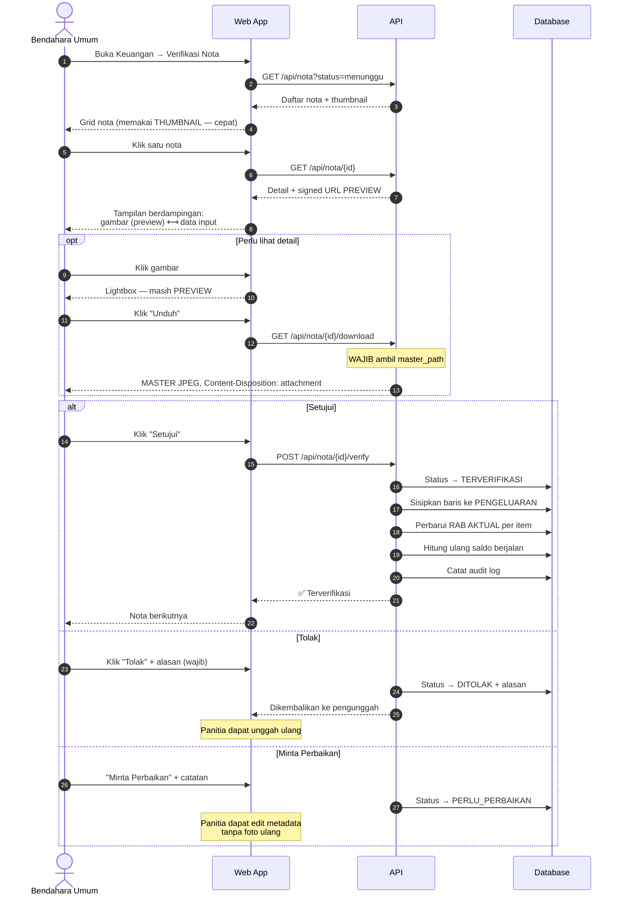

### 7.3 Aturan Unduhan Gambar (Kritis)

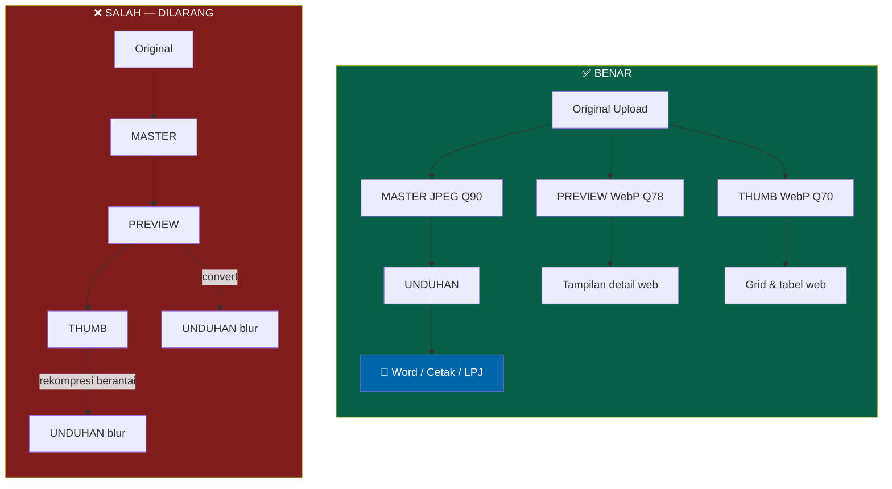

### 7.4 Alur Generate LPJ

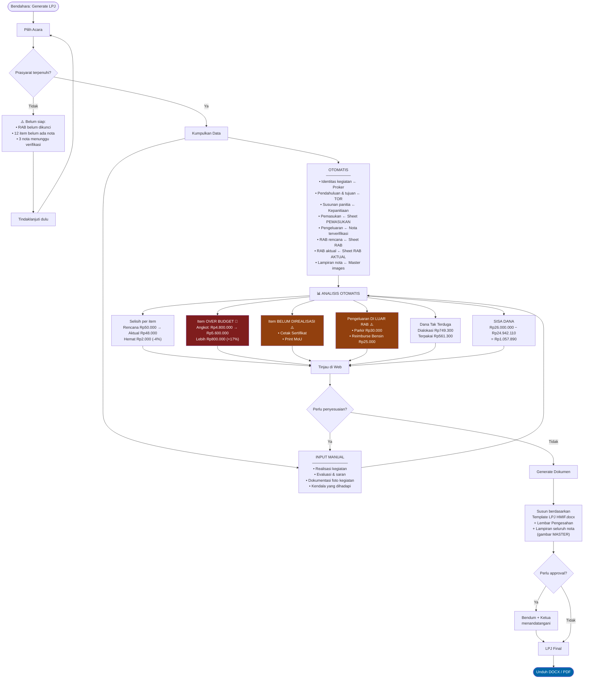

---

## 8. Alur Progres & Kendala

### 8.1 Kanban Departemen

```mermaid
flowchart LR
    subgraph BOARD["Kanban — Departemen Kominfo"]
        direction LR
        TODO["📋 TO DO (5)<br/>─────────────<br/>┌─────────────┐<br/>│ Desain Poster│<br/>│ 👤 Rina      │<br/>│ 📅 5 Sep     │<br/>│ 🔴 Tinggi    │<br/>│ ☑ 2/5        │<br/>└─────────────┘"]

        PROG["⚡ IN PROGRESS (3)<br/>─────────────<br/>┌─────────────┐<br/>│ Konten IG    │<br/>│ 👤 Budi      │<br/>│ 📅 3 Sep ⚠️  │<br/>│ 🟡 Sedang    │<br/>│ ☑ 4/6        │<br/>└─────────────┘"]

        REV["👁️ REVIEW (2)<br/>─────────────<br/>┌─────────────┐<br/>│ Draft Artikel│<br/>│ 👤 Citra     │<br/>│ 📅 8 Sep     │<br/>│ ☑ 6/6        │<br/>└─────────────┘"]

        DONE["✅ DONE (12)<br/>─────────────<br/>┌─────────────┐<br/>│ Setup Website│<br/>│ 👤 Dedi      │<br/>│ ✓ Selesai    │<br/>└─────────────┘"]
    end

    TODO -.drag.-> PROG
    PROG -.drag.-> REV
    REV -.drag.-> DONE

    DONE --> CALC["Progres Proker<br/>12 / 22 = 55%"]

    style DONE fill:#065f46,color:#fff
```

### 8.2 Alur Pelaporan Kendala

```mermaid
flowchart TD
    START([Anggota menemui kendala]) --> NEW[Klik 'Lapor Kendala']

    NEW --> FORM["Form Kendala<br/>────────────<br/>Judul: ______________<br/>Deskripsi: __________<br/>Prioritas: ( )Rendah<br/>           ( )Sedang<br/>           (•)Tinggi<br/>           ( )Kritis<br/>Assignee: [Dropdown ▾]<br/>Proker terkait: [▾]<br/>Lampiran: [+ File]"]

    FORM --> SUBMIT[Kirim]
    SUBMIT --> STATUS1[Status: TERBUKA]

    STATUS1 --> PRIO{Prioritas?}
    PRIO -->|Kritis| ESCALATE[🚨 Muncul di dashboard<br/>Ketua, Wakil, dan BPH]
    PRIO -->|Lainnya| DEPTONLY[Muncul di dashboard<br/>Kadept & assignee]

    ESCALATE --> THREAD
    DEPTONLY --> THREAD

    THREAD["💬 THREADED DISCUSSION<br/>─────────────────────<br/>Andi: Kendala di sini...<br/>  └ Rina: Sudah dicoba X?<br/>      └ Andi: Sudah, hasilnya...<br/>  └ @Kadept: Saya bantu koordinasi<br/><br/>[Tulis balasan...]"]

    THREAD --> WORK[Assignee menangani]
    WORK --> STATUS2[Status: SEDANG_DITANGANI]

    STATUS2 --> RESOLVE{Terselesaikan?}
    RESOLVE -->|Belum| THREAD
    RESOLVE -->|Ya| CLOSE[Tandai SELESAI<br/>+ catatan penyelesaian]

    CLOSE --> ARCHIVE[Masuk arsip kendala<br/>dapat dicari untuk<br/>referensi periode berikutnya]
    ARCHIVE --> END([Selesai])

    style ESCALATE fill:#7f1d1d,color:#fff
    style END fill:#065f46,color:#fff
```

---

## 9. Alur Sekretaris

### 9.1 Import Data Pengurus

```mermaid
flowchart TD
    START([Sekum: Data Pengurus]) --> METHOD{Metode input?}

    METHOD -->|Satuan| MANUAL[Form manual:<br/>Nama, NIM, Jabatan,<br/>Departemen, Angkatan]
    METHOD -->|Massal| IMPORT[Import CSV/XLSX]

    IMPORT --> UPLOAD[Unggah file hasil<br/>form pendataan]
    UPLOAD --> PARSE[Baca file]

    PARSE --> MAP["Pemetaan Kolom<br/>─────────────<br/>Kolom file    →  Field sistem<br/>'Nama'        →  nama_lengkap<br/>'NIM'         →  nim<br/>'Jabatan'     →  jabatan<br/>'Departemen'  →  departemen<br/>[Sesuaikan pemetaan ▾]"]

    MAP --> VALIDATE[Validasi setiap baris]

    VALIDATE --> PREVIEW["📋 PRATINJAU<br/>─────────────────────────────<br/>✅ 87 baris valid<br/>⚠️ 8 baris peringatan (NIM duplikat)<br/>❌ 5 baris error (NIM kosong)<br/><br/>[Lihat detail] [Lewati bermasalah]<br/>[Batal] [Import 87 baris]"]

    PREVIEW -->|Batal| END1([Batal])
    PREVIEW -->|Import| SAVE[Simpan ke database]

    SAVE --> AUDIT[Catat audit log]
    AUDIT --> RESULT["✅ 87 pengurus tersimpan<br/>⚠️ 13 dilewati<br/>[Unduh laporan]"]

    MANUAL --> SAVE

    RESULT --> USE([Siap dipakai untuk<br/>Surat Aktif Organisasi])

    style USE fill:#0066A9,color:#fff
```

### 9.2 Alur Notulensi

```mermaid
flowchart TD
    START([Sekum: Buat Notulensi]) --> META["Metadata Rapat<br/>─────────────<br/>Judul: Rapat Koordinasi Bulanan<br/>Tanggal: 1 Sep 2026<br/>Waktu: 16.00 – 18.00<br/>Tempat: Sekretariat HMIF<br/>Pemimpin: Ketua Himpunan<br/>Notulis: Sekum"]

    META --> ATT["👥 Daftar Hadir<br/>Checklist dari data pengurus:<br/>☑ Andi (Ketua) — Hadir<br/>☑ Budi (Wakil) — Hadir<br/>☐ Citra (Sekum) — Izin<br/>☑ Dedi (Bendum) — Hadir<br/>...<br/>Ringkasan: 18 Hadir · 2 Izin · 1 Sakit · 0 Alfa"]

    ATT --> EDITOR["📝 Editor Rich Text<br/>─────────────────<br/>Toolbar: B I U · H1 H2 · ≡ • 1. ·<br/>         ▦ Tabel · ☑ Checklist ·<br/>         ❝ Kutipan · 🔗 Tautan<br/><br/>[Area penulisan notulensi]"]

    EDITOR --> KEP["✅ Poin Keputusan<br/>1. Proker X disetujui dengan revisi anggaran<br/>2. Deadline LPJ diperpanjang 1 minggu<br/>3. ..."]

    KEP --> ACT["📌 Action Item<br/>┌────────────────┬─────────┬─────────┐<br/>│ Tugas          │ PIC     │Deadline │<br/>├────────────────┼─────────┼─────────┤<br/>│ Revisi RAB     │ Dedi    │ 5 Sep   │<br/>│ Susun TOR      │ Rina    │ 8 Sep   │<br/>└────────────────┴─────────┴─────────┘<br/><br/>[→ Konversi jadi kartu Kanban]"]

    ACT --> CONV{Konversi ke Kanban?}
    CONV -->|Ya| KANBAN[Buat kartu di<br/>Kanban departemen terkait]
    CONV -->|Tidak| ATTACH

    KANBAN --> ATTACH[📎 Lampiran file]

    ATTACH --> SAVE[Simpan]
    SAVE --> OUT{Generate dokumen?}
    OUT -->|Ya| DOCX[Generate DOCX<br/>mengikuti Template Notulensi]
    OUT -->|Tidak| ARCH

    DOCX --> ARCH[Masuk Arsip Notulensi<br/>dengan pencarian teks penuh]
    ARCH --> END([Selesai])

    style END fill:#0066A9,color:#fff
```

### 9.3 Alur Peminjaman Ruangan

```mermaid
flowchart TD
    START([Sekum: Peminjaman Ruangan]) --> SETUP{Ruangan sudah<br/>terdaftar?}

    SETUP -->|Belum| ADDROOM["Tambah Ruangan<br/>─────────────<br/>Nama: Auditorium FT<br/>Lokasi: Gedung FT Lt.1<br/>Kapasitas: 200<br/>Pengelola: Kabag Sekretariat FT<br/>Catatan: Perlu izin H-7"]
    ADDROOM --> ROOMLIST

    SETUP -->|Sudah| ROOMLIST[Daftar Ruangan]

    ROOMLIST --> BOOK[Buat Peminjaman]

    BOOK --> FORM["Form Peminjaman<br/>─────────────<br/>Ruangan: [Auditorium FT ▾]<br/>Kegiatan: MUSMAIF<br/>Hari, Tanggal: Kamis, 9 Okt 2026<br/>Pukul: 16.00 – selesai<br/>Jumlah Peserta: 150<br/>Keperluan: Musyawarah Mahasiswa"]

    FORM --> CALCHECK[Cek kalender booking]
    CALCHECK --> CLASH{Ada jadwal lain<br/>di tanggal & ruangan sama?}

    CLASH -->|Ya| WARNCLASH["⚠️ PERINGATAN (bukan blokir)<br/>Ruangan ini sudah tercatat dipinjam:<br/>'Seminar Nasional' 9 Okt 14.00–16.00<br/><br/>Keputusan akhir tetap di Dekanat.<br/>Lanjutkan?"]
    WARNCLASH -->|Batal| FORM
    WARNCLASH -->|Lanjut| SAVE

    CLASH -->|Tidak| SAVE[Simpan booking]

    SAVE --> SURAT{Buat surat sekarang?}
    SURAT -->|Ya| GENSURAT["Buka form Surat Peminjaman Ruangan (05)<br/>dengan field terisi otomatis dari booking"]
    GENSURAT --> LETTERFLOW([→ Alur Persuratan])

    SURAT -->|Nanti| CAL[Tampil di kalender booking]
    CAL --> END([Selesai])

    style WARNCLASH fill:#92400e,color:#fff
```

---

## 10. Alur Backup & Restore

### 10.1 Backup Otomatis Bulanan

```mermaid
sequenceDiagram
    autonumber
    participant CRON as Vercel Cron
    participant API as API Backup
    participant DB as PostgreSQL
    participant ST as Storage
    participant GD as Google Drive<br/>(setelah tersedia)

    Note over CRON: Tanggal 1, pukul 02:00 WIB
    CRON->>API: POST /api/cron/backup

    API->>API: Buat ID backup + folder

    rect rgb(20, 40, 70)
        Note over API,DB: LAPIS 1 — Database Dump
        API->>DB: pg_dump seluruh skema
        DB-->>API: dump SQL
        API->>API: Kompres → full-dump.sql.gz
    end

    rect rgb(20, 50, 60)
        Note over API,DB: LAPIS 2 — Export Modul JSON
        loop Setiap modul
            API->>DB: SELECT seluruh data modul
            DB-->>API: Rows
            API->>API: Serialisasi → {modul}.json
        end
        API->>API: Bangun rab-{acara}.xlsx
        API->>API: Bangun daftar-surat.xlsx
    end

    rect rgb(40, 40, 70)
        Note over API,ST: LAPIS 3 — Arsip File
        API->>ST: Daftar seluruh objek
        ST-->>API: Daftar file
        API->>API: Bundel → storage-archive.zip
    end

    API->>API: Hitung checksum tiap file
    API->>API: Susun manifest.json<br/>(versi skema, jumlah record, checksum)

    API->>ST: Simpan bundel ke bucket backup
    opt Service Account tersedia
        API->>GD: Unggah ke Backup/2026-09/
    end

    API->>DB: Catat record backup + status
    API->>DB: Catat audit log
    API->>API: Hapus backup > 12 bulan (kecuali manual)

    Note over API: ✅ Backup selesai
```

### 10.2 Alur Restore

```mermaid
flowchart TD
    START([Admin: Backup & Restore]) --> LIST["Daftar Backup<br/>─────────────────────────────<br/>📦 2026-09-01 · Otomatis · 1,2 GB ✅<br/>📦 2026-08-15 · Manual   · 1,1 GB ✅<br/>📦 2026-08-01 · Otomatis · 1,0 GB ✅<br/>..."]

    LIST --> SELECT[Pilih backup]
    SELECT --> VERIFY[Verifikasi checksum]

    VERIFY --> VOK{Integritas OK?}
    VOK -->|Tidak| CORRUPT[❌ Backup korup<br/>Pilih backup lain]
    CORRUPT --> LIST

    VOK -->|Ya| MODE{Mode restore?}

    MODE -->|Penuh| FULL["⚠️ RESTORE PENUH<br/>Seluruh data akan diganti<br/>dengan kondisi 1 Sep 2026.<br/><br/>Ketik 'RESTORE PENUH' untuk konfirmasi:<br/>[________________]"]

    MODE -->|Per Modul| PARTIAL["Pilih modul yang direstore:<br/>☑ Program Kerja<br/>☐ Persuratan<br/>☑ RAB & Nota<br/>☐ Pengguna<br/><br/>Mode: (•)Tambah ( )Timpa ( )Gabung"]

    FULL --> SAFETY
    PARTIAL --> SAFETY

    SAFETY["🛡️ SAFETY NET<br/>Sistem membuat backup<br/>kondisi SAAT INI terlebih dahulu"]

    SAFETY --> EXEC[Jalankan restore]
    EXEC --> PROGRESS["Progres restore:<br/>▓▓▓▓▓▓▓░░░ 70%<br/>Memulihkan: nota.json (450/640)"]

    PROGRESS --> RESULT{Berhasil?}
    RESULT -->|Ya| OK["✅ Restore berhasil<br/>• 640 nota<br/>• 312 surat<br/>• 48 proker<br/>• 1.240 file"]
    RESULT -->|Tidak| ROLLBACK["❌ Restore gagal pada langkah X<br/>Sistem dikembalikan ke<br/>kondisi sebelum restore"]

    OK --> AUDIT[Catat audit log]
    ROLLBACK --> AUDIT
    AUDIT --> END([Selesai])

    style FULL fill:#7f1d1d,color:#fff
    style SAFETY fill:#065f46,color:#fff
    style ROLLBACK fill:#7f1d1d,color:#fff
```

---

## 11. Matriks State Transition

### 11.1 Status Proker

```mermaid
stateDiagram-v2
    [*] --> DRAFT: Kadept membuat
    DRAFT --> DRAFT: Simpan progres wizard
    DRAFT --> MENUNGGU_APPROVAL: Ajukan
    DRAFT --> [*]: Hapus draft

    MENUNGGU_APPROVAL --> DISETUJUI: Ketua/Wakil setujui<br/>🔒 kunci kalender
    MENUNGGU_APPROVAL --> DITOLAK: Ketua/Wakil tolak
    MENUNGGU_APPROVAL --> PERLU_REVISI: Minta revisi

    DITOLAK --> DRAFT: Kadept revisi
    PERLU_REVISI --> MENUNGGU_APPROVAL: Ajukan ulang

    DISETUJUI --> BERJALAN: Tanggal mulai persiapan tiba
    DISETUJUI --> MENUNGGU_APPROVAL_REVISI: Kadept ubah tanggal<br/>🔒 kunci lama dipertahankan
    DISETUJUI --> DIBATALKAN: Ketua/Wakil batalkan<br/>🔓 lepas kunci

    MENUNGGU_APPROVAL_REVISI --> DISETUJUI: Disetujui<br/>🔓🔒 pindah kunci
    MENUNGGU_APPROVAL_REVISI --> DISETUJUI: Ditolak<br/>kembali tanggal lama

    BERJALAN --> SELESAI: Hari-H terakhir lewat<br/>🔓 lepas kunci
    BERJALAN --> DIBATALKAN: Dibatalkan

    SELESAI --> [*]
    DIBATALKAN --> [*]
```

### 11.2 Status Surat

```mermaid
stateDiagram-v2
    [*] --> DRAFT: Buat surat
    DRAFT --> DRAFT: Auto-save
    DRAFT --> MENUNGGU_APPROVAL: Ajukan
    DRAFT --> [*]: Hapus<br/>(nomor belum dialokasikan)

    MENUNGGU_APPROVAL --> DISETUJUI: Ketua/Wakil/Sekum setujui<br/>🔢 ALOKASI NOMOR (atomik)
    MENUNGGU_APPROVAL --> DITOLAK: Tolak + alasan

    DITOLAK --> DRAFT: Perbaiki

    DISETUJUI --> TERBIT: Dokumen ter-generate<br/>📄 DOCX/PDF tersimpan
    TERBIT --> DIBATALKAN: Batalkan<br/>⚠️ nomor TIDAK didaur ulang

    TERBIT --> [*]
    DIBATALKAN --> [*]
```

### 11.3 Status RAB

```mermaid
stateDiagram-v2
    [*] --> DRAFT: Koordinator mulai isi
    DRAFT --> DRAFT: Edit item
    DRAFT --> DIAJUKAN: Ajukan ke Ketuplak

    DIAJUKAN --> DRAFT: Dikembalikan dengan catatan
    DIAJUKAN --> DISETUJUI: Ketuplak + Bendum setujui<br/>🔒 RAB dikunci

    DISETUJUI --> DRAFT: Buka kunci<br/>⚠️ wajib alasan, tercatat audit
    DISETUJUI --> REALISASI: Nota pertama terverifikasi

    REALISASI --> REALISASI: Nota masuk<br/>RAB AKTUAL diperbarui
    REALISASI --> SELESAI: LPJ di-generate

    SELESAI --> [*]
```

### 11.4 Status Nota

```mermaid
stateDiagram-v2
    [*] --> DIUNGGAH: Panitia upload
    DIUNGGAH --> MENUNGGU_VERIFIKASI: Validasi server lolos
    DIUNGGAH --> [*]: Validasi gagal<br/>🗑️ file parsial dihapus

    MENUNGGU_VERIFIKASI --> TERVERIFIKASI: Bendahara setujui<br/>→ PENGELUARAN & RAB AKTUAL
    MENUNGGU_VERIFIKASI --> DITOLAK: Bendahara tolak + alasan
    MENUNGGU_VERIFIKASI --> PERLU_PERBAIKAN: Minta perbaikan metadata

    DITOLAK --> DIUNGGAH: Unggah ulang
    PERLU_PERBAIKAN --> MENUNGGU_VERIFIKASI: Perbaiki metadata

    TERVERIFIKASI --> MENUNGGU_VERIFIKASI: Bendahara batalkan verifikasi<br/>⚠️ hitung ulang saldo

    TERVERIFIKASI --> [*]
```

---

## 12. Peta Layar & Rute

| Rute | Layar | Role yang Dapat Mengakses |
|---|---|---|
| `/login` | Halaman Login | Publik |
| `/undangan/[token]` | Aktivasi Akun | Publik (dengan token valid) |
| `/` | **Beranda + Master Gantt** | Semua |
| `/proker` | Daftar Program Kerja | Semua |
| `/proker/baru` | Wizard Tambah Proker | Kadept, Ketua, Wakil, Admin |
| `/proker/[id]` | Detail Proker | Semua (edit sesuai izin) |
| `/proker/kalender` | Kalender Ketersediaan | Semua |
| `/proker/approval` | Antrian Approval Proker | Ketua, Wakil |
| `/acara` | Daftar Acara Besar | Semua |
| `/acara/[id]` | Ruang Kerja Acara | Semua (edit sesuai izin) |
| `/acara/[id]/divisi/[divId]` | Ruang Kerja Divisi | Semua (edit hanya divisi sendiri) |
| `/acara/[id]/rab` | RAB Acara | Semua (edit: Koor, Ketuplak, Bendum) |
| `/acara/[id]/tor` | Editor TOR | Ketuplak, Sekretaris Acara |
| `/acara/[id]/proposal` | Editor Proposal | Ketuplak, Sekretaris Acara |
| `/acara/[id]/lpj` | Generator LPJ | Bendum, Ketuplak |
| `/surat` | Arsip Surat | Semua kecuali Anggota |
| `/surat/baru` | Buat Surat | Sekum, Ketua, Wakil, Bendum, Kadept |
| `/surat/[id]` | Detail Surat | Sesuai izin |
| `/surat/approval` | Antrian Approval Surat | Ketua, Wakil, Sekum |
| `/keuangan` | Dashboard Keuangan | Bendum, Ketua, Wakil, BPH |
| `/keuangan/nota/upload` | Upload Nota | Panitia divisi |
| `/keuangan/nota/verifikasi` | Verifikasi Nota | Bendum |
| `/departemen/[kode]` | Ruang Departemen | Anggota dept terkait + pimpinan |
| `/departemen/[kode]/kanban` | Kanban | Anggota dept terkait |
| `/departemen/[kode]/kendala` | Kendala | Anggota dept terkait |
| `/sekretariat/notulensi` | Arsip Notulensi | Semua (edit: Sekum) |
| `/sekretariat/notulensi/baru` | Buat Notulensi | Sekum, Kadept |
| `/sekretariat/pengurus` | Data Pengurus | Sekum, Admin |
| `/sekretariat/ruangan` | Peminjaman Ruangan | Sekum, Kadept |
| `/admin/pengguna` | Kelola Pengguna | Admin |
| `/admin/periode` | Periode Kepengurusan | Admin |
| `/admin/konfigurasi` | Konfigurasi Sistem | Admin |
| `/admin/backup` | Backup & Restore | Admin |
| `/admin/audit` | Audit Log | Admin, Ketua, Wakil, BPH |
| `/profil` | Profil & TTD | Semua (diri sendiri) |

---

## Lampiran — Prinsip Interaksi

### Umpan Balik Sistem

| Situasi | Respons Sistem | Durasi |
|---|---|---|
| Aksi berhasil | Toast hijau di kanan atas | 3 detik |
| Aksi gagal | Toast merah + penjelasan + saran tindakan | 6 detik |
| Sedang memuat data | Skeleton loader sesuai bentuk konten | — |
| Sedang memproses | Tombol berubah jadi "Memproses..." + nonaktif | — |
| Perubahan tersimpan otomatis | Teks halus "Tersimpan ✓" di dekat form | 2 detik |
| Konflik terdeteksi | Panel merah inline (bukan modal) dengan detail konflik | Menetap |
| Koneksi live terputus | Banner kuning tipis di atas Gantt | Menetap sampai pulih |

### Pola Konfirmasi

| Tingkat Risiko | Pola | Contoh |
|---|---|---|
| **Rendah** | Langsung eksekusi + undo | Pindah kartu Kanban |
| **Sedang** | Dialog konfirmasi sederhana | Hapus item RAB |
| **Tinggi** | Dialog + wajib isi alasan | Tolak proker, buka kunci RAB |
| **Kritis** | Dialog + ketik teks konfirmasi | Restore penuh, hapus periode |

### Pintasan Keyboard

| Pintasan | Aksi |
|---|---|
| `Ctrl/⌘ + K` | Command palette (pencarian global) |
| `G` lalu `H` | Ke Beranda |
| `G` lalu `P` | Ke Program Kerja |
| `G` lalu `S` | Ke Persuratan |
| `N` | Buat baru (kontekstual) |
| `Esc` | Tutup panel/modal |
| `?` | Tampilkan daftar pintasan |

---

*Seluruh alur dalam dokumen ini mengacu pada spesifikasi fungsional di [PRD.md](PRD.md) dan diimplementasikan sesuai arsitektur di [SYSTEM_DESIGN.md](SYSTEM_DESIGN.md).*
