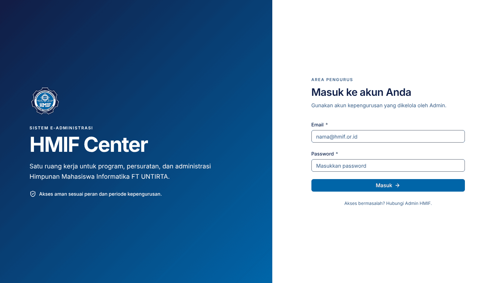
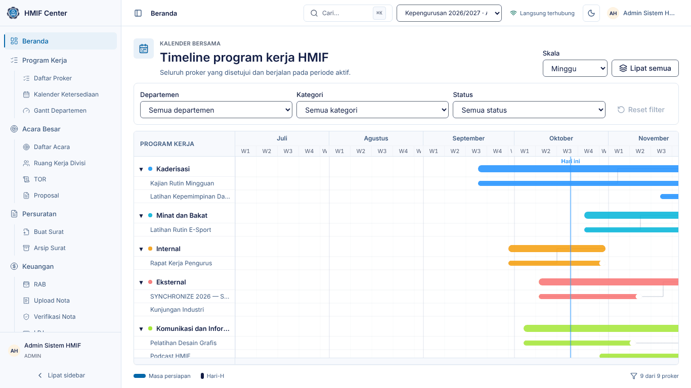
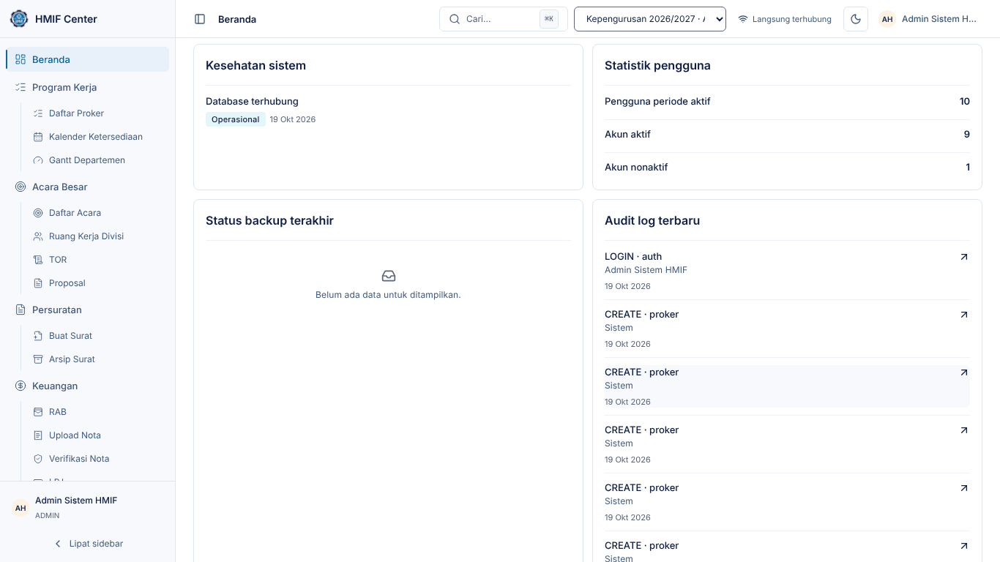
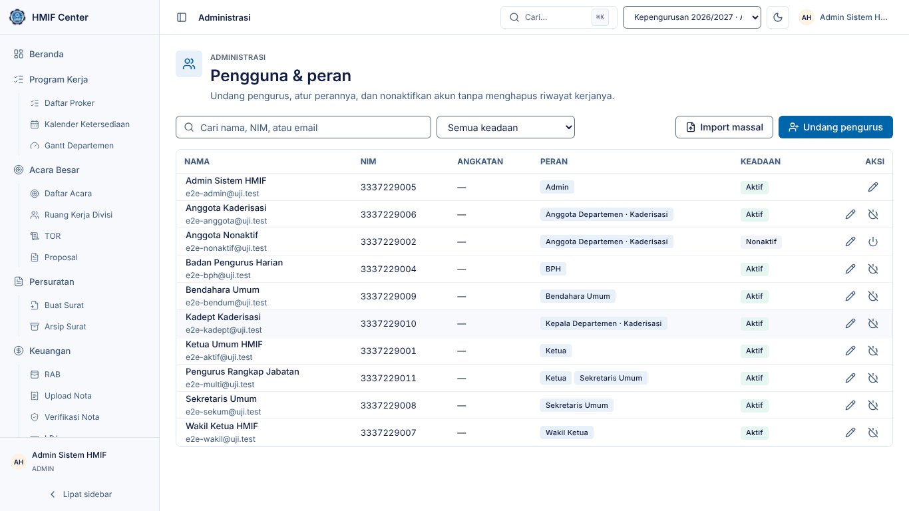
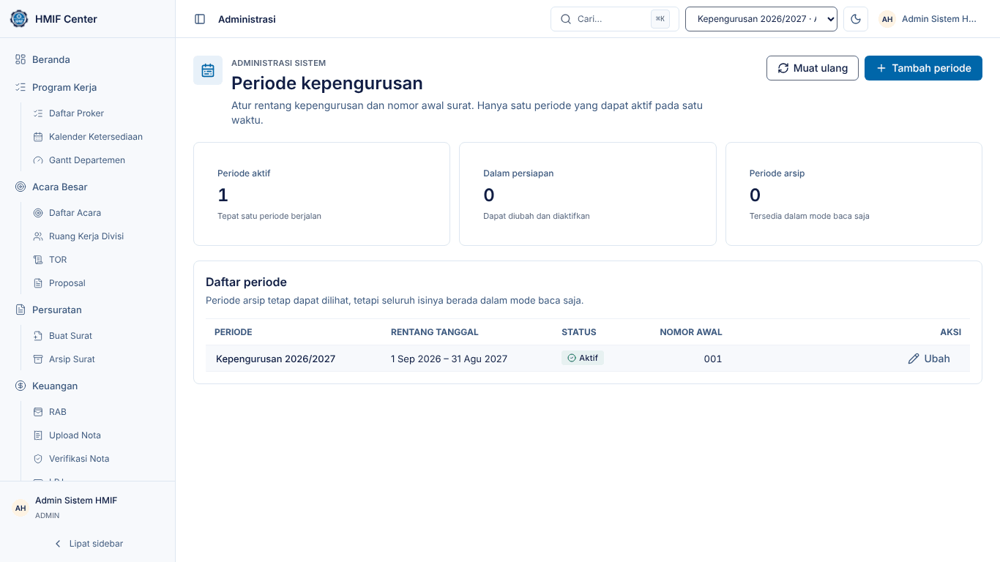
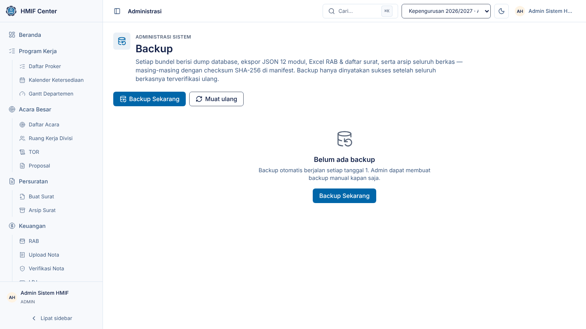
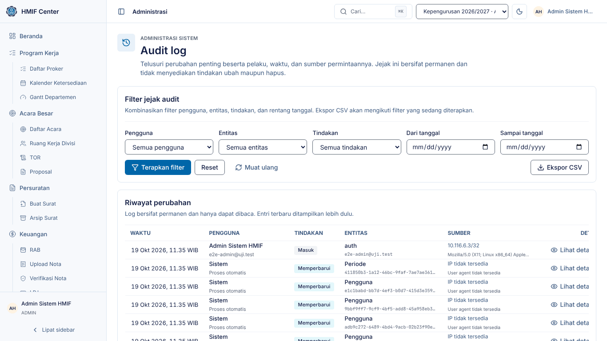

# Panduan Admin — HMIF Center

Untuk pengurus yang memegang peran **Admin**: mengelola akun, peran, periode
kepengurusan, backup, dan memantau audit log. Admin juga dapat membuka seluruh
modul lain dengan akses penuh — untuk alur modul itu, lihat panduan role yang
bersangkutan.

> Tangkapan layar diambil dari lingkungan demo (data contoh). Nama, tanggal,
> dan angka di sistem Anda akan berbeda.

## 1. Masuk dan mengenali layar

1. Buka alamat HMIF Center di browser, lalu isi **Email** dan **Kata sandi**.
2. Klik **Masuk**. Setelah 5 kali gagal dalam 15 menit, login dikunci
   sementara — tunggu sesuai waktu yang ditampilkan.
3. Anda tiba di **Beranda**: Master Gantt seluruh proker, lalu panel Admin di
   bawahnya — kesehatan sistem, statistik pengguna, backup terakhir, dan audit
   terbaru.

Di bagian atas setiap halaman:

- **Cari** (atau tekan `Ctrl`/`⌘` + `K`) membuka palet perintah untuk melompat
  ke halaman mana pun.
- **Pemilih periode** — periode lama dapat dibuka sebagai arsip baca-saja.
- **Tombol tema** terang/gelap.
- **Menu pengguna** (inisial nama di kanan atas) → **Keluar**.

## 2. Menu Anda

Sidebar hanya memuat yang Anda perlukan (ADR-037). Menu lain tetap dapat
dibuka lewat pencarian (**Ctrl/⌘ K**).

| Menu | Akses | Isi |
|---|---|---|
| Beranda | penuh | Master Gantt + panel Admin |
| Administrasi | penuh | Pengguna & Peran, Periode Kepengurusan, Backup & Restore, Audit Log |

## 3. Mengundang pengurus baru

1. Buka **Administrasi → Pengguna & Role**.
2. Klik **Undang pengurus**.
3. Isi nama, NIM, email, dan angkatan; pilih satu atau lebih **peran**. Untuk
   Kepala Departemen dan Anggota, pilih juga **departemennya**.
4. Kirim undangan. Tautan aktivasi (berlaku 7 hari) ditampilkan — klik
   **Salin** dan kirimkan lewat WhatsApp/email bila email tidak sampai.
5. Pengurus membuka tautan, membuat kata sandi (minimal 8 karakter, huruf dan
   angka), lalu dapat masuk.

Email/NIM yang sudah terdaftar pada periode aktif ditolak dengan pesan yang
menyebut kolom mana yang bentrok.

**Banyak pengurus sekaligus:** klik **Import massal**, unggah berkas Excel/CSV
sesuai template, periksa pratinjau (baris bermasalah diberi tanda dan alasan),
lalu konfirmasi. Tautan undangan seluruh baris dapat disalin dengan
**Salin semua tautan**.

## 4. Mengubah peran atau menonaktifkan akun

1. Di **Pengguna & Role**, cari nama/NIM/email di kotak pencarian.
2. Klik ikon **pensil** untuk mengubah peran atau departemen.
3. Klik ikon **daya** untuk menonaktifkan akun. Akun nonaktif tidak bisa masuk,
   tetapi seluruh riwayat kerjanya (surat, nota, audit) tetap utuh. Klik lagi
   untuk **Aktifkan kembali**.

## 5. Periode kepengurusan

1. Buka **Administrasi → Periode Kepengurusan**.
2. Klik **Buat periode**, isi nama dan rentang tanggalnya. Nomor surat periode
   baru mulai dari `001`; bila organisasi memutuskan melanjutkan penomoran,
   isi nomor awal surat di form ini.
3. Saat pergantian pengurus, pilih periode baru lalu **Aktifkan periode** dan
   konfirmasi. Hanya satu periode yang aktif; data periode lama menjadi arsip
   baca-saja. Akun Admin ikut terbawa ke periode baru supaya sistem tetap
   dapat dikelola.

## 6. Backup & restore

**Backup otomatis** berjalan setiap tanggal 1 dan menyimpan 12 backup bulanan
terakhir. Backup manual:

1. Buka **Administrasi → Backup & Restore**.
2. Klik **Backup Sekarang**. Progres tampil di halaman; backup selesai setelah
   seluruh berkas diperiksa ulang checksum-nya.
3. Batas backup manual 3 kali per hari.

**Restore** (hanya bila benar-benar perlu — misalnya data rusak):

1. Pada baris backup, pilih **Restore penuh** atau **Impor per modul**.
2. Sistem SELALU membuat backup pra-restore dulu, lalu memverifikasi berkas.
3. Untuk restore penuh, ketik **HMIF Center** sebagai konfirmasi.
4. Untuk impor per modul, pilih modul dan strategi (**Tambah** — lewati yang
   sudah ada; **Timpa** — ganti seluruh kolom; **Gabung** — isi kolom yang
   berbeda saja), periksa pratinjau baru/berubah/sama, lalu jalankan.
5. Bila proses terputus, buka kembali halaman dan lanjutkan dari tahap terakhir.

## 7. Audit log

1. Buka **Administrasi → Audit Log**.
2. Saring berdasarkan pengguna, tabel/aksi, atau rentang tanggal.
3. Setiap baris mencatat siapa, kapan, dari IP mana, dan perubahan apa. Audit
   log tidak dapat diubah atau dihapus oleh siapa pun.

## 8. Masalah umum

| Gejala | Yang dilakukan |
|---|---|
| Pengurus tidak menerima email undangan | Salin tautan dari halaman Pengguna dan kirim manual |
| "Belum ada periode aktif" saat login | Aktifkan satu periode di Periode Kepengurusan |
| Backup gagal | Lihat pesan di baris backup; coba lagi (kuota 3/hari termasuk percobaan gagal) |
| Pengurus salah peran | Ubah lewat ikon pensil; perubahan tercatat di audit log |
