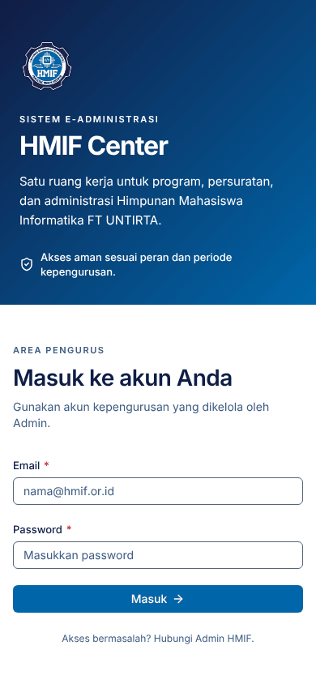
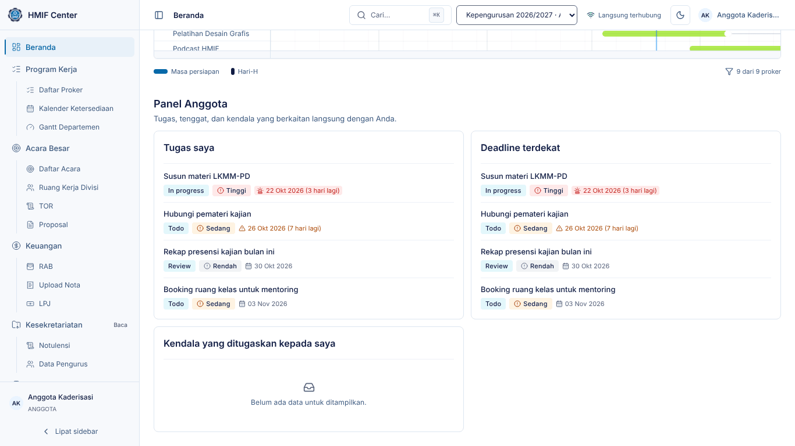
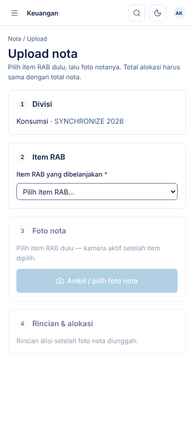
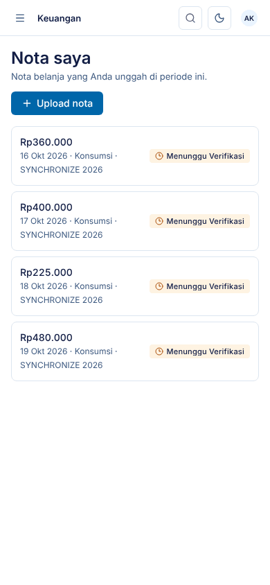
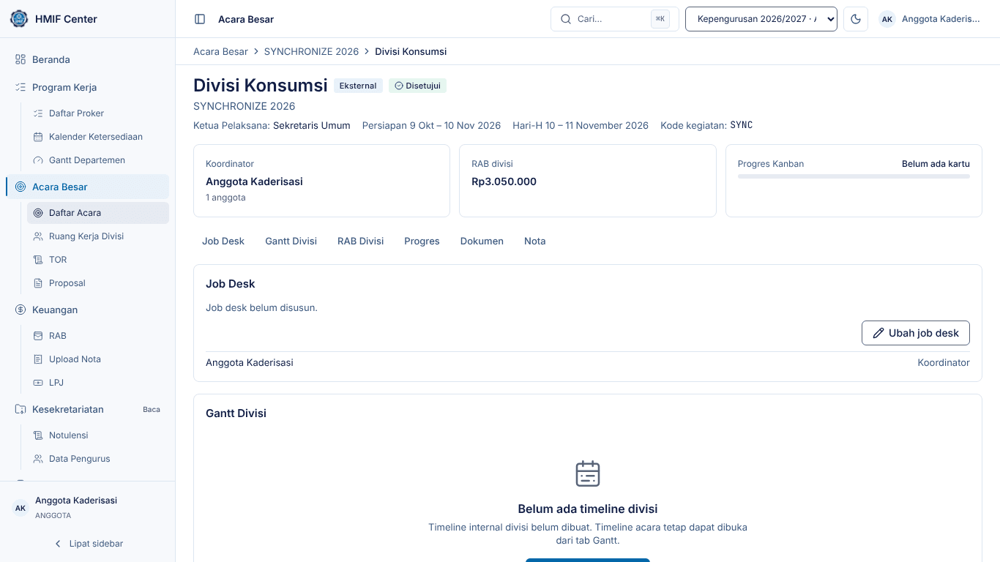
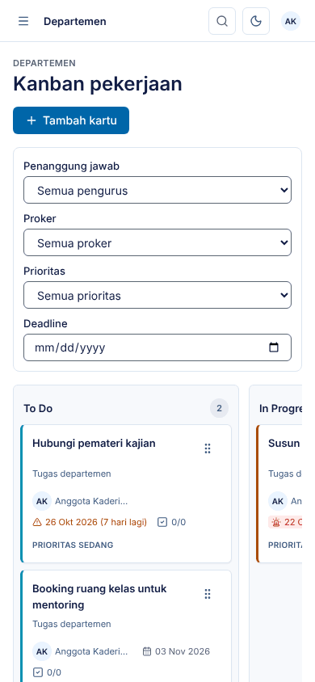

# Panduan Anggota & Panitia — HMIF Center

Untuk **Anggota departemen** dan panitia acara: mengunggah nota belanja dari
ponsel, bekerja di ruang kerja divisi, dan mengerjakan kartu Kanban.

> Tangkapan layar diambil dari lingkungan demo (data contoh). Nama, tanggal,
> dan angka di sistem Anda akan berbeda.

## 1. Masuk dari ponsel

1. Buka alamat HMIF Center di browser ponsel (Chrome/Safari), isi **Email** dan
   **Kata sandi**, ketuk **Masuk**.
2. Menu ada di tombol **☰** kiri atas; ikon kaca pembesar membuka pencarian.
3. Tips: gunakan menu browser **Tambahkan ke layar utama** supaya HMIF Center
   bisa dibuka seperti aplikasi.

Beranda menampilkan Master Gantt seluruh proker dan panel Anda: **tugas saya**,
**deadline terdekat**, dan **kendala saya**.

## 2. Menu Anda

| Menu | Akses | Isi |
|---|---|---|
| Beranda | penuh | Master Gantt + panel Anggota |
| Program Kerja | penuh | Daftar Proker, Kalender Ketersediaan, Gantt Departemen |
| Acara Besar | penuh | Daftar Acara, Ruang Kerja Divisi, TOR, Proposal |
| Keuangan | penuh | RAB, **Upload Nota** (untuk divisi Anda), LPJ |
| Kesekretariatan | baca | Notulensi, Data Pengurus |
| Departemen | penuh | Kanban, Kendala (departemen Anda) |

## 3. Mengunggah nota belanja dari ponsel

1. Buka **Keuangan → Upload Nota**, ketuk **Upload nota**.
2. **Divisi** — terisi otomatis bila Anda hanya di satu divisi; bila lebih,
   pilih divisi yang berbelanja.
3. **Item RAB** — pilih item yang dibelanjakan (boleh lebih dari satu). Kamera
   baru aktif setelah item dipilih, dan hanya item RAB divisi Anda yang muncul.
   Belanja yang tidak ada di RAB: pilih **Pengeluaran di luar RAB**.
4. **Foto nota** — ketuk **Ambil / pilih foto nota**:
   - Arahkan kamera ke nota lalu ketuk tombol **Ambil foto**, atau
   - **Pilih dari galeri** untuk foto yang sudah ada.
   Sistem mendeteksi tepi nota dan meluruskan perspektifnya ("Tepi dokumen
   terdeteksi"). Periksa hasilnya, lalu **Gunakan** atau **Ambil Ulang**.
5. Foto diperkecil dan dibersihkan dari data lokasi di ponsel Anda sebelum
   terkirim — biasanya hanya beberapa detik.
6. **Rincian & alokasi** — isi **Tanggal belanja** dan **Total nota**, lalu
   bagi nominal ke item RAB yang dipilih. Penanda di bawah menunjukkan sisa:
   jumlah alokasi harus **sama persis** dengan total nota.
7. Ketuk **Kirim nota**. Status nota menjadi *Menunggu Verifikasi* Bendahara.

## 4. Memantau dan memperbaiki nota

1. **Keuangan → Upload Nota** menampilkan **Nota saya** beserta statusnya.
2. *Perlu Perbaikan* — Bendahara meminta koreksi data (mis. nominal atau item
   salah). Ketuk **Perbaiki**, ubah datanya (foto tidak perlu diambil ulang),
   lalu **Kirim perbaikan**.
3. *Ditolak* — baca alasannya, lalu unggah nota baru bila memang perlu.
4. *Terverifikasi* — nominal sudah tercatat sebagai pengeluaran acara.

## 5. Ruang kerja divisi

1. Buka **Acara Besar → Ruang Kerja Divisi** dan pilih acara (atau buka acara
   lalu tab **Divisi**).
2. Di halaman divisi Anda tersedia:
   - **Job Desk** — tugas tiap anggota (koordinator dapat **Ubah job desk**).
   - **Gantt Divisi** — timeline internal divisi.
   - **RAB Divisi** — susun item RAB divisi selama RAB masih Draf.
   - **Progres** — kartu Kanban divisi.
   - **Dokumen** dan **Nota** divisi.
3. Divisi lain dapat dilihat sebatas yang diizinkan (ringkasan), tidak
   diubah.

## 6. Kanban

1. Buka **Departemen → Kanban** dan pilih departemen Anda.
2. Saring **Penanggung jawab** ke nama Anda untuk melihat tugas sendiri.
3. Geser kartu (lewat pegangan ⋮⋮) ke kolom berikutnya saat pekerjaan maju:
   **To Do → In Progress → Review → Done**.
4. Buka kartu untuk mencentang **Checklist**. Tanda merah/kuning menunjukkan
   deadline yang dekat atau lewat.

## 7. Melaporkan kendala

1. Buka **Departemen → Kendala**, klik **Lapor kendala**.
2. Isi judul, deskripsi, dan prioritas. Kendala **Kritis** langsung terlihat
   oleh Ketua dan BPH di Beranda mereka.
