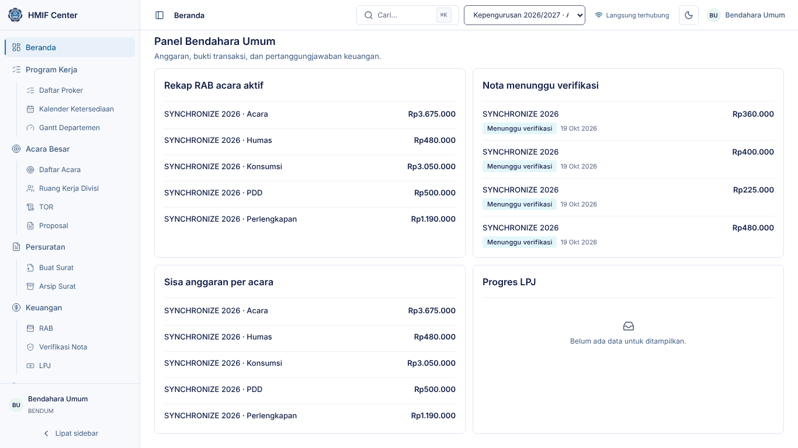
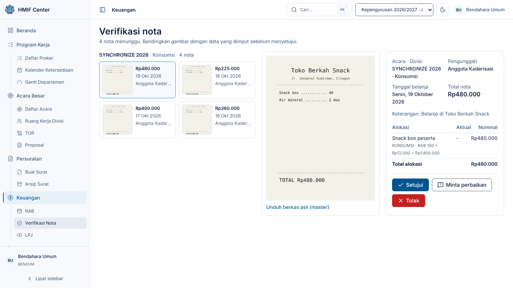
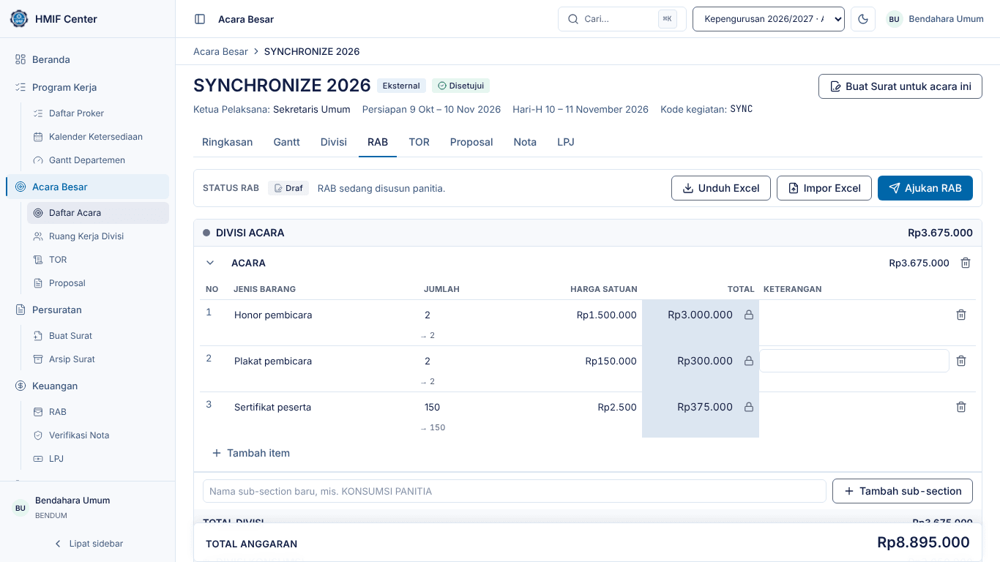
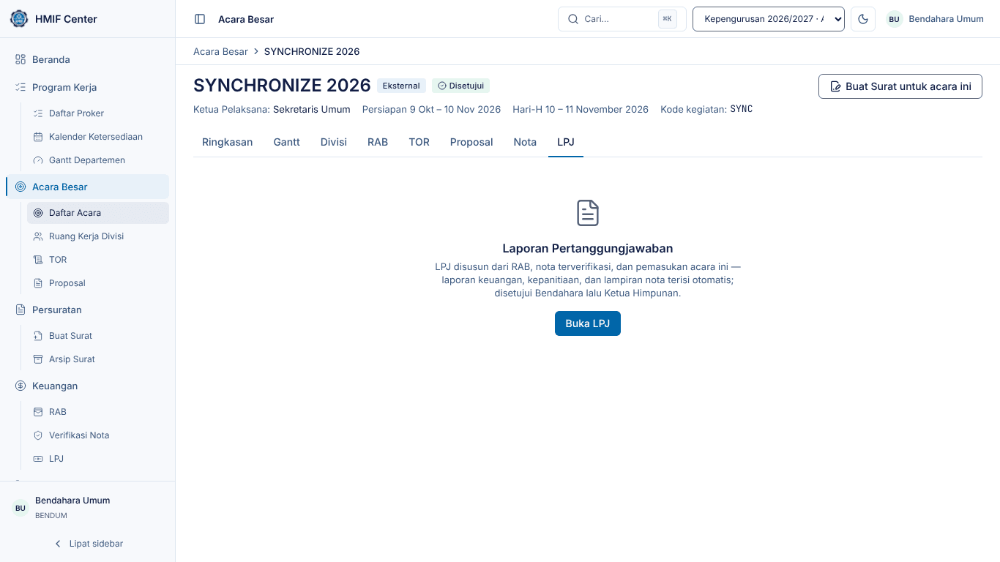

# Panduan Bendahara Umum — HMIF Center

Untuk **Bendahara Umum**: memverifikasi nota panitia, mengunci RAB, memantau
realisasi anggaran, dan menyusun serta menyetujui LPJ.

> Tangkapan layar diambil dari lingkungan demo (data contoh). Nama, tanggal,
> dan angka di sistem Anda akan berbeda.

## 1. Masuk dan Beranda

1. Buka HMIF Center, isi **Email** dan **Kata sandi**, klik **Masuk**.
2. Beranda menampilkan Master Gantt, lalu panel Bendahara: rekap RAB, nota
   yang menunggu verifikasi, sisa anggaran, dan progres LPJ.
3. Tekan `Ctrl`/`⌘` + `K` untuk mencari dan melompat ke halaman mana pun.

## 2. Menu Anda

| Menu | Akses | Isi |
|---|---|---|
| Beranda | penuh | Master Gantt + panel Bendahara |
| Program Kerja | penuh | Daftar Proker, Kalender Ketersediaan, Gantt Departemen |
| Acara Besar | penuh | Daftar Acara, Ruang Kerja Divisi, TOR, Proposal |
| Persuratan | penuh | Buat Surat, Arsip Surat |
| Keuangan | penuh | RAB, **Verifikasi Nota**, LPJ |
| Kesekretariatan | baca | Notulensi, Data Pengurus, Peminjaman Ruangan |
| Departemen | baca | Kanban, Kendala |

## 3. Memverifikasi nota

1. Buka **Keuangan → Verifikasi Nota**. Nota dikelompokkan per acara dan
   divisi; jumlah yang menunggu tertera di atas.
2. Klik kartu nota. Gambar nota tampil di tengah, data yang diinput panitia di
   kanan: tanggal belanja, total nota, keterangan, dan **alokasi** ke item RAB.
3. Bandingkan gambar dengan data, lalu pilih:
   - **Setujui** — nota terverifikasi; nominalnya otomatis masuk **pengeluaran**
     dan **RAB aktual** item yang dialokasikan.
   - **Minta perbaikan** — tulis apa yang harus diperbaiki (mis. nominal atau
     alokasi salah); panitia memperbaiki tanpa mengunggah ulang foto.
   - **Tolak** — tulis alasannya; panitia harus mengunggah nota baru.
4. **Unduh berkas asli (master)** untuk melihat foto resolusi penuh — galeri
   hanya memakai gambar kecil supaya cepat.
5. Salah menyetujui? Di tab **RAB** acara, bagian RAB aktual/pengeluaran, klik
   **Batalkan verifikasi** pada baris nota itu — nota kembali menunggu
   verifikasi, pengeluaran dan RAB aktual dihitung ulang.

## 4. RAB acara

1. Buka **Keuangan → RAB** lalu pilih acara (atau tab **RAB** di halaman acara).
2. Panitia menyusun RAB per divisi: jenis barang, jumlah, harga satuan; total
   per item, divisi, dan acara dihitung seketika. Jumlah berupa teks seperti
   "2 Hari 1 Malam" meminta angka perhitungan terpisah.
3. Status RAB tertera di bilah atas: **Draf** → **Diajukan** (panitia klik
   **Ajukan RAB**) → **Disetujui** (terkunci).
4. Saat RAB diajukan, periksa lalu klik **Setujui & kunci**, atau
   **Kembalikan** dengan catatan untuk diperbaiki.
5. RAB terkunci tidak dapat diubah siapa pun. Bila perlu diubah, klik
   **Buka kunci** dan tulis alasannya (minimal 10 karakter) — tercatat di audit
   log.
6. **Unduh Excel** menghasilkan berkas RAB sesuai template HMIF (4 sheet:
   RAB, PEMASUKAN, PENGELUARAN, RAB AKTUAL). **Impor Excel** membaca kembali
   berkas berformat sama.

Setelah nota pertama diverifikasi, RAB berstatus **Realisasi** dan tab
**Nota** serta sheet RAB Aktual menunjukkan rencana vs. realisasi per item.

## 5. LPJ

1. Buka **Keuangan → LPJ** lalu pilih acara, klik **Buka LPJ**.
2. **Prasyarat** harus terpenuhi: minimal satu nota terverifikasi, RAB sudah
   Realisasi, dan minimal satu foto dokumentasi.
3. Lengkapi bagian manual (pendahuluan, pelaksanaan kegiatan, narasi per
   divisi, penutup, pejabat lembar pengesahan) dan unggah foto dokumentasi.
   Laporan keuangan dan **lampiran nota** terisi otomatis dari nota
   terverifikasi.
4. Klik **Buat dokumen LPJ** untuk menghasilkan DOCX, periksa, lalu
   **Ajukan**.
5. Sebagai Bendahara, periksa LPJ yang diajukan lalu **Setujui** — LPJ diteruskan
   ke Ketua untuk **Setujui & finalkan**. Bila ada kesalahan, **Kembalikan**
   dengan catatan; LPJ kembali ke draf.
6. LPJ final dibekukan; **Unduh LPJ** kapan saja dari tab yang sama.

## 6. Tips

- Nota yang alokasinya tidak sama dengan totalnya tidak bisa dikirim panitia,
  jadi selisih yang Anda temukan biasanya salah input item — minta perbaikan.
- Pengeluaran di luar RAB tetap tercatat (ditandai "di luar RAB") dan ikut
  dilaporkan di LPJ.
