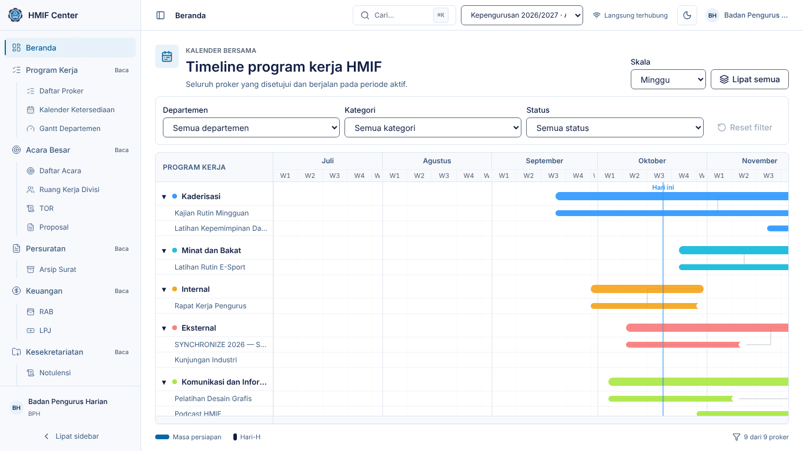
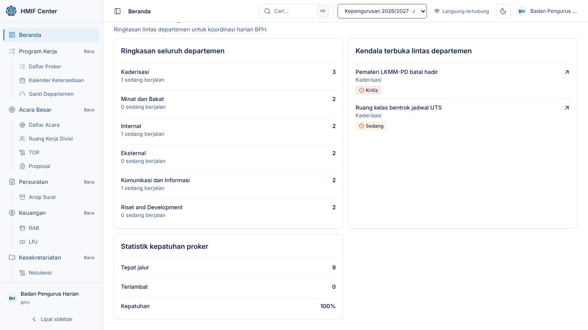
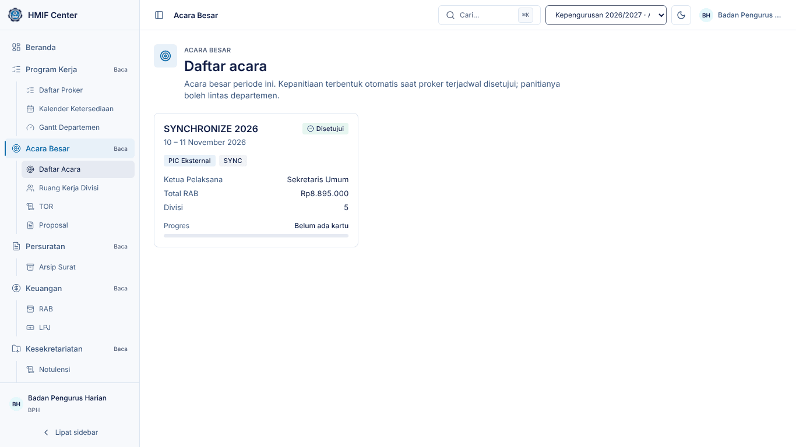
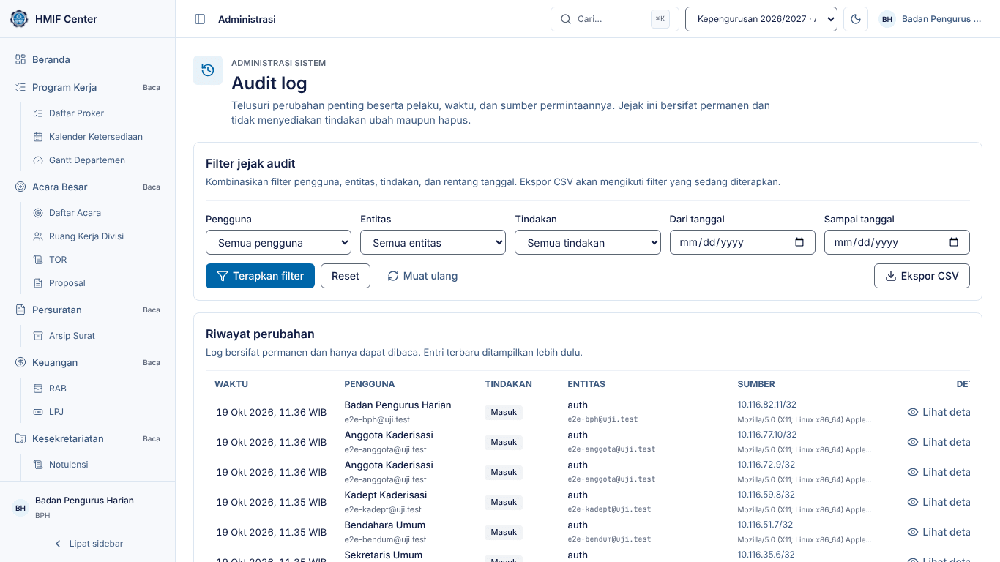

# Panduan Badan Pengurus Harian (BPH) — HMIF Center

Untuk **BPH**: memantau seluruh kegiatan himpunan tanpa mengubah data. Semua
menu Anda berlabel **Baca** — Anda dapat membuka, mencari, dan mengunduh,
tetapi tidak menyunting.

> Tangkapan layar diambil dari lingkungan demo (data contoh). Nama, tanggal,
> dan angka di sistem Anda akan berbeda.

## 1. Masuk dan Beranda

1. Buka HMIF Center, isi **Email** dan **Kata sandi**, klik **Masuk**.
2. Beranda menampilkan **Master Gantt** seluruh proker yang disetujui dan
   berjalan. Saring per departemen/kategori/status, ubah **Skala**, atau
   **Lipat semua** untuk ringkasan per departemen.
3. Gulir ke bawah untuk panel BPH: **ringkasan per departemen**, **kendala
   lintas departemen** (termasuk yang Kritis), dan **statistik kepatuhan**.

Tekan `Ctrl`/`⌘` + `K` untuk mencari dan melompat ke halaman mana pun.

## 2. Menu Anda

| Menu | Akses | Isi |
|---|---|---|
| Beranda | penuh | Master Gantt + panel BPH |
| Program Kerja | baca | Daftar Proker, Kalender Ketersediaan, Gantt Departemen |
| Acara Besar | baca | Daftar Acara, Ruang Kerja Divisi, TOR, Proposal |
| Persuratan | baca | Arsip Surat |
| Keuangan | baca | RAB, LPJ |
| Kesekretariatan | baca | Notulensi, Data Pengurus, Peminjaman Ruangan |
| Departemen | baca | Kanban, Kendala |
| Administrasi | baca | Audit Log |

## 3. Memantau program kerja

1. **Program Kerja → Daftar Proker**: seluruh proker periode berjalan dengan
   statusnya (ikon + teks). Saring per departemen, kategori, atau status.
2. **Kalender Ketersediaan**: rentang yang dikunci acara besar.
3. **Gantt Departemen**: timeline tiap departemen.

## 4. Memantau acara dan keuangan

1. **Acara Besar → Daftar Acara** → pilih acara: ringkasan, Gantt, divisi, RAB,
   TOR, proposal, nota, dan LPJ dalam tab.
2. Tab **RAB** menunjukkan rencana vs. realisasi (RAB aktual dari nota yang
   diverifikasi Bendahara).
3. Tab **LPJ**: unduh LPJ final untuk diperiksa.

## 5. Memantau persuratan dan kesekretariatan

1. **Persuratan → Arsip Surat**: cari surat berdasarkan perihal/tujuan/isi,
   saring per status atau kegiatan, unduh surat terbit.
2. **Kesekretariatan → Notulensi**: baca notulensi rapat dan action item-nya.

## 6. Audit log

1. Buka **Administrasi → Audit Log**.
2. Saring per pengguna, aksi/tabel, atau rentang tanggal untuk menelusuri siapa
   mengubah apa dan kapan. Audit log tidak dapat diubah atau dihapus.

## 7. Bila menemukan masalah

BPH tidak menyunting data. Sampaikan temuan kepada pengurus terkait (Kadept,
Sekum, Bendahara, atau Ketua); kendala Kritis yang Anda lihat di Beranda sudah
pasti terlihat juga oleh Ketua.
