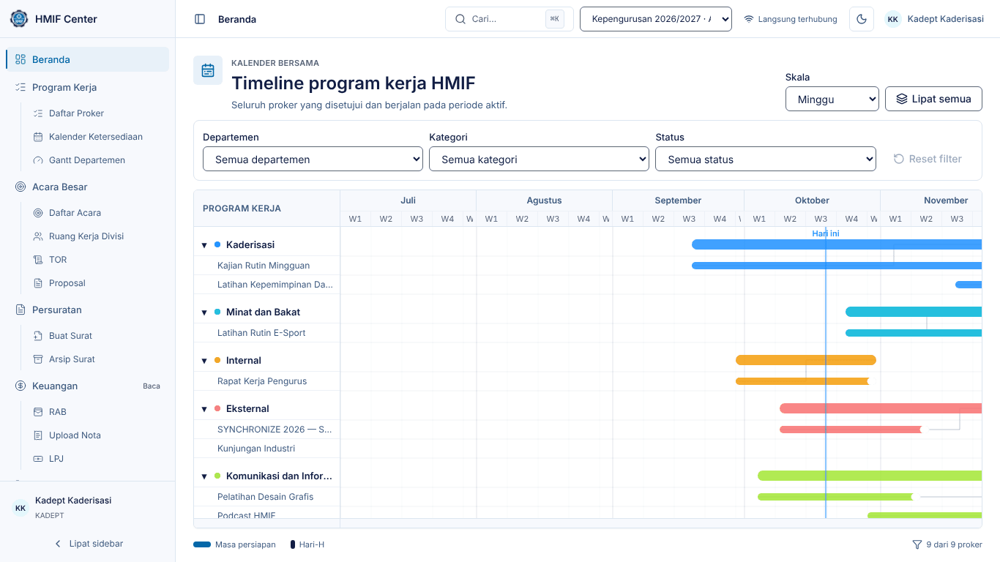
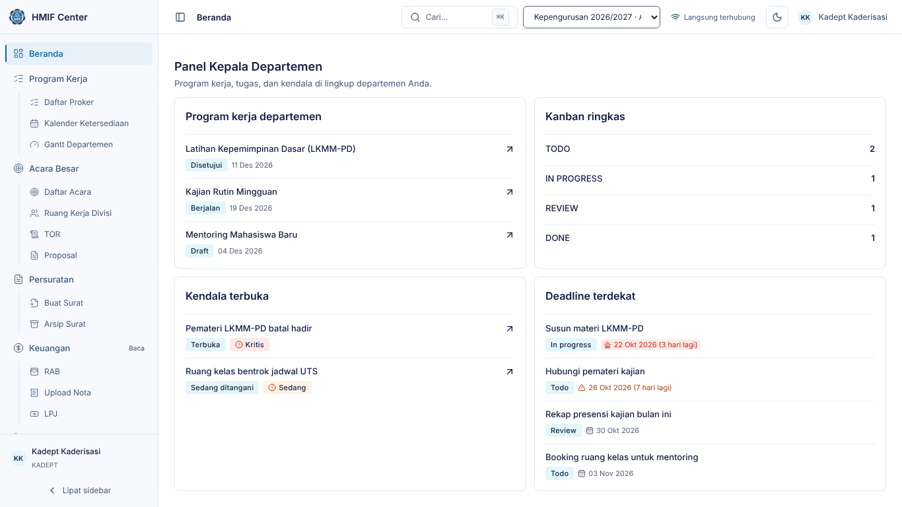
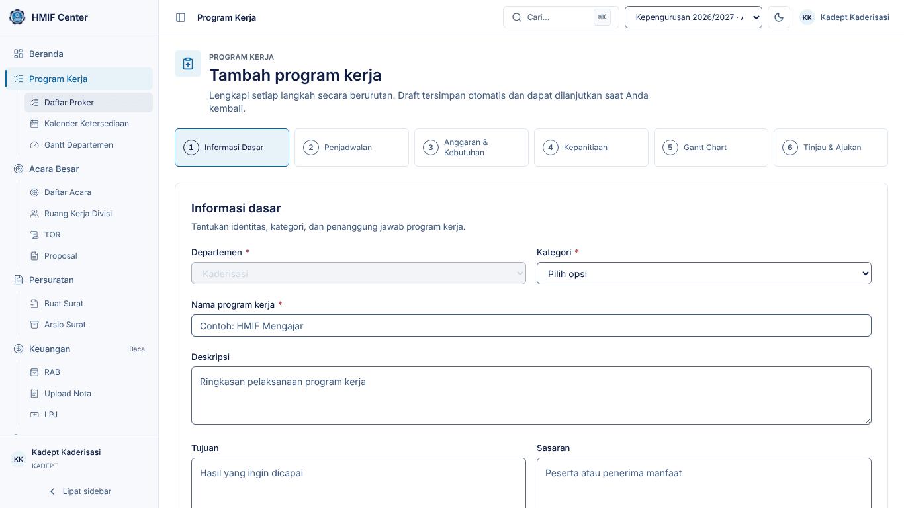
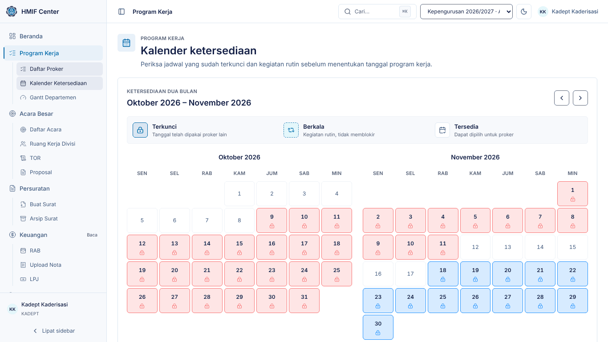
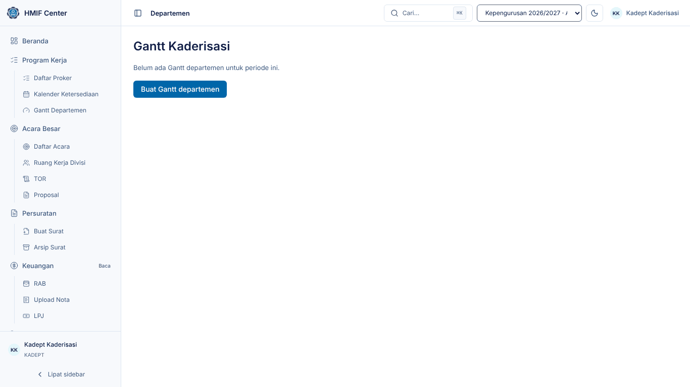
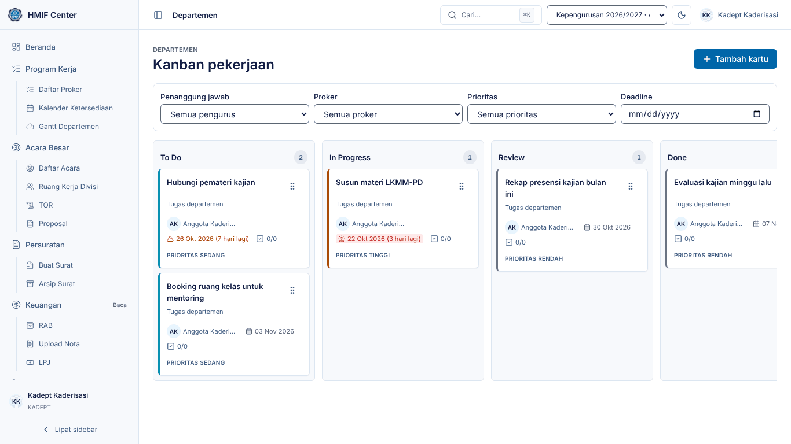
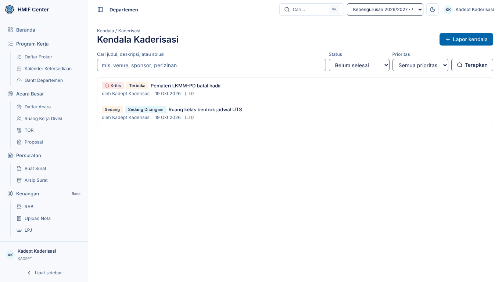

# Panduan Kepala Departemen — HMIF Center

Untuk **Kepala Departemen (Kadept)**: mengajukan program kerja departemen,
memeriksa ketersediaan kalender, mengelola Gantt, Kanban, dan kendala
departemen.

> Tangkapan layar diambil dari lingkungan demo (data contoh). Nama, tanggal,
> dan angka di sistem Anda akan berbeda.

## 1. Masuk dan Beranda

1. Buka HMIF Center, isi **Email** dan **Kata sandi**, klik **Masuk**.
2. Beranda menampilkan Master Gantt seluruh proker HMIF — gunakan saringan
   **Departemen** untuk fokus ke departemen Anda — lalu panel Kadept di bawahnya
   (proker departemen, ringkasan Kanban, kendala terbuka, deadline terdekat).
3. Tekan `Ctrl`/`⌘` + `K` untuk mencari dan melompat ke halaman mana pun.

## 2. Menu Anda

Sidebar hanya memuat yang Anda perlukan (ADR-037). Menu lain tetap dapat
dibuka lewat pencarian (**Ctrl/⌘ K**).

| Menu | Akses | Isi |
|---|---|---|
| Beranda | penuh | Master Gantt + panel Kadept |
| Departemen Saya | penuh | Kanban, Kendala, Gantt Departemen (departemen Anda) |
| Program Kerja | penuh | Daftar Proker, Buat Proker, Kalender Ketersediaan |
| Acara Besar | penuh | Daftar acara; RAB, TOR, Proposal, Divisi di tab tiap acara |
| Kesekretariatan | penuh | Notulensi, Peminjaman Ruangan |
| Surat Keterangan Aktif | penuh | Ajukan SK Aktif atas nama sendiri |

**Surat.** Surat dibuat Sekretaris Umum. Anda dapat mengajukan **Surat
Keterangan Aktif** atas nama sendiri lewat menu **Surat Keterangan Aktif**: isi
keperluannya, nama/NIM/jabatan terisi dari Data Pengurus, dan surat yang sudah
terbit dapat diunduh di halaman yang sama (ADR-036).

## 3. Mengajukan program kerja (wizard 6 langkah)

1. Buka **Program Kerja → Daftar Proker**, klik **Tambah proker** di kanan atas
   (atau `Ctrl`/`⌘` + `K` → **Buat Proker Baru**).
2. **Informasi Dasar** — departemen terisi otomatis. Pilih **Kategori**:
   - *Terjadwal* — acara besar dengan masa persiapan dan Hari-H; mengunci
     kalender setelah disetujui dan otomatis membentuk kepanitiaan.
   - *Berkala* — kegiatan rutin (setiap minggu/bulan).
   - *Responsif* — kegiatan yang muncul sesuai kebutuhan.
   Isi nama, deskripsi, tujuan, sasaran, dan penanggung jawab.
3. **Penjadwalan** — pilih tanggal mulai persiapan dan Hari-H. Untuk proker
   terjadwal, masa persiapan wajib **15–45 hari** sebelum Hari-H.
   Bila rentang Anda menabrak acara yang sudah mengunci kalender, muncul
   peringatan **Konflik jadwal** beserta nama proker dan departemen yang
   bertabrakan, dan tombol **Lanjut** tertahan. **Geser tanggal** sampai
   peringatan hilang — lihat
   **Kalender Ketersediaan** (bagian 4) untuk mencari rentang kosong.
4. **Anggaran & Kebutuhan** — estimasi anggaran, peserta, sumber dana,
   kebutuhan barang dan ruangan.
5. **Kepanitiaan** (terjadwal) — nama acara, tema, divisi, dan anggotanya.
6. **Gantt Chart** — rencana timeline awal per fase.
7. **Tinjau & Ajukan** — periksa ringkasan, lalu **Ajukan proker**. Sistem
   memeriksa konflik sekali lagi; proker masuk **Antrian Approval** Ketua/Wakil.

Draf tersimpan otomatis di setiap langkah — Anda dapat berhenti dan melanjutkan
nanti dari Daftar Proker.

Bila Ketua meminta **revisi**, proker berstatus *Perlu revisi* beserta
catatannya: buka proker, perbaiki, ajukan lagi.

## 4. Kalender ketersediaan

1. Buka **Program Kerja → Kalender Ketersediaan**.
2. Tanggal yang sudah dikunci acara lain ditandai beserta nama proker dan
   departemennya (arahkan kursor/ketuk tanggal untuk detail).
3. Pakai kalender ini **sebelum** mengisi langkah Penjadwalan supaya pengajuan
   tidak bentrok.

## 5. Mengubah proker yang sudah disetujui

1. Buka proker di **Daftar Proker** → ubah.
2. Perubahan kecil (nama, deskripsi, tujuan, sasaran, estimasi, penanggung
   jawab, sumber dana) langsung tersimpan;
   status dan kunci kalender tidak berubah.
3. Perubahan besar — **tanggal apa pun, kategori, atau departemen** — diajukan
   sebagai **revisi** dan menunggu persetujuan Ketua/Wakil (sistem memberi
   peringatan sebelum Anda menyimpan). Selama menunggu, jadwal lama tetap
   berlaku dan tetap mengunci kalender.

## 6. Gantt departemen dan acara

1. Buka **Departemen Saya → Gantt Departemen**. Pada periode baru, klik
   **Buat Gantt departemen** sekali. Di ponsel, Gantt tampil sebagai **Daftar**
   (kartu per tugas berisi tanggal, status, dan progres); ketuk **Grafik**
   untuk bagan lengkap.
2. Tambah grup dan task (contoh chart yang sudah terisi di bawah); seret bar untuk menggeser tanggal, seret tepi bar
   untuk mengubah durasi (atau fokuskan bar lalu tekan panah kiri/kanan;
   `Shift` + panah mengubah durasi).
3. Ganti **Skala** Minggu/Bulan/Kuartal; ekspor ke PNG bila perlu dibagikan.
4. Gantt per proker, ketua pelaksana, dan divisi dibuka dari daftar Gantt atau
   tab **Gantt** halaman acara.

## 7. Kanban departemen

1. Buka **Departemen Saya → Kanban**.
2. **Tambah kartu**: judul, penanggung jawab, prioritas, deadline, proker
   terkait (opsional), lalu **Simpan kartu**.
3. Seret kartu lewat pegangan ⋮⋮ antar-kolom **To Do → In Progress → Review →
   Done**. Dengan keyboard: fokus pegangan, tekan `Spasi`, pindah dengan
   panah, `Spasi` lagi untuk meletakkan. Di ponsel, papan tampil satu kolom
   per layar dengan tab status, dan kartu dipindah lewat pilihan **Status**.
4. Buka kartu untuk **Checklist** langkah-langkah kecil; progres checklist
   tampil di kartu.
5. Saring per penanggung jawab, proker, prioritas, atau deadline. Kartu yang
   mendekati deadline ditandai.

## 8. Kendala

1. Buka **Departemen Saya → Kendala**, klik **Lapor kendala**.
2. Isi judul, deskripsi, **prioritas** (Rendah/Sedang/Tinggi/Kritis),
   penanggung jawab, dan proker terkait (opsional).
3. Perbarui status saat ditangani. Menutup kendala sebagai **Selesai** wajib
   disertai **catatan penyelesaian**.
4. Kendala **Kritis** langsung tampil di Beranda Ketua, Wakil, BPH, dan Admin.
