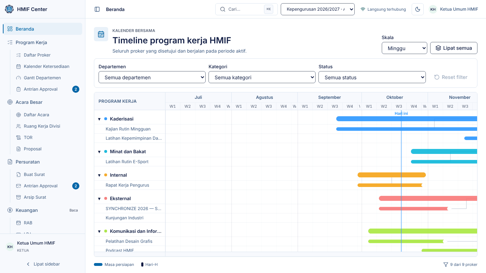
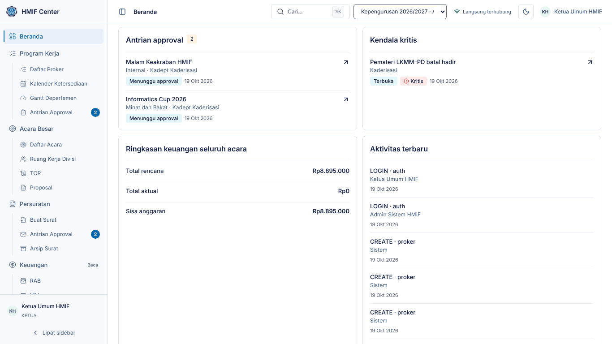
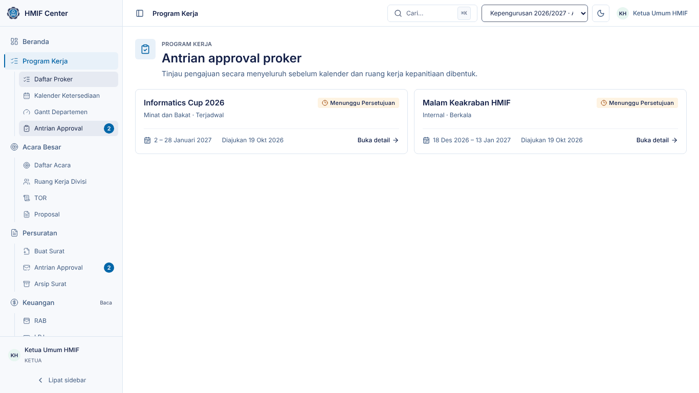
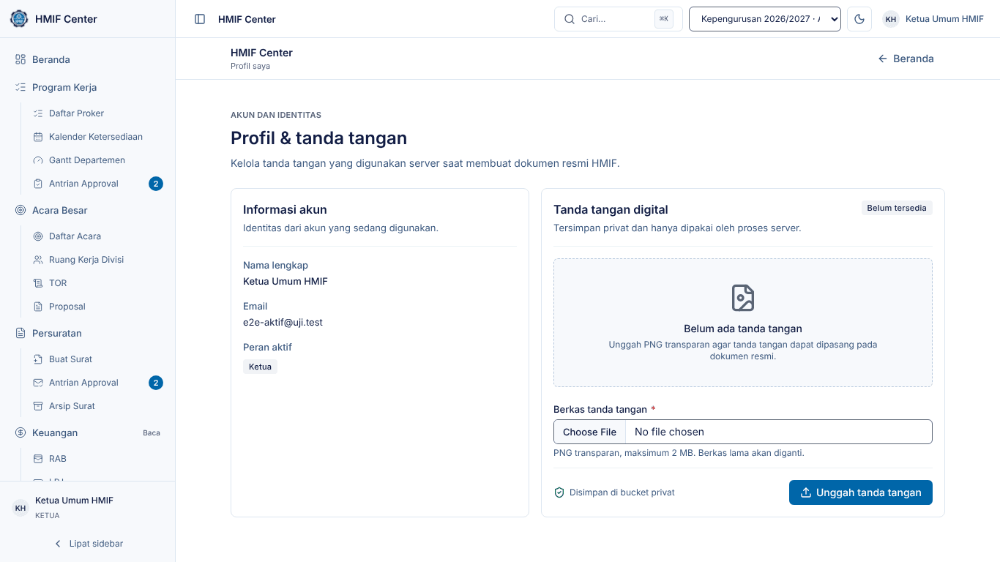

# Panduan Ketua Umum — HMIF Center

Untuk **Ketua Umum HMIF**: menyetujui program kerja dan surat, memantau
seluruh departemen dari Beranda, menyetujui LPJ akhir, dan menyediakan tanda
tangan untuk surat resmi.

> Tangkapan layar diambil dari lingkungan demo (data contoh). Nama, tanggal,
> dan angka di sistem Anda akan berbeda.

## 1. Masuk dan Beranda

1. Buka HMIF Center, isi **Email** dan **Kata sandi**, klik **Masuk**.
2. Beranda menampilkan **Master Gantt** — timeline seluruh proker yang disetujui
   dan berjalan, dikelompokkan per departemen. Garis biru "Hari ini" menandai
   tanggal sekarang; bagian gelap pada bar adalah Hari-H.
3. Ubah **Skala** (Minggu/Bulan/Kuartal), saring per departemen, kategori, atau
   status, dan klik **Lipat semua** untuk ringkasan per departemen.
4. Indikator **Langsung terhubung** di atas berarti perubahan proker dari
   pengurus lain muncul otomatis tanpa memuat ulang halaman.

Gulir ke bawah untuk panel Ketua: **Antrian approval**, **Kendala kritis**
seluruh departemen, **Ringkasan keuangan** seluruh acara, dan **Aktivitas
terbaru**.

## 2. Menu Anda

| Menu | Akses | Isi |
|---|---|---|
| Beranda | penuh | Master Gantt + panel Ketua |
| Program Kerja | penuh | Daftar Proker, Kalender Ketersediaan, Gantt Departemen, **Antrian Approval** |
| Acara Besar | penuh | Daftar Acara, Ruang Kerja Divisi, TOR, Proposal |
| Persuratan | penuh | Buat Surat, **Antrian Approval**, Arsip Surat |
| Keuangan | baca | RAB, LPJ |
| Kesekretariatan | baca | Notulensi, Data Pengurus, Peminjaman Ruangan |
| Departemen | baca | Kanban, Kendala |
| Administrasi | baca | Audit Log |

Angka bulat di samping **Antrian Approval** = jumlah yang menunggu keputusan
Anda.

## 3. Menyetujui program kerja

1. Buka **Program Kerja → Antrian Approval** (atau klik item di panel Antrian
   approval Beranda).
2. Pilih proker untuk membuka detailnya: departemen pengusul, masa persiapan,
   Hari-H, penanggung jawab, estimasi peserta & anggaran, sumber dana, dan
   rencana kepanitiaan.
3. Tentukan keputusan:
   - **Setujui** — sistem menjalankan pemeriksaan bentrok jadwal terakhir.
     Proker *terjadwal* yang disetujui **mengunci kalender** pada rentangnya,
     sehingga departemen lain tidak dapat mengajukan acara besar di tanggal
     yang sama. Untuk acara besar, kepanitiaan dan ruang kerjanya terbentuk
     otomatis.
   - **Minta revisi** — proker kembali ke pengusul untuk diperbaiki.
   - **Tolak** — proker ditutup.
4. Untuk **Tolak** dan **Minta revisi**, isi **Alasan penolakan atau catatan
   revisi** — wajib, dan dibaca langsung oleh pengusul.

Bila persetujuan ditolak karena bentrok (pengajuan lain lebih dulu disetujui
di rentang yang sama), detail menampilkan proker yang bertabrakan; minta
pengusul menggeser tanggal.

## 4. Menyetujui surat

1. Buka **Persuratan → Antrian Approval**.
2. Buka surat untuk melihat pratinjaunya.
3. Klik **Setujui** — nomor surat dialokasikan otomatis dan berurutan, lalu
   dokumen DOCX dibuat dengan tanda tangan Ketua Himpunan. Surat berstatus **Terbit**
   dan dapat diunduh pembuatnya (**Unduh DOCX**).
4. Atau **Tolak** dan tulis alasannya; surat kembali ke pembuat untuk
   diperbaiki.

Beberapa surat dapat disetujui sekaligus dari antrian. Nomor surat yang sudah
terbit tidak pernah dipakai ulang, termasuk bila suratnya kemudian dibatalkan.

## 5. Tanda tangan untuk surat

1. Buka menu pengguna (kanan atas) → **Profil**.
2. Unggah gambar tanda tangan (PNG berlatar transparan paling rapi).
3. Tanda tangan ini dipasang pada **setiap** surat resmi HMIF, siapa pun yang
   menyetujuinya (Ketua, Wakil, atau Sekum). Selama belum diunggah, surat
   tidak dapat terbit dan persetujuan berhenti dengan pesan "… (Ketua
   Himpunan) belum mengunggah tanda tangan" — unggah dulu, lalu setujui lagi.

## 6. LPJ akhir acara

1. Buka **Acara Besar → Daftar Acara**, pilih acara, tab **LPJ**.
2. Setelah Bendahara menyetujui, tombol **Setujui & finalkan** tersedia untuk
   Anda. Periksa dokumen LPJ (unduh bila perlu), lalu setujui.
3. Bila ada yang harus diperbaiki, pilih **Kembalikan** dan tulis catatan untuk
   panitia.

## 7. Memantau

- **Kendala kritis** di Beranda diperbarui otomatis saat ada kendala berprioritas
  Kritis dari departemen mana pun. Klik untuk melihat detail dan
  penanganannya.
- **Departemen → Kanban/Kendala** dan **Keuangan → RAB/LPJ** dapat Anda buka
  dalam mode baca.
- **Administrasi → Audit Log** mencatat setiap perubahan data — siapa, kapan,
  dan apa.
