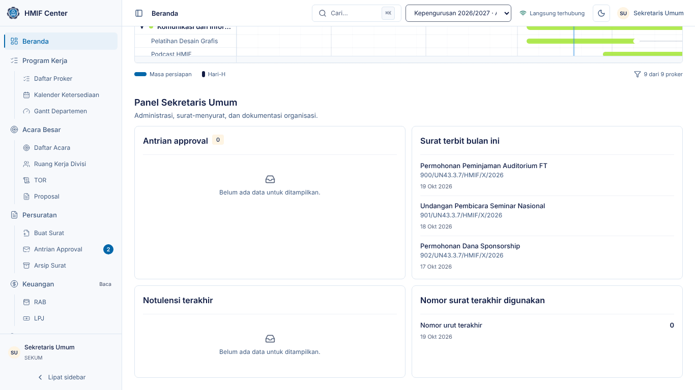
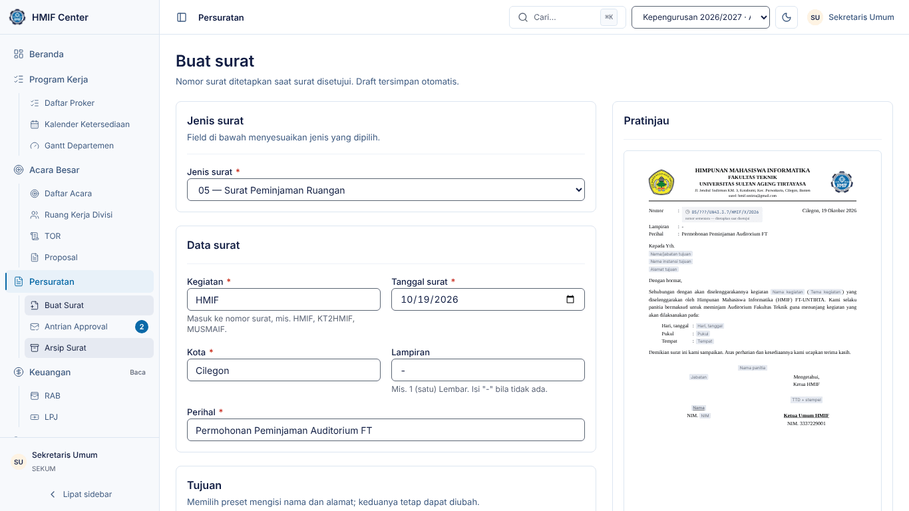
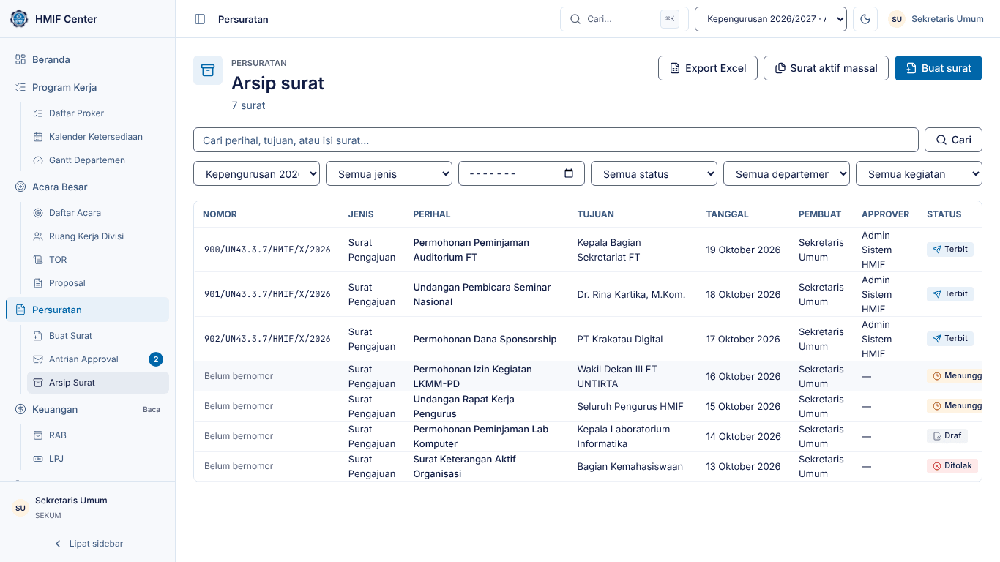
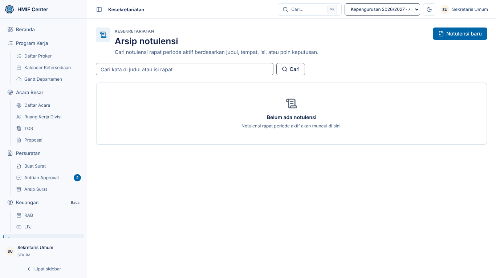
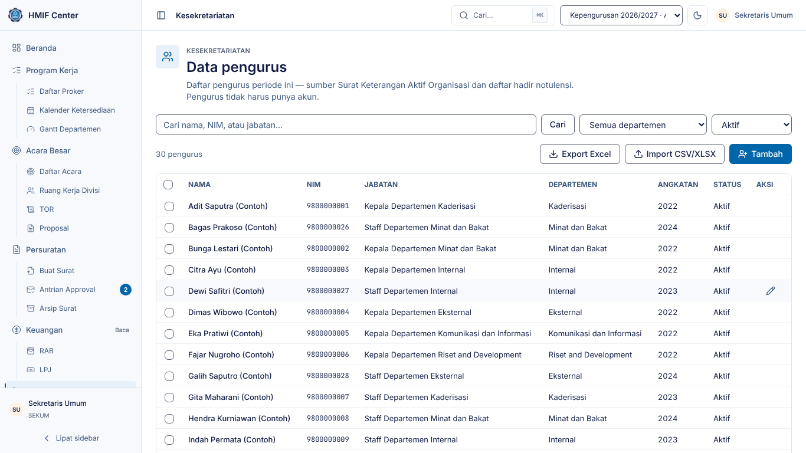
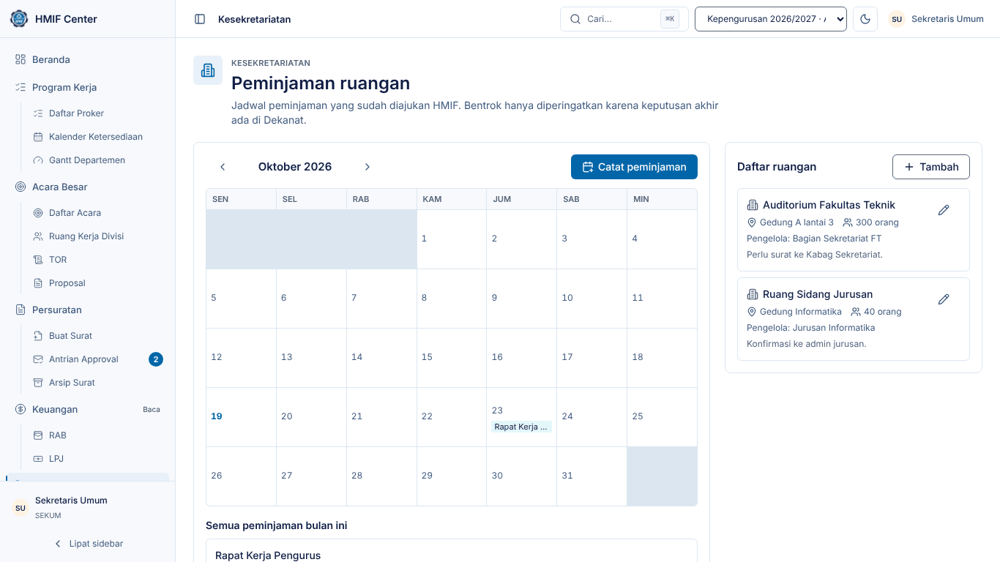
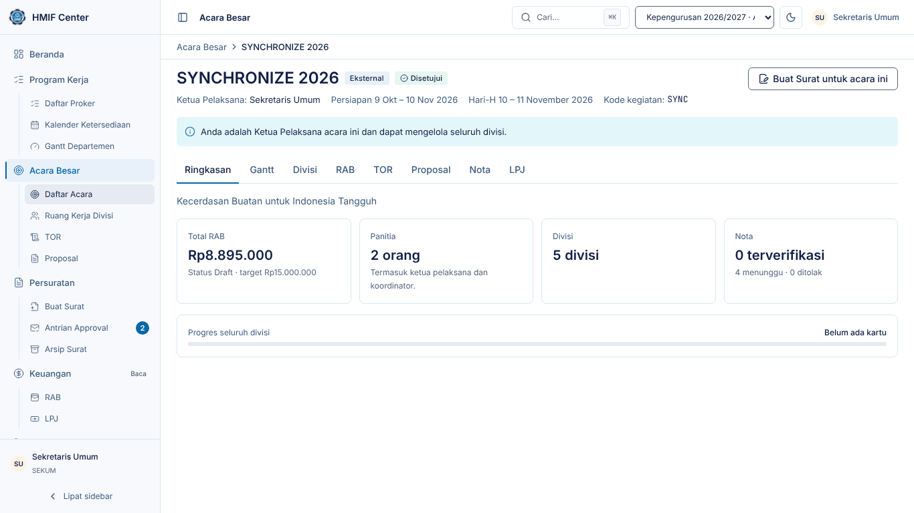
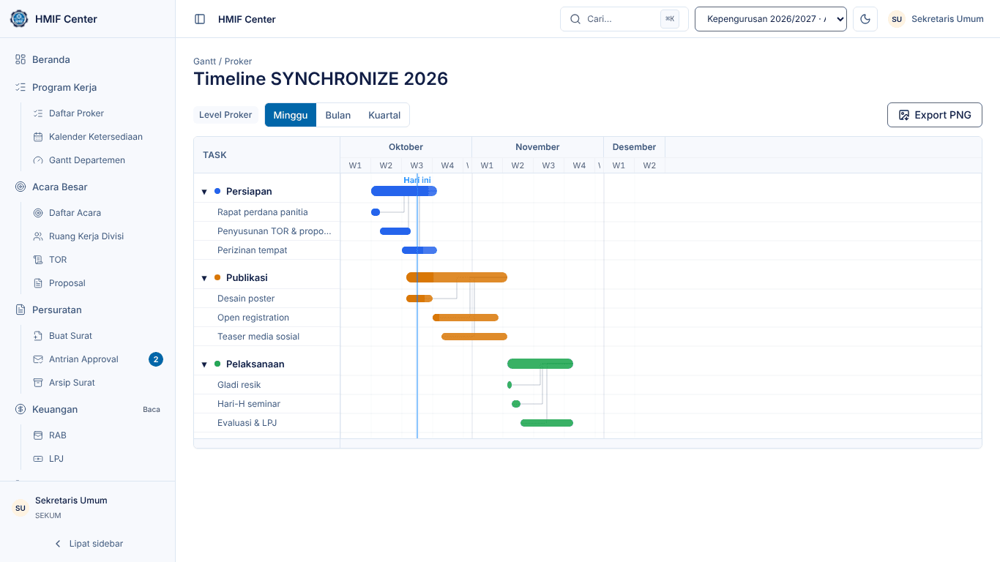
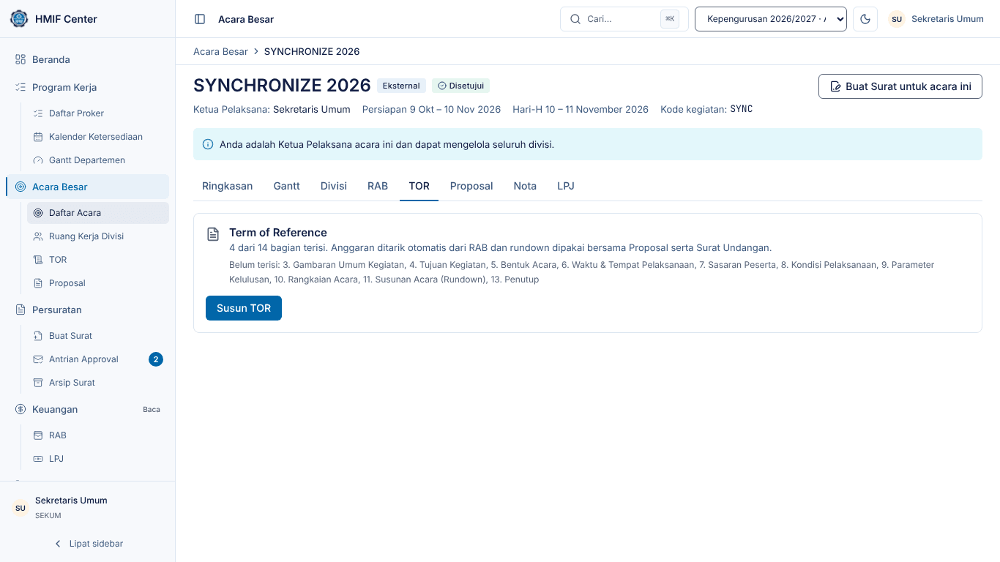

# Panduan Sekretaris Umum — HMIF Center

Untuk **Sekretaris Umum**: membuat dan menyetujui surat, mengelola arsip surat,
notulensi rapat, data pengurus, dan peminjaman ruangan.

> Tangkapan layar diambil dari lingkungan demo (data contoh). Nama, tanggal,
> dan angka di sistem Anda akan berbeda.

## 1. Masuk dan Beranda

1. Buka HMIF Center, isi **Email** dan **Kata sandi**, klik **Masuk**.
2. Beranda menampilkan Master Gantt seluruh proker, lalu panel Sekum di
   bawahnya: antrian approval, surat terbit bulan ini, notulensi terakhir, dan
   nomor surat terakhir.
3. Tekan `Ctrl`/`⌘` + `K` untuk mencari dan melompat ke halaman mana pun.

## 2. Menu Anda

Sidebar hanya memuat yang Anda perlukan (ADR-037). Menu lain tetap dapat
dibuka lewat pencarian (**Ctrl/⌘ K**).

| Menu | Akses | Isi |
|---|---|---|
| Beranda | penuh | Master Gantt + panel Sekum |
| Persuratan | penuh | **Buat Surat**, Surat Aktif Massal, **Antrian Approval**, Arsip Surat |
| Kesekretariatan | penuh | Notulensi, Data Pengurus, Peminjaman Ruangan |
| Program Kerja | baca | Daftar Proker, Kalender Ketersediaan |
| Acara Besar | baca | Daftar acara; TOR, Proposal, RAB di tab tiap acara |

Hanya Anda (dan Admin) yang membuat surat dari formulir — semua jenis.
Pengurus lain mengajukan **Surat Keterangan Aktif** atas nama sendiri; pengajuan
itu masuk ke **Antrian Approval** Anda seperti surat lain (ADR-036).

## 3. Membuat surat

1. Buka **Persuratan → Buat Surat**, pilih **jenis surat** (dan sub-jenisnya
   bila ada, mis. Peminjaman Ruangan).
2. Isi form di kiri. Pratinjau di kanan berubah seketika saat Anda mengetik;
   bagian abu-abu menandai isian yang belum diisi.
3. **Preset tujuan** mengisi nama dan alamat tujuan sekaligus; keduanya tetap
   dapat diubah.
4. Nomor di pratinjau masih **sementara** (`???`). Nomor resmi baru
   dialokasikan saat surat disetujui.
5. Draf tersimpan otomatis — Anda dapat menutup halaman dan melanjutkan nanti.
6. Klik **Ajukan** setelah semua kolom wajib terisi (tombol nonaktif dan
   menyebut kolom yang kurang selama belum lengkap). Surat masuk antrian
   approval Ketua, Wakil, dan Sekum.

Surat untuk sebuah acara dapat dibuat langsung dari halaman acara lewat
**Buat Surat untuk acara ini** — kegiatan terisi otomatis.

## 4. Menyetujui surat

1. Buka **Persuratan → Antrian Approval**, buka surat, periksa pratinjaunya.
2. **Setujui** — nomor dialokasikan berurutan dan DOCX terbit dengan tanda
   tangan Ketua Himpunan (pastikan Ketua sudah mengunggahnya di Profil).
3. Atau **Tolak** dengan alasan; surat berstatus Ditolak dan pembuatnya dapat
   memperbaiki lalu mengajukannya lagi.
4. Surat massal (bagian 6) tidak muncul satu per satu di antrian — antrian
   menautkan ke halaman massal, dan satu batch disetujui sekaligus.

## 5. Arsip surat

1. Buka **Persuratan → Arsip Surat**.
2. Cari berdasarkan perihal, tujuan, atau isi; saring per periode, jenis,
   tanggal, status, departemen, atau kegiatan.
3. Buka surat terbit untuk **Unduh DOCX** (atau PDF bila diaktifkan).
4. **Export Excel** mengunduh daftar surat sesuai saringan.
5. Surat terbit yang batal dikirim: buka surat → **Batalkan surat** dan tulis
   alasannya. Nomornya tetap tercatat dan **tidak dipakai ulang**.

## 6. Surat Keterangan Aktif massal

1. Di Arsip Surat klik **Surat aktif massal**.
2. Pilih pengurus (atau **pilih semua pengurus aktif**) dan isi keperluan.
3. Ajukan — satu surat per pengurus. Penyetuju menyetujui satu batch sekaligus;
   nomornya berurutan tanpa disela surat lain. Hasil dapat diunduh sekaligus
   sebagai **ZIP** (`{nomor}-{nama}.docx`). Bila sebagian gagal terbit, pakai
   **Terbitkan ulang yang gagal**.

Sumbernya adalah **Data Pengurus** (bagian 8), jadi perbarui data itu dulu.

## 7. Notulensi rapat

1. Buka **Kesekretariatan → Notulensi**, klik **Notulensi baru**.
2. Isi informasi rapat (judul, tanggal, mulai–selesai, tempat, pemimpin rapat,
   notulis) dan centang **Daftar hadir** dari Data Pengurus.
3. Tulis isi notulensi, tambahkan **Poin keputusan** dan **Action item**
   (tugas, PIC, deadline, departemen tujuan).
4. Klik **Simpan notulensi**. Notulensi dapat diunduh sebagai DOCX dan dicari
   kembali dari arsip berdasarkan judul, tempat, isi, atau poin keputusan.

## 8. Data pengurus

1. Buka **Kesekretariatan → Data Pengurus**.
2. **Tambah** untuk satu orang, atau **Import CSV/XLSX** untuk banyak sekaligus
   — periksa pratinjau, baris bermasalah dilewati dengan alasannya.
3. Ubah atau nonaktifkan lewat ikon pensil. Pengurus tidak harus punya akun
   aplikasi; data ini menjadi sumber daftar hadir notulensi dan Surat
   Keterangan Aktif.
4. **Export Excel** mengunduh daftar sesuai saringan.

## 9. Peminjaman ruangan

1. Buka **Kesekretariatan → Peminjaman Ruangan**.
2. Daftarkan ruangan yang biasa dipinjam lewat **Tambah** (nama, lokasi,
   kapasitas, pengelola).
3. Klik **Catat peminjaman**, pilih ruangan, tanggal, jam, kegiatan, jumlah
   peserta, dan keperluan.
4. Bila ruangan sudah tercatat dipinjam di tanggal yang sama, sistem memberi
   peringatan (jam yang beririsan ditandai). Anda tetap dapat melanjutkan —
   keputusan akhir ada di Dekanat.
5. Klik **Buat Surat Peminjaman Ruangan** pada peminjaman itu: draf surat
   peminjaman ruangan dibuat dan terisi data peminjaman (ruangan, kegiatan,
   hari-tanggal, waktu, tujuan = pengelola ruangan). Klik lagi membuka draf
   yang sama.

## 10. Ruang kerja acara (bila Anda ketua pelaksana)

1. Buka **Acara Besar**, pilih acara. Ketua pelaksana, masa
   persiapan, Hari-H, dan kode kegiatan tampil di kepala halaman.
2. Tab **Ringkasan, Gantt, Divisi, RAB, TOR, Proposal, Nota, LPJ** memuat
   seluruh pekerjaan acara. Tab **Gantt** membuka timeline acara:

3. Atur divisi dan koordinatornya di tab **Divisi**; RAB yang sudah lengkap
   diajukan dari tab **RAB** dengan **Ajukan RAB** untuk dikunci Bendahara.

## 11. TOR dan proposal acara

Bila Anda ketua pelaksana atau sekretaris sebuah acara:

1. Buka **Acara Besar**, pilih acaranya, lalu tab **TOR** (atau **Proposal**).
2. Isi setiap bagian; anggaran terisi otomatis dari RAB acara.
3. Klik **Buat dokumen TOR** / **Buat dokumen proposal** untuk menghasilkan DOCX
   sesuai template HMIF.
