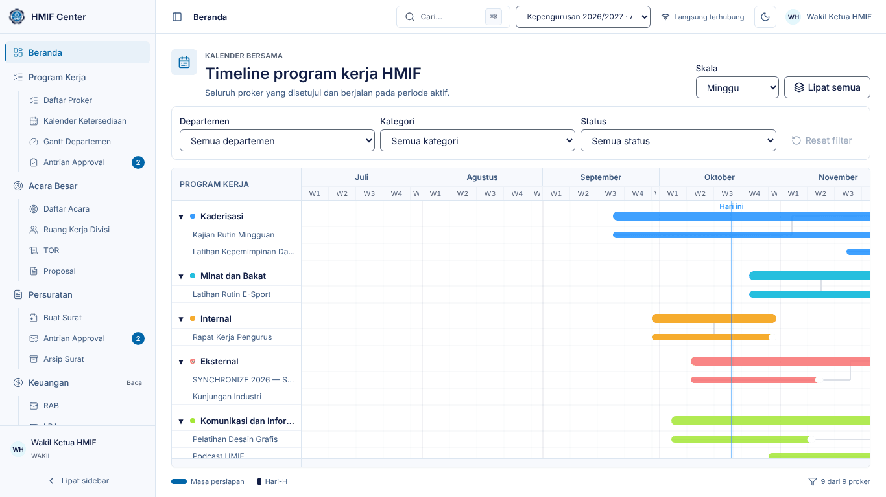
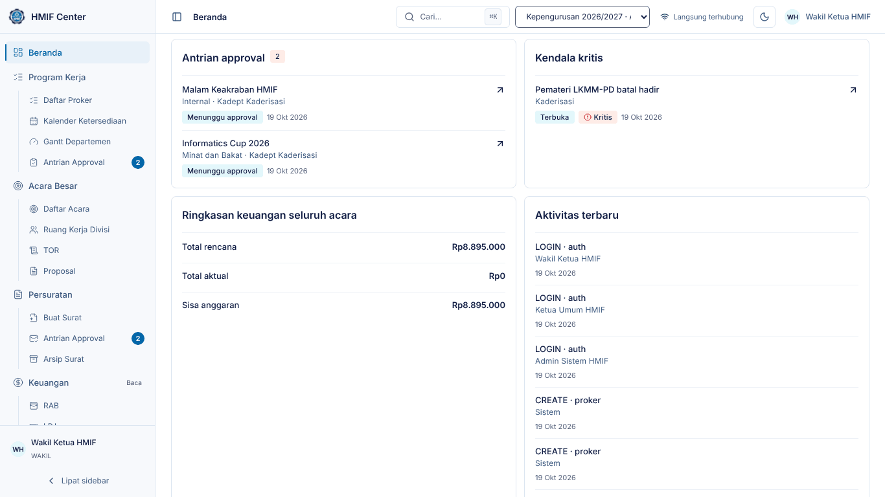
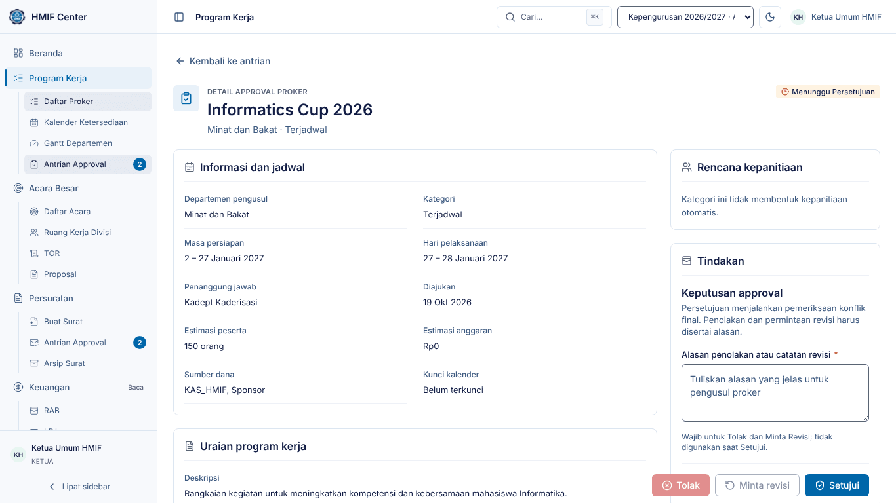
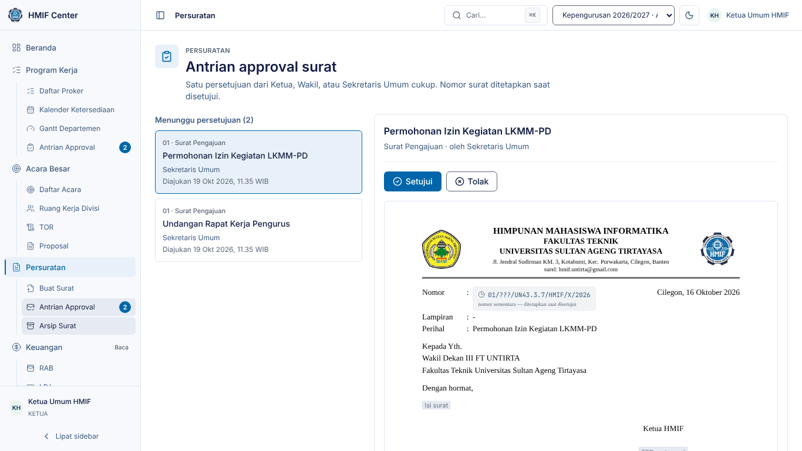
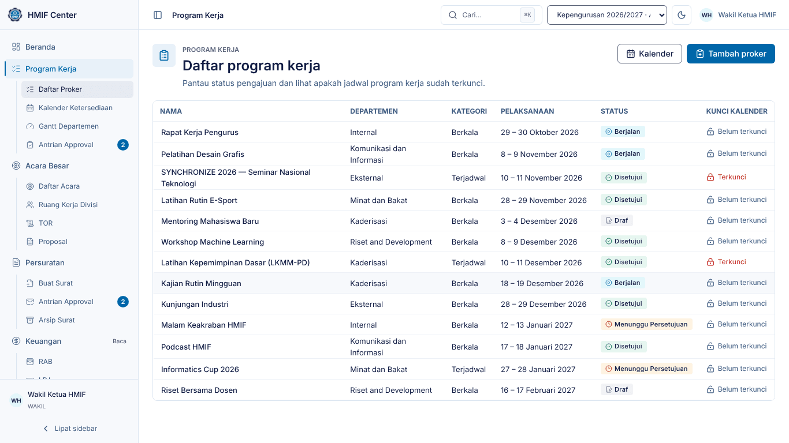

# Panduan Wakil Ketua — HMIF Center

Untuk **Wakil Ketua HMIF**: ikut menyetujui program kerja dan surat bersama
Ketua, serta memantau jalannya kepengurusan.

> Tangkapan layar diambil dari lingkungan demo (data contoh). Nama, tanggal,
> dan angka di sistem Anda akan berbeda.

## 1. Masuk dan Beranda

1. Buka HMIF Center, isi **Email** dan **Kata sandi**, klik **Masuk**.
2. Beranda menampilkan **Master Gantt** seluruh proker yang disetujui dan
   berjalan. Ubah **Skala**, saring per departemen/kategori/status, atau
   **Lipat semua** untuk ringkasan per departemen.
3. Gulir ke bawah untuk panel pimpinan (sama dengan Ketua): antrian approval,
   kendala kritis, ringkasan keuangan seluruh acara, dan aktivitas terbaru.

Tekan `Ctrl`/`⌘` + `K` untuk mencari dan melompat ke halaman mana pun.

## 2. Menu Anda

| Menu | Akses | Isi |
|---|---|---|
| Beranda | penuh | Master Gantt + panel |
| Program Kerja | penuh | Daftar Proker, Kalender Ketersediaan, Gantt Departemen, **Antrian Approval** |
| Acara Besar | penuh | Daftar Acara, Ruang Kerja Divisi, TOR, Proposal |
| Persuratan | penuh | Buat Surat, **Antrian Approval**, Arsip Surat |
| Keuangan | baca | RAB, LPJ |
| Kesekretariatan | baca | Notulensi, Data Pengurus, Peminjaman Ruangan |
| Departemen | baca | Kanban, Kendala |

## 3. Menyetujui program kerja

1. Buka **Program Kerja → Antrian Approval**.
2. Pilih proker; periksa jadwal persiapan, Hari-H, anggaran, dan rencana
   kepanitiaan.
3. Pilih **Setujui**, **Minta revisi**, atau **Tolak**. Revisi dan penolakan
   wajib disertai alasan yang jelas untuk pengusul.
4. Persetujuan menjalankan pemeriksaan bentrok jadwal terakhir dan, untuk proker
   terjadwal, mengunci kalender pada rentangnya.

Satu proker cukup diputuskan oleh satu penyetuju — bila Ketua sudah
memutuskan, proker itu hilang dari antrian Anda.

## 4. Menyetujui surat

1. Buka **Persuratan → Antrian Approval**, buka surat, periksa pratinjaunya.
2. **Setujui** — nomor surat dialokasikan otomatis dan dokumen DOCX terbit
   dengan tanda tangan Ketua Himpunan.
3. Atau **Tolak** dengan alasan; surat kembali ke pembuatnya.

## 5. Memantau program kerja

1. **Program Kerja → Daftar Proker** memuat seluruh proker periode berjalan
   beserta statusnya (selalu ikon + teks, mis. Menunggu approval,
   Disetujui, Berjalan, Perlu revisi).
2. Saring per departemen, kategori, atau status; klik nama proker untuk detail.
3. **Kalender Ketersediaan** memperlihatkan rentang yang sudah terkunci acara
   lain — berguna saat menengahi bentrok jadwal antar-departemen.
